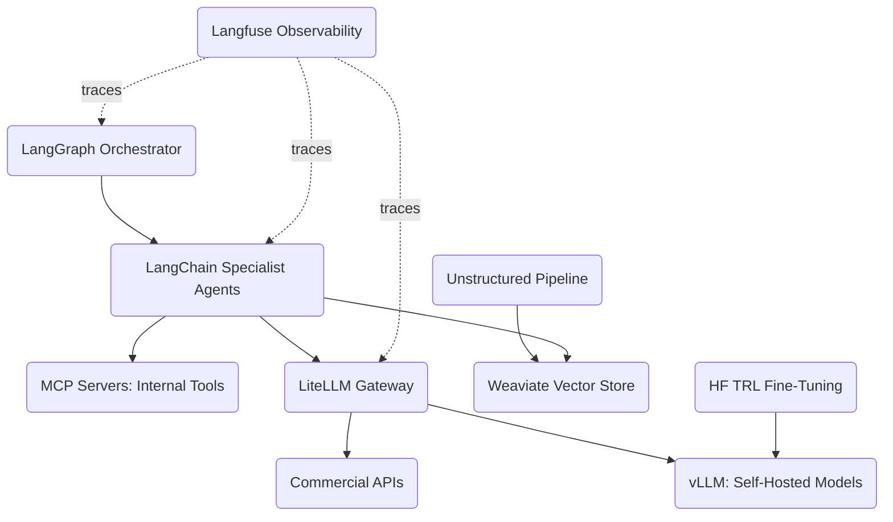

# Enterprise Agentic Pipeline

<!-- SUMMARY: A complete configuration walkthrough assembling LangChain, LangGraph, MCP servers, LiteLLM, Weaviate, Unstructured, Langfuse, vLLM, and HF TRL into a governed multi-agent system for enterprise engineering organizations. The architecture introduces orchestrated agent coordination, gateway-enforced cost and compliance controls, production observability, and a closed-loop fine-tuning pipeline that the solo developer configuration intentionally omitted. -->

A local-first stack such as the [Solo Developer Stack](solo-developer-stack-configuration.html) works because one engineer generates a bounded request volume, inspects agent behavior directly in the terminal, and carries no multi-tenant audit obligations. An engineering organization operating at team scale faces a different class of operational constraints: multiple departments share model infrastructure, finance teams require per-project cost attribution, compliance policies mandate immutable logs of every prompt and response, long-running workflows must survive transient node failures, and specialized agents must coordinate on tasks that exceed any single agent's scope. This configuration from the [Guides collection](index.html#tab-guides) assembles a nine-layer architecture that satisfies those enterprise requirements.

## The Problem

An engineering organization needs a governed, multi-agent platform that routes requests across commercial and self-hosted model providers, enforces team budget and data-residency rules, records complete audit trails, and recovers cleanly from mid-workflow failures.

### Nine-Layer Enterprise Requirements

Delivering those guarantees across multiple engineering teams requires coordinated capabilities across nine ecosystem layers:

- **Stateful multi-agent orchestration**: A central control plane that decomposes complex requests across specialized LangChain agents, persists intermediate state after every step, and pauses execution at human approval gates.
- **Gateway-enforced cost and routing governance**: A unified proxy that abstracts provider-specific SDKs, enforces per-team monthly budget caps via virtual keys, and routes traffic between commercial APIs and internal GPU clusters according to data sensitivity.
- **Standardized internal tool connectivity**: A shared library of Model Context Protocol servers that expose internal databases, REST services, and ticketing platforms without duplicating authentication logic across agent repositories.
- **High-volume heterogeneous document ingestion**: A batch and event-driven parsing pipeline capable of extracting clean text and tables from hundreds of thousands of scanned PDFs, PowerPoint decks, Word files, and HTML archives.
- **Multi-tenant hybrid vector storage**: A self-hosted vector database that partitions embeddings at the storage layer per department and combines dense semantic similarity with BM25 keyword matching.
- **End-to-end trace observability and model adaptation**: A centralized tracing platform that records every prompt, completion, tool call, token cost, and latency span while feeding curated production traces into a parameter-efficient fine-tuning and high-throughput GPU serving loop.

### Closing the Solo-to-Enterprise Gap

The single-developer workstation stack intentionally omitted five of these nine layers: application frameworks, multi-agent orchestrators, AI gateways, observability platforms, and fine-tuning pipelines. At solo scale, a terminal coding agent handles planning internally and the operator watches execution live. At organizational scale, automated services run unattended across shared infrastructure, turning those five omitted layers into mandatory control planes.

## Architecture Overview

The architecture separates multi-agent execution, tool and model routing, document retrieval, and continuous model improvement into distinct operational boundaries connected by standard HTTP and OpenTelemetry protocols.

### Four Functional Zones

System components group into four cooperating zones:

- **Orchestration zone**: User applications submit high-level tasks to LangGraph, which decomposes each request into a stateful directed graph and dispatches subtasks to specialized LangChain research, analysis, and writing agents.
- **Connectivity and routing zone**: MCP servers connect the LangChain agents to internal databases, REST APIs, and issue trackers, while the LiteLLM gateway routes model invocations to commercial cloud APIs or internal vLLM servers based on cost and privacy rules.
- **Knowledge zone**: Unstructured parses raw enterprise document repositories into structure-preserving chunks, and Weaviate stores the resulting embeddings inside isolated per-tenant storage partitions.
- **Model lifecycle zone**: Hugging Face TRL fine-tunes open-weight checkpoints on curated production datasets, and vLLM serves the resulting LoRA adapters alongside base models behind an OpenAI-compatible API.

### Cross-Layer Observability

Langfuse spans all four zones as the system's observability and governance backbone. Dotted edges in the architecture diagram represent asynchronous trace ingestion rather than synchronous request flow. Every LangGraph state transition, LangChain agent step, MCP tool call, and LiteLLM proxy request emits structured telemetry spans to Langfuse, producing a complete, queryable audit record of each workflow execution.

## Component Selection

### Framework Layer: LangChain

Application-level agent construction standardizes on LangChain, profiled in [Agent Frameworks Compared](ai-tooling-chapter_02.html), which offers the broadest integration surface in the framework ecosystem. Its prompt templates, tool-binding abstractions, and output parsers give engineering teams a uniform programming model across model providers. The library includes maintained integrations for every adjacent component in this stack: Weaviate hybrid retrievers, OpenAI-compatible LiteLLM chat clients, MCP tool adapters through `langchain-mcp-adapters`, and Langfuse callback handlers.

For a multi-team organization, integration breadth and interface stability outweigh single-purpose framework minimalism. Standardizing on LangChain lets platform engineers publish shared authentication wrappers, retrieval utilities, and guardrail middleware once, while application teams swap underlying vector stores or model gateways through configuration changes rather than code rewrites.

### Orchestrator Layer: LangGraph

Multi-agent workflow coordination runs on LangGraph, profiled in [Agent Orchestrators Compared](ai-tooling-chapter_03.html), which extends LangChain with persistent graph state and cyclic control flow. Where LangChain defines the prompt and tool logic of an individual specialist agent, LangGraph defines the state machine that coordinates multiple specialist agents across long-running business processes.

Three LangGraph mechanisms address enterprise reliability and governance requirements directly:

- **Checkpoint-backed fault recovery**: LangGraph serializes the complete workflow state to PostgreSQL or SQLite after every node execution. A fifteen-step workflow that encounters a transient upstream timeout at step seven resumes directly from step seven once the dependency recovers, avoiding redundant token spend and duplicate side effects from steps one through six.
- **Human-in-the-loop approval gates**: Interrupt nodes pause graph execution at designated compliance boundaries, persist the pending state, and wait for an external sign-off signal before advancing. A financial or legal workflow can synthesize a draft analysis, halt for reviewer approval, and resume days later within the same thread context.
- **Concurrent branch fan-out**: Independent graph branches execute in parallel across separate specialist agents and merge their structured outputs at a downstream reducer node, cutting end-to-end wall-clock latency on multi-source research tasks.

### Connectivity Layer: MCP Servers

Internal tool access across the organization relies on the Model Context Protocol, profiled in [Connectivity and Routing](ai-tooling-chapter_04.html). Where a solo developer connects local `stdio` servers for filesystem and Git inspection, an enterprise platform deploys shared MCP servers in front of internal relational databases, REST microservices, Jira or ServiceNow ticketing systems, and corporate document repositories.

Standardizing on MCP eliminates the $N \times M$ integration tax across teams. Without a shared protocol, five product teams connecting agents to four internal systems write twenty bespoke tool wrappers with inconsistent credential rotation, retry logic, and input validation. A platform-maintained catalog of MCP servers centralizes OAuth token exchange, role-based access control, rate limiting, and schema validation at the server boundary so every LangChain agent consumes the same audited tool interfaces.

### Gateway Layer: LiteLLM

All outbound and internal model traffic passes through LiteLLM, profiled in [Connectivity and Routing](ai-tooling-chapter_04.html). Deploying LiteLLM as a centralized proxy between LangChain agents and model endpoints solves four governance problems that do not exist on a single workstation:

- **Multi-provider protocol normalization**: LiteLLM translates a single OpenAI-compatible chat completions request into provider-specific calls for OpenAI, Anthropic, AWS Bedrock, Google Vertex AI, Azure OpenAI, and self-hosted vLLM servers. Application repositories never import vendor SDKs or store raw provider credentials.
- **Virtual keys and budget enforcement**: Platform administrators issue distinct virtual API keys to research, product, and infrastructure teams with hard monthly spend ceilings in PostgreSQL. LiteLLM tracks token consumption in real time and rejects requests from any key that exhausts its allocated budget.
- **Policy-driven traffic routing**: Declarative routing rules inspect the requested model alias and metadata tags to direct confidential payloads to internal vLLM instances while sending general reasoning workloads to commercial frontier APIs with automated cross-provider failover.
- **Centralized telemetry callbacks**: LiteLLM's native `langfuse` callback logs prompt tokens, completion tokens, dollar cost, and provider latency for every request automatically, ensuring complete spend visibility even if an application developer forgets to attach framework-level callbacks.

### Memory Layer: Weaviate

Enterprise retrieval-augmented generation stores embeddings and document payloads in Weaviate, profiled in [Data Infrastructure](ai-tooling-chapter_05.html). Two architectural capabilities distinguish a self-hosted Weaviate cluster from the embedded ChromaDB store used at solo scale:

- **Storage-level multi-tenancy**: Weaviate isolates each department or customer tenant inside a dedicated storage shard on disk. Queries must specify a target tenant context, preventing legal, human-resources, or finance embeddings from leaking into engineering retrieval results.
- **Native hybrid search**: Weaviate executes dense vector similarity search and BM25 sparse keyword scoring within a single query pass and fuses the rankings. Dense embeddings capture conceptual paraphrases, while BM25 matches literal error codes, SKU identifiers, and internal service names that dense models frequently smooth over.

Running Weaviate on internal container infrastructure keeps all document chunks and vector indices inside the corporate network boundary. LangChain agents query their assigned tenant partition through the `weaviate-client` v4 protocol over HTTP and gRPC.

### Knowledge Management Layer: Unstructured

Document ingestion at organizational scale uses Unstructured, profiled in [Data Infrastructure](ai-tooling-chapter_05.html). Docling excels at local PDF and Word parsing on a single laptop, whereas enterprise repositories accumulate hundreds of thousands of heterogeneous files across shared drives, wikis, and archive buckets.

Unstructured partitions complex multi-column PDFs, scanned image documents requiring optical character recognition, PowerPoint slide decks, HTML exports, and multi-message email threads through a unified element taxonomy. Rather than slicing extracted text at fixed character counts, Unstructured categorizes document regions into `Title`, `NarrativeText`, `ListItem`, and `Table` elements, then groups those elements with title-aware chunking via `chunk_by_title`. Table rows remain attached to their column headers, bulleted lists stay intact, and section boundaries prevent unrelated topics from merging into a single vector embedding.

### Observability Layer: Langfuse

Production trace capture, cost analytics, and training dataset curation run on self-hosted Langfuse, profiled in [Runtime Infrastructure](ai-tooling-chapter_06.html). Within this architecture, Langfuse fulfills three operational mandates beyond developer debugging:

- **Immutable compliance audit trails**: Every model prompt, completion, tool argument, token count, and latency measurement persists in Langfuse's ClickHouse and PostgreSQL stores. Restricting trace deletion permissions to security administrators turns the trace store into a verifiable audit log for regulatory reviews.
- **Granular cost attribution**: Combining LiteLLM proxy callbacks with LangGraph session and user metadata breaks down monthly model expenditure by department, workflow graph, and model family, exposing expensive retry loops or oversized system prompts immediately.
- **Production dataset curation**: Engineers filter production traces by latency, user feedback score, or error status, annotate failure cases with corrected outputs, and export curated JSONL datasets directly into the fine-tuning pipeline.

Langfuse ingests OpenTelemetry spans natively, so an OpenTelemetry Collector can tee trace traffic simultaneously to Langfuse for LLM-specific evaluation and to Datadog, Splunk, or Grafana for infrastructure alerting.

### Serving Layer: vLLM

Self-hosted open-weight models and custom fine-tuned adapters run on vLLM, profiled in [Runtime Infrastructure](ai-tooling-chapter_06.html). Where Ollama prioritizes single-command convenience for one user, vLLM maximizes concurrent request throughput and GPU memory utilization across shared server hardware:

- **PagedAttention KV-cache management**: vLLM partitions key-value attention states into non-contiguous memory blocks, eliminating internal memory fragmentation and supporting hundreds of simultaneous agent requests per node.
- **Tensor and pipeline parallelism**: Models such as `Llama-3.1-70B-Instruct` shard cleanly across four or eight GPUs within a node via `--tensor-parallel-size`, or across multiple nodes via pipeline parallelism, when weights exceed single-GPU VRAM.
- **Automatic prefix caching**: Enabling `--enable-prefix-caching` reuses computed KV blocks across requests that share long enterprise system prompts or few-shot instruction headers, cutting time-to-first-token across specialist agent calls.

LiteLLM addresses vLLM through its standard OpenAI-compatible `/v1/chat/completions` endpoint, treating self-hosted base models and LoRA adapters identically to commercial cloud providers.

### Fine-Tuning Layer: HF TRL

Continuous model specialization uses Hugging Face TRL and PEFT, profiled in [Runtime Infrastructure](ai-tooling-chapter_06.html), executing a four-stage closed feedback loop across the stack:

1. **Production trace capture**: Langfuse records live multi-agent interactions across all workflow runs, tagging traces with automated evaluation scores, latency metrics, and human reviewer feedback.
2. **Dataset export and preference pairing**: Platform engineers export high-scoring traces from Langfuse into `training_data.jsonl` as supervised instruction-response pairs and pair corrected failure traces into chosen-versus-rejected records for alignment.
3. **Parameter-efficient training**: HF TRL's `SFTTrainer` runs supervised fine-tuning on the curated JSONL corpus, followed optionally by Direct Preference Optimization via `DPOTrainer` on the preference pairs, using 4-bit `bitsandbytes` quantization and PEFT LoRA adapters to fit training onto a compact GPU node.
4. **Canary deployment and traffic shifting**: vLLM loads the trained LoRA adapter alongside the base checkpoint, LiteLLM routes a canary percentage of production traffic to the new variant, and Langfuse compares live task accuracy and token cost before promoting the adapter to full traffic.

## Integration Walkthrough

Request execution and background data flows traverse five sequential integration paths across the nine components:

1. **Application to LangGraph and specialist LangChain nodes**: The client application submits a task payload with a `thread_id` to the compiled LangGraph workflow. LangGraph initializes or restores the persisted `WorkflowState` from its PostgreSQL or SQLite checkpointer, invokes the designated LangChain research, analysis, or writing node, and checkpoints the updated state dictionary after each node finishes.
2. **LangChain specialist nodes to LiteLLM proxy**: Every LangChain agent instantiates `ChatOpenAI` pointed at the internal LiteLLM gateway URL `http://localhost:4000/v1` using a team-scoped virtual key such as `sk-litellm-team-key`. LiteLLM validates the team's remaining monthly budget, selects the target commercial API or internal vLLM server based on routing rules, injects the upstream credential, and returns the normalized response.
3. **LangChain specialist nodes to internal MCP servers**: At agent initialization, `langchain-mcp-adapters` connects to the organization's MCP servers and registers their JSON Schema tool definitions on the LangChain model wrapper. Whenever an agent emits a tool call for an internal database query or ticket update, the MCP server validates caller permissions, executes the operation, and returns structured JSON.
4. **Unstructured batch ingestion into multi-tenant Weaviate**: A scheduled ingestion job runs `partition` and `chunk_by_title` over new PDFs, slide decks, and HTML files in the enterprise document store. The script resolves the target department's tenant partition in Weaviate via `with_tenant`, generates vector embeddings through the configured vectorizer, and inserts each chunk with source path, document type, and chunk index metadata.
5. **Cross-layer telemetry into Langfuse and HF TRL**: Langfuse callback handlers attached to LangGraph, LangChain, and LiteLLM stream nested trace spans to the self-hosted Langfuse cluster on port 3000. Curated trace exports from Langfuse feed `scripts/finetune.py` in HF TRL, and the resulting adapter weights load back into vLLM on port 8000 to complete the improvement cycle.

## Tradeoffs and Alternatives

This architecture delivers multi-team cost governance, tenant-isolated retrieval, checkpointed fault recovery, and auditable model traces. Operating all nine layers introduces three substantial engineering costs:

- **Platform engineering overhead**: Provisioning, upgrading, and monitoring PostgreSQL, ClickHouse, Redis, MinIO, Weaviate, LiteLLM, Langfuse, and multi-GPU vLLM nodes requires a dedicated platform engineering team rather than an individual application developer.
- **Multi-hop request latency**: Every user request traverses LangGraph state serialization, LangChain prompt assembly, LiteLLM proxy translation, network transport to the model endpoint, and asynchronous telemetry callbacks, adding measurable overhead compared to direct SDK calls.
- **Self-hosted GPU capital floor**: Serving 70-billion-parameter models in BF16 on vLLM and running TRL fine-tuning jobs requires multi-GPU server nodes with high-bandwidth `NVLink` interconnects and sustained power and cooling budgets.

**Alternative substitutions at each layer**:

- **Framework layer**: Replace LangChain with LlamaIndex when enterprise workflows center almost entirely on complex document retrieval and index synthesis rather than heterogeneous tool orchestration.
- **Orchestrator layer**: Replace LangGraph with CrewAI when teams prefer declarative role-and-task agent definitions over explicit state-graph nodes and conditional edges, trading fine-grained checkpoint control for faster prototyping.
- **Gateway layer**: Replace LiteLLM with Portkey when built-in semantic response caching and inline personally identifiable information redaction are required directly inside the gateway proxy.
- **Memory layer**: Replace Weaviate with Qdrant when single-binary Rust deployment simplicity outweighs native BM25-plus-vector hybrid search, or with Pinecone when a fully managed cloud service is permitted by data-residency rules.
- **Knowledge management layer**: Replace Unstructured with Docling when the enterprise corpus consists primarily of standard PDFs and DOCX specifications rather than scanned images, slide decks, and email archives.
- **Observability layer**: Replace Langfuse with Braintrust when automated CI/CD evaluation gates and scoring datasets take priority over self-hosted trace warehousing, or with Arize Phoenix when embedding drift diagnostics are the primary concern.
- **Serving layer**: Replace vLLM with SGLang when agent workflows rely heavily on constrained JSON schema decoding and multi-turn branching prompts where RadixAttention maximizes prefix cache hits.
- **Fine-tuning layer**: Replace HF TRL with Unsloth when single-GPU memory efficiency and fused Triton kernel speed outweigh multi-node distributed training, or with Axolotl when teams prefer declarative YAML training configs.

This architecture transitions AI engineering from single-workstation productivity to governed organizational infrastructure. The companion [Setup Guide](enterprise-agentic-pipeline-guide.html) provides the Docker configurations, Python wiring scripts, and verification checks needed to deploy every layer.

## References

1. LangChain Documentation, LangChain Inc.
2. LangGraph Documentation, LangChain Inc.
3. Model Context Protocol Specification, Anthropic and MCP Steering Group.
4. LiteLLM Proxy Documentation, BerriAI.
5. Weaviate Documentation, Weaviate B.V.
6. Unstructured Documentation, Unstructured Technologies.
7. Langfuse Self-Hosting Documentation, Langfuse GmbH.
8. vLLM Documentation, vLLM Project.
9. Hugging Face TRL Documentation, Hugging Face.
10. Hugging Face PEFT Documentation, Hugging Face.
