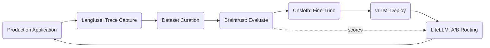

# Evaluation-Driven Development Loop

<!-- SUMMARY: A complete configuration walkthrough assembling LangChain or LlamaIndex, Langfuse, Braintrust, Unsloth, vLLM, and LiteLLM into a continuous improvement cycle that captures production traces, curates evaluation datasets, scores output quality across experiments, fine-tunes specialized models from high-quality examples, deploys fine-tuned checkpoints alongside base models, and routes traffic between variants for data-driven comparison. The architecture treats systematic quality measurement as the primary engineering discipline rather than an afterthought applied to a finished system. -->

Every AI application across the [AI Tooling series](series-ai-tooling.html) and the [Guides collection](index.html#tab-guides), whether a RAG pipeline, a multi-agent workflow, an enterprise chatbot, or a code generation tool, produces outputs whose quality varies across inputs, model versions, prompt revisions, and infrastructure changes. Without systematic measurement, teams rely on intuition and spot-checking to assess whether a change improved or degraded the system.

Intuition scales poorly across production workloads. A prompt revision that improves responses for one category of inputs can silently degrade responses for another. A model upgrade that raises average quality can introduce regressions on edge cases that the team discovers only after deployment. This configuration replaces intuition with a closed-loop evaluation cycle that captures production behavior, measures quality against structured criteria, and feeds the results back into model improvement.

## The Problem

A team building an AI application needs a systematic engineering process to resolve three core challenges that manual spot-checking cannot reliably address:

- **Baseline quality measurement**: Quantifying how well the production system performs right now against concrete, repeatable scoring rubrics rather than subjective developer impressions.
- **Change impact attribution**: Determining whether the latest prompt revision, model upgrade, retrieval parameter adjustment, or fine-tuned checkpoint improved or degraded output quality, and by what margin across input categories.
- **Data-driven specialization**: Assessing whether the system has accumulated sufficient high-quality production traces to justify fine-tuning a specialized domain model that outperforms a general-purpose base model on the application's actual task distribution.

### Three Evaluation Layers

Those three engineering questions map directly to three distinct evaluation layers within the improvement cycle:

- **Unit-level evaluation**: Scores individual model outputs against expected reference answers or structural constraints, measuring whether each response meets explicit quality thresholds for factual correctness, retrieval faithfulness, topical relevance, and schema compliance.
- **Pipeline-level evaluation**: Measures end-to-end system behavior across a curated dataset of representative production inputs, producing aggregate quality metrics that track performance trends across multi-step tool calls, retrieval passes, and synthesis stages.
- **Regression-level evaluation**: Compares aggregate and slice-specific metrics across system versions, verifying that a candidate change improves target quality dimensions without introducing silent regressions on previously passing edge cases.

### Production Integration Constraints

Deploying an evaluation loop around a live system requires satisfying four operational constraints so measurement never degrades user-facing reliability:

- **Asynchronous trace capture**: Emitting production execution traces must add negligible latency to live user requests and must never block the application response path if the telemetry server is unreachable.
- **Real-world dataset curation**: Curating evaluation benchmarks must draw directly from production inputs and observed failure modes rather than synthetic test prompts that miss the vocabulary, ambiguity, and edge cases of actual user traffic.
- **Offline batch scoring**: Running deterministic and model-graded scoring rubrics must execute offline against captured trace datasets rather than inline with live customer requests.
- **Direct training artifact export**: Exporting curated evaluation records into fine-tuning pipelines must produce training-ready instruction and preference datasets directly, eliminating fragile manual format conversions between evaluation tables and model training scripts.

## Architecture Overview

The diagram forms a closed feedback cycle, which is the defining structural characteristic of this configuration. Unlike linear inference pipelines where data flows from document ingestion through model generation to a terminal user response, this architecture routes production outputs back into dataset curation, automated evaluation, and adapter training.

### Baseline Measurement Loop

The cycle begins at the production application, which can be any system from prior configurations: a hybrid RAG pipeline, an enterprise multi-agent workflow, or an airgapped analysis service. Langfuse captures asynchronous traces from every production interaction, recording the raw user input, the generated response, end-to-end latency, token counts, LiteLLM routing metadata, and intermediate tool or retrieval spans.

The dataset curation stage queries Langfuse for production traces that represent the application's active input distribution, enriches them with expected reference outputs or human review annotations, and uploads them into versioned evaluation datasets in Braintrust. Braintrust executes the candidate system against these versioned datasets and scores each generated output across deterministic and model-graded quality dimensions, establishing a quantitative performance baseline before any model weights change.

### Model Adaptation and A/B Routing Loop

The cycle enters the fine-tuning branch when Braintrust evaluation metrics reveal a persistent quality gap or latency bottleneck that prompt engineering and retrieval tuning cannot close. High-scoring curated datasets export from Braintrust as structured training records for Unsloth, which trains lightweight LoRA adapters tailored to the application's domain distribution. The resulting fine-tuned adapter deploys to vLLM alongside the frozen base model on shared GPU memory.

LiteLLM routes a controlled percentage of live production traffic to the fine-tuned adapter while the remaining traffic continues through the baseline model. Langfuse captures traces from both traffic splits with explicit model variant identifiers, and Braintrust evaluates both cohorts side by side. The comparative quality scores determine whether the fine-tuned variant earns a larger traffic allocation, requires further dataset curation and training, or rolls back immediately. Each full rotation through the loop expands the evaluation benchmark, sharpens the scoring rubrics, and compounds domain-specific model quality.

## Component Selection

### Application Layer: LangChain or LlamaIndex

The evaluation loop wraps around an existing AI application rather than prescribing a single orchestration framework. Any application architecture from earlier guides in this collection can serve as the system under evaluation. A LangChain multi-agent enterprise pipeline, a LlamaIndex hybrid RAG service, a solo developer agent stack, or an airgapped classification workflow all emit the same foundational telemetry artifacts that the evaluation loop consumes: structured input-output pairs and intermediate execution spans captured as traces.

Framework selection depends entirely on the application's workload requirements, as analyzed in [Agent Frameworks Compared](ai-tooling-chapter_02.html). The evaluation infrastructure attaches to the application through non-intrusive tracing hooks: a callback handler passed into LangChain invocation configs or an OpenInference OpenTelemetry instrumentor registered with LlamaIndex. The evaluation loop imposes zero architectural constraints on how the underlying application constructs prompts, retrieves context, or invokes tools.

### Observability Layer: Langfuse

Telemetry capture relies on Langfuse, profiled in [Runtime Infrastructure](ai-tooling-chapter_06.html), to connect live production traffic to the offline evaluation cycle. The enterprise pipeline configuration used Langfuse primarily for governance audit trails and token cost attribution, whereas this configuration elevates production traces into the raw material for versioned evaluation benchmarks and fine-tuning corpora.

Langfuse captures three distinct categories of telemetry data that downstream curation and scoring stages require:

- **Session-grouped input-output pairs**: Records the raw user prompt and final generated response as a root trace observation while grouping multi-turn conversations under a shared session identifier to preserve full dialogue context.
- **Intermediate execution spans**: Captures nested child observations for every retrieval query, reranker pass, tool invocation, and intermediate model call within multi-step chains, enabling component-level diagnosis when end-to-end quality drops.
- **Quality scores and metadata tags**: Stores programmatic and human review annotations directly on trace records, alongside LiteLLM routing metadata that identifies which backend model variant served each request.

The trace-to-dataset curation pipeline operates through a three-stage workflow:

1. **Trace accumulation**: Langfuse ingests live production traces continuously over an operating window, indexing root observations, latency metrics, and model variant identifiers in ClickHouse and PostgreSQL.
2. **Quality filtering and annotation**: Automated curation scripts or human reviewers filter accumulated traces by confidence scores, user feedback signals, or latency bounds, promoting verified high-quality responses to gold-standard reference examples and flagging low-scoring responses for correction.
3. **Structured dataset export**: The curation pipeline queries annotated root observations through the Langfuse Python SDK and uploads normalized input, expected output, and metadata records into a versioned Braintrust dataset.

### Evaluation Layer: Braintrust

Systematic quality measurement runs on Braintrust, profiled in [Runtime Infrastructure](ai-tooling-chapter_06.html), which provides programmatic experiment execution, dataset versioning, and side-by-side metric comparison. The RAG-first configuration used Braintrust specifically to verify retrieval precision and context faithfulness, whereas this architecture uses the complete evaluation platform to govern prompt revisions, model upgrades, and fine-tuned checkpoints across every task dimension.

Braintrust combines three complementary scoring strategies so teams can evaluate both rigid structural invariants and nuanced semantic quality:

- **LLM-as-judge scoring**: Evaluates generated responses against natural-language grading rubrics using a dedicated judge model, quantifying semantic dimensions such as factual accuracy, completeness, tone compliance, and groundedness.
- **Deterministic code scoring**: Executes fast Python functions that verify concrete structural properties, including JSON schema validity, required key presence, citation formatting, length boundaries, and forbidden phrase absence.
- **Human review calibration**: Integrates domain experts who grade sampled outputs on structured rubrics, allowing teams to measure alignment between automated LLM judge scores and human engineering judgment.

Dataset versioning guarantees reproducibility across months of iterative engineering. Every modification to an evaluation dataset creates an immutable version identifier, and Braintrust links every experiment run to the specific dataset snapshot used during scoring. Version tracking separates score changes caused by harder test data from score changes caused by model or prompt modifications whenever engineers expand a benchmark with newly discovered production edge cases.

Side-by-side experiment comparison serves as the release gate before production deployment. Each experiment binds a candidate system configuration, such as a revised system prompt, a new retrieval top-k threshold, or a fine-tuned LoRA adapter, against the active baseline. Braintrust computes per-record and aggregate score deltas across all registered scorers. A candidate change that raises domain accuracy by eight percentage points while reducing schema compliance by two percentage points surfaces immediately as an explicit engineering tradeoff before any live user traffic shifts.

### Fine-Tuning Layer: Unsloth

Model specialization uses Unsloth, profiled in [Runtime Infrastructure](ai-tooling-chapter_06.html), to convert curated evaluation records into memory-efficient LoRA adapters. Where the airgapped deployment used Unsloth to adapt open-weight models inside an isolated enclave, this configuration positions Unsloth as the targeted optimization engine that closes the evaluation loop whenever prompt engineering and retrieval tuning hit a quality ceiling.

The evaluation-to-training pipeline supports three operational mechanics that keep fine-tuning lightweight and governed by benchmark data:

- **Supervised fine-tuning export**: Extracts verified high-scoring input-output records from Braintrust and formats them into instruction-response chat templates for supervised fine-tuning via `SFTTrainer`.
- **Preference pair export**: Pairs high-scoring and low-scoring responses generated for the same production prompt into chosen-rejected tuples for Direct Preference Optimization when teams need to suppress specific stylistic or factual failure modes.
- **Metric-gated training triggers**: Initiates adapter training only when Braintrust experiments confirm that prompt optimization has plateaued below target quality thresholds and the curated dataset contains enough verified domain examples to prevent overfitting.

Unsloth trains low-rank adapter matrices in 4-bit quantized memory rather than duplicating full 8-billion-parameter model weights, so each training iteration completes on a single 24GB GPU and produces a compact adapter checkpoint that loads directly into the inference server.

### Serving Layer: vLLM

Production inference runs on vLLM, profiled in [Runtime Infrastructure](ai-tooling-chapter_06.html), which serves the frozen base model and multiple fine-tuned LoRA adapters concurrently from a single GPU process. The enterprise and airgapped architectures used vLLM for high-throughput batch concurrency, whereas this configuration relies on its dynamic multi-LoRA serving engine to power zero-downtime A/B testing.

Deploying candidate adapters through vLLM provides two operational capabilities that eliminate the infrastructure cost of standing up separate GPU clusters for every model experiment:

- **Dynamic LoRA hot-loading**: Loads newly trained LoRA adapter weights into a running vLLM server through the `/v1/load_lora_adapter` HTTP endpoint without restarting the process or duplicating the base model's VRAM footprint.
- **Staged cohort isolation**: Registers each loaded adapter under a distinct model identifier in the OpenAI-compatible `/v1/models` registry, allowing the upstream gateway to dispatch requests to either the frozen base model or a specific adapter checkpoint on a per-request basis.

Operators unload an underperforming adapter or set its upstream traffic weight to zero immediately during initial production exposure, restoring 100% baseline routing without disturbing active GPU memory allocation.

### Gateway Layer: LiteLLM

Traffic distribution and variant tagging run through LiteLLM, profiled in [Connectivity and Routing](ai-tooling-chapter_04.html), which sits between the production application and the vLLM inference server. Earlier guides used LiteLLM for provider normalization, budget enforcement, and multi-provider failover. Here, LiteLLM acts as the A/B traffic controller that splits live requests across model variants and injects variant attribution into the telemetry stream.

LiteLLM anchors the deployment side of the improvement cycle through three routing mechanisms:

- **Weighted traffic splitting**: Maps a single logical model alias in the application code, such as `app-model`, to multiple backend vLLM model targets with configurable percentage weights, shifting traffic gradually from a 90/10 canary split to a 50/50 comparison or full cutover.
- **Variant metadata propagation**: Injects each deployment's unique `model_info.id` identifier into the `hidden_params` metadata of every response and forwards that attribution directly to Langfuse via its built-in success callback.
- **Dedicated judge model routing**: Exposes a separate `gpt-4o-judge` endpoint alongside the application model group so Braintrust evaluation scripts can invoke external or higher-capacity judge models through the same unified gateway and authentication key.

## Integration Walkthrough

The six components connect through four sequential integration paths that form a complete, repeatable improvement cycle:

1. **Production trace emission from `LangChain` or `LlamaIndex` through `LiteLLM` to `Langfuse`**: The production application sends inference requests to LiteLLM's `/v1` proxy endpoint using the logical `app-model` alias while attaching the Langfuse `CallbackHandler` or OpenInference instrumentor. LiteLLM routes each request to either the base model or the fine-tuned adapter in vLLM according to the configured weights and logs the selected `model_id` in the Langfuse observation metadata.
2. **Trace curation from `Langfuse` to `Braintrust`**: The curation script queries Langfuse's observations API for root traces, extracts the normalized user prompt, system response, and `hidden_params.model_id` attribution, and inserts those records into a versioned Braintrust dataset. That pipeline converts raw production telemetry into a reproducible benchmark snapshot.
3. **Offline scoring and training export from `Braintrust` to `Unsloth`**: The evaluation script runs candidate prompts or model endpoints against the Braintrust dataset using deterministic faithfulness functions and `gpt-4o-judge` rubrics. Validated high-scoring examples export into a JSONL instruction dataset that `SFTTrainer` and Unsloth consume to train a 4-bit LoRA adapter.
4. **Adapter hot-load and weighted rollout from `Unsloth` through `vLLM` to `LiteLLM`**: A `POST` request to vLLM's `/v1/load_lora_adapter` endpoint registers the `finetuned-v1` model at runtime after Unsloth saves the trained adapter checkpoint. Updating the `weight` values in `litellm_config.yaml` shifts a controlled fraction of live `app-model` traffic to the new adapter, feeding fresh variant-tagged traces back into Langfuse for the next evaluation pass.

## Tradeoffs and Alternatives

This configuration optimizes for empirical, regression-safe quality improvement across production AI workloads. Every prompt change, retrieval parameter tweak, and LoRA fine-tuning run produces comparative score distributions before earning full production traffic. Achieving that rigor introduces three concrete operational costs:

- **Multi-service infrastructure overhead**: Operating the Langfuse v4 stack with PostgreSQL, ClickHouse, Redis, and MinIO alongside Braintrust evaluation jobs, Unsloth training environments, vLLM multi-LoRA serving, and the LiteLLM proxy requires dedicated GPU memory and container orchestration.
- **Sustained rubric and dataset engineering**: Automated evaluation is only as reliable as its scoring functions and reference datasets; teams must continuously audit LLM-as-judge prompts against human domain experts so the loop optimizes genuine task utility rather than superficial rubric gaming.
- **Multi-day feedback cycle latency**: Completing a full rotation from production trace accumulation through dataset curation, offline scoring, LoRA training, and staged A/B rollout takes days rather than minutes, making the full loop heavier than ad-hoc prompt editing for early prototypes.

**Alternative substitutions at each layer**:

- **Observability**: Replace Langfuse with Arize Phoenix when the team prioritizes embedding drift visualization and retrieval cluster diagnostics over session-grouped trace annotation and dataset export APIs.
- **Evaluation**: Replace Braintrust with Weights and Biases Weave when engineering teams already standardize on W&B for model training telemetry and want evaluation tables inside the same workspace, or replace Braintrust with Promptfoo for lightweight, CLI-driven prompt regression testing in CI pipelines.
- **Fine-Tuning**: Replace Unsloth with Hugging Face TRL on multi-GPU clusters when training full-parameter checkpoints or architectures outside Unsloth's custom kernel coverage, or replace Unsloth with Axolotl when teams prefer declarative YAML training specifications over Python scripts.
- **Serving**: Replace vLLM with SGLang when the application relies heavily on complex JSON schema decoding or shared multi-turn prefix trees where RadixAttention yields higher cache hit rates alongside LoRA serving.
- **Gateway**: Replace LiteLLM with Portkey when the architecture requires built-in semantic caching to reduce repeated LLM-as-judge scoring costs or managed compliance guardrails at the gateway boundary.

The companion [Setup Guide](evaluation-driven-development-loop-guide.html) provides the complete Docker Compose deployment, Python environment setup, Unsloth training scripts, vLLM runtime LoRA loading commands, and LiteLLM weighted routing configurations required to run this loop end to end.

## References

1. LangChain Documentation, LangChain Inc.
2. LlamaIndex Documentation, LlamaIndex Inc.
3. Langfuse Documentation, Langfuse GmbH.
4. Braintrust Documentation, Braintrust Data Inc.
5. Unsloth Documentation, Unsloth AI.
6. vLLM Documentation, vLLM Project.
7. LiteLLM Documentation, BerriAI.
