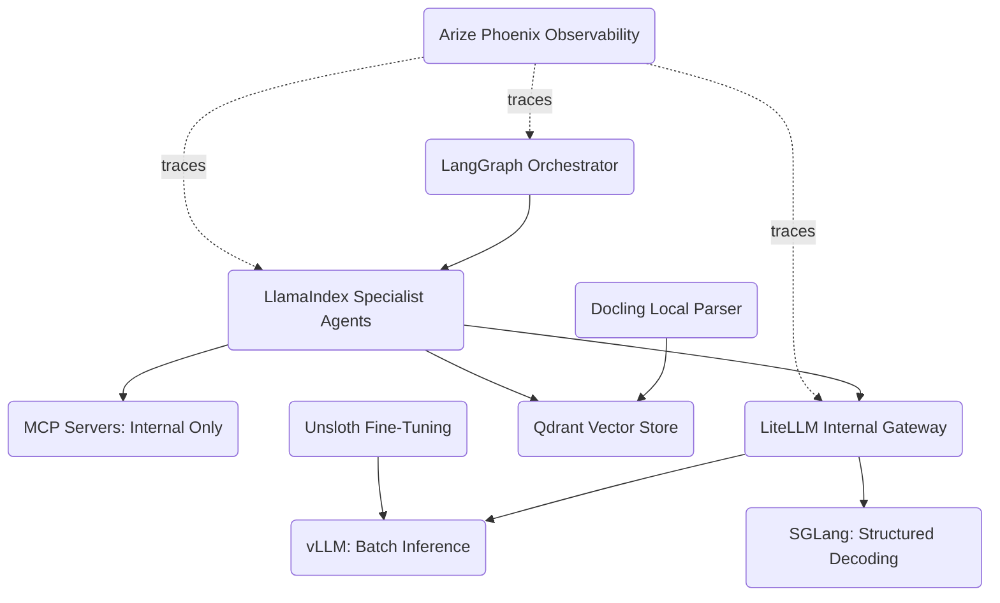

# Private and Airgapped Deployment

<!-- SUMMARY: A complete configuration walkthrough assembling LlamaIndex, LangGraph, MCP servers, LiteLLM, vLLM, SGLang, Qdrant, Docling, Arize Phoenix, and Unsloth into a self-contained AI system that operates entirely within a network perimeter with zero external connectivity. The architecture replaces every commercial API dependency from the enterprise pipeline with self-hosted alternatives, addresses offline model acquisition, and closes the fine-tuning loop entirely on-premises. -->

Enterprise AI architectures such as the [Enterprise Agentic Pipeline](enterprise-agentic-pipeline-configuration.html) assume outbound internet connectivity for commercial frontier APIs, cloud embedding endpoints, and live package registries during deployment. Organizations operating in classified or heavily regulated environments across defense, intelligence, healthcare, and critical infrastructure face a boundary condition that invalidates that assumption: zero bytes may leave the network perimeter, and no external service may receive inbound connections. Every component in this configuration from the [Guides collection](index.html#tab-guides) runs on-premises, every model weight and wheel archive arrives via physical media transfer, and the complete stack operates indefinitely without internet access.

## The Problem

An organization operating inside a sealed or classified network must deploy multi-agent retrieval, reasoning, and model adaptation entirely on isolated infrastructure. The architecture spans the same nine ecosystem layers as the standard enterprise pipeline, with one non-negotiable constraint applied at every boundary: zero external network connectivity.

### Nine-Layer Airgapped Requirements

Operating a production multi-agent system inside an airgapped enclave imposes seven technical requirements across the stack:

- **Persistent workflow orchestration**: Classified research and compliance investigations span hours or days across human review checkpoints, requiring a state machine that checkpoints progress to local storage and survives node restarts.
- **Deep retrieval-augmented generation**: Internal analysts primarily query proprietary technical manuals, intelligence reports, and regulatory filings, so the application framework must prioritize index composition, multi-step query decomposition, and grounded citation synthesis.
- **Dual-engine local GPU serving**: On-premises GPU servers must handle both high-throughput batch inference and schema-constrained JSON generation without falling back to external cloud APIs.
- **Single-binary vector storage**: Security accreditation and air-gap media transfer rules favor a compiled, zero-dependency vector database binary over multi-container storage clusters that pull external runtime plugins.
- **Offline vision-based document parsing**: Raw PDFs and Word specifications must convert into structured Markdown using pre-staged local layout and table-structure models with outbound telemetry disabled.
- **On-premises retrieval observability**: Trace collection, latency profiling, embedding cluster visualization, and corpus drift detection must run on an internal server with zero SaaS dependencies.
- **Memory-efficient local fine-tuning**: Base open-weight models must adapt to internal domain acronyms, classification markings, and report templates on constrained on-premises GPUs using locally curated trace datasets.

### Inverting the Inference Path

Where a cloud-connected enterprise pipeline treats commercial APIs as the default reasoning path and self-hosted models as a cost-saving or privacy fallback, an airgapped deployment inverts that relationship completely. Self-hosted open-weight checkpoints serve 100 percent of traffic, internal routing separates general reasoning from constrained structured decoding, and every Python wheel, binary executable, and safetensors checkpoint must install cleanly from an offline staging directory.

## Architecture Overview

Every node and edge in the architecture diagram executes inside the sealed enclave perimeter. No outbound arrows cross the firewall boundary, and no external SaaS endpoint participates in inference, embedding generation, document parsing, or trace storage.

### Four Isolated Functional Zones

The internal topology divides into four cooperating functional zones that replace cloud-dependent components from the standard enterprise stack with self-contained equivalents:

- **Orchestration zone**: LangGraph coordinates stateful multi-step workflows and human classification review gates, while LlamaIndex replaces LangChain inside each graph node to optimize for deep multi-document retrieval and synthesis.
- **Connectivity and routing zone**: MCP servers connect strictly to internal SQL databases, approved document shares, and classification metadata services, while LiteLLM routes OpenAI-compatible requests exclusively between internal vLLM and SGLang endpoints.
- **Knowledge zone**: Docling parses PDFs and DOCX files against pre-staged local vision weights, a local BGE-Large checkpoint generates 1,024-dimensional embeddings, and Qdrant stores the vectors inside a single compiled Rust binary.
- **Model lifecycle zone**: Unsloth fine-tunes LoRA adapters on single-node GPU hardware using custom Triton kernels, and vLLM mounts the resulting adapter weights alongside base Llama checkpoints.

### Retrieval-Focused Observability

Arize Phoenix replaces Langfuse as the self-hosted observability plane across all four zones. Both platforms ingest OpenTelemetry traces on-premises, and Phoenix adds UMAP embedding projection and vector drift diagnostics that help operators spot unindexed knowledge gaps or distribution shifts after bulk air-gap document transfers.

## Component Selection

### Framework Layer: LlamaIndex

Retrieval-centric agent construction uses LlamaIndex, profiled in [Agent Frameworks Compared](ai-tooling-chapter_02.html), which organizes application logic around index data structures, retrievers, and response synthesizers. Where LangChain optimizes for broad third-party tool integration, LlamaIndex optimizes for retrieval depth across complex internal document corpora.

In a classified or regulated enclave, the dominant engineering workload is answering multi-part analytical questions from internal repositories. Analysts cross-reference security audits, systems engineers trace hardware revision histories, and legal reviewers inspect contract clauses. LlamaIndex's `VectorStoreIndex`, `SummaryIndex`, and sub-question query engines decompose complex prompts into targeted retrieval passes and synthesize grounded answers with explicit source node references. Connecting LlamaIndex to Qdrant through `llama-index-vector-stores-qdrant` and to local BGE weights through `llama-index-embeddings-huggingface` keeps the entire embedding and retrieval pipeline inside the enclave.

### Orchestrator Layer: LangGraph

Multi-agent workflow state management runs on LangGraph, profiled in [Agent Orchestrators Compared](ai-tooling-chapter_03.html). Operating inside an airgapped perimeter does not relax orchestration requirements; classified analytical workflows routinely span multiple specialist passes, require mandatory human sign-off at security classification boundaries, and must recover cleanly from hardware or process restarts.

LangGraph checkpoints the typed workflow state dictionary to a local SQLite or PostgreSQL database after every node transition and evaluates conditional edges against document sensitivity labels or reviewer decisions. Embedding LlamaIndex query engines inside LangGraph nodes combines LlamaIndex's retrieval precision with LangGraph's cyclic state control: a research node retrieves and condenses top-ranked chunks from Qdrant, checkpoints the extracted context, and hands control to an analysis node that synthesizes the structured compliance assessment.

### Connectivity Layer: MCP Servers, Local Only

Standardized tool access inside the enclave relies on the Model Context Protocol, profiled in [Connectivity and Routing](ai-tooling-chapter_04.html), restricted strictly to internal network resources. Four local MCP server types cover typical airgapped operational needs:

- **Scoped filesystem server**: Grants read-only or directory-restricted read-write access to accredited document staging shares and repository trees.
- **Internal database server**: Exposes parameterized read queries against on-premises PostgreSQL, SQLite, or relational data warehouses without exposing raw connection strings in prompts.
- **Internal REST service wrapper**: Connects specialist agents to intranet ticketing, inventory, and configuration management APIs hosted inside the perimeter.
- **Classification and provenance server**: Returns document security markings, handling caveats, and ingestion lineage metadata so agents can enforce access-control rules before synthesizing answers.

Isolation is enforced at two independent layers: MCP server manifests declare explicit internal directory paths and hostnames, and host firewall rules in nftables or iptables block MCP subprocesses from opening outbound sockets outside the enclave subnet.

### Gateway Layer: LiteLLM, Self-Hosted

Traffic routing across on-premises GPU servers runs through a self-hosted LiteLLM proxy, profiled in [Connectivity and Routing](ai-tooling-chapter_04.html), configured with an internal-only model catalog. Removing all commercial cloud providers shifts the gateway's role from external spend governance to three internal operational functions:

- **Serving engine abstraction**: LlamaIndex agents target a single OpenAI-compatible gateway URL on port 4000 at `http://localhost:4000/v1` without hardcoding whether a model runs on vLLM, SGLang, or a LoRA adapter port.
- **Task-specific engine routing**: LiteLLM directs long-context synthesis and high-concurrency batch queries under the `llama-70b` alias to vLLM while routing schema-constrained extraction and inter-agent JSON payloads under `llama-8b-structured` to SGLang.
- **Unified telemetry export**: LiteLLM's callback pipeline emits request latency, token volume, and model routing spans to the internal Arize Phoenix collector automatically.

### Serving Layer: vLLM and SGLang

On-premises GPU inference pairs vLLM and SGLang, both profiled in [Runtime Infrastructure](ai-tooling-chapter_06.html), to cover two distinct workload profiles on local hardware:

- **vLLM for high-throughput batch and general reasoning**: PagedAttention memory management, continuous batching, and multi-GPU tensor parallelism via `--tensor-parallel-size 4` allow vLLM to serve 70-billion-parameter Llama 3.1 checkpoints, pooled BGE-Large embedding models, and dynamically mounted Unsloth LoRA adapters across concurrent analyst sessions.
- **SGLang for low-latency structured decoding**: RadixAttention prefix caching and fast finite-state-machine constrained decoding allow SGLang to serve an 8-billion-parameter Llama 3.1 checkpoint that guarantees valid JSON schema or regex-constrained outputs during agent-to-agent handoffs inside LangGraph.

Running vLLM and SGLang in separate virtual environments or on dedicated GPU ports 8000, 8001, 8002, and 8003 avoids dependency version conflicts between their CUDA and FlashInfer kernels while presenting a single OpenAI-compatible surface through LiteLLM.

### Memory Layer: Qdrant, Self-Hosted

Vector indexing and similarity search run on Qdrant, profiled in [Data Infrastructure](ai-tooling-chapter_05.html). In an accredited airgapped environment where every software artifact must clear media scanning and change-control review, Qdrant's systems architecture provides three operational advantages:

- **Zero-dependency single binary**: Qdrant compiles from Rust into a single native Linux executable archive that launches directly under systemd without requiring a Docker daemon, Java virtual machine, or external relational database engine.
- **Configurable memory-mapped storage**: Collections fit entirely in RAM for sub-millisecond search latency or spill to disk via memory-mapped files with `on_disk_payload: true` alongside scalar or product quantization when corpora scale to millions of chunks.
- **Built-in telemetry disablement**: Setting `telemetry_disabled: true` in `/opt/qdrant/config.yaml` guarantees that the binary never attempts outbound phone-home connections inside the isolated network.

### Knowledge Management Layer: Docling

Offline document parsing relies on Docling, profiled in [Data Infrastructure](ai-tooling-chapter_05.html). Cloud parsing APIs such as LlamaParse are unreachable inside an airgapped enclave, and general-purpose OCR pipelines require complex multi-package system dependencies. Docling bridges that gap by running compact layout-detection and TableFormer vision models entirely on local CPU or GPU hardware.

During pre-deployment staging on an internet-connected machine, operators run `docling-tools models download` to fetch the layout and table checkpoints into a local directory, transfer that directory across the air gap, and point the production environment at the staged weights via `DOCLING_ARTIFACTS_PATH`. Docling then converts internal PDFs and DOCX files into structured Markdown with zero network calls, preserving multi-column reading order and technical specification tables for downstream vector indexing.

### Observability Layer: Arize Phoenix

Self-hosted tracing and retrieval diagnostics run on Arize Phoenix, profiled in [Runtime Infrastructure](ai-tooling-chapter_06.html). Phoenix deploys as a single local Python service on port 6006 backed by local SQLite or PostgreSQL storage, providing three diagnostic capabilities tailored to airgapped RAG systems:

- **Embedding space visualization**: Phoenix projects high-dimensional query and document vectors into interactive 2D clusters, allowing operators to spot unindexed topic clusters where analyst queries land far from any stored document chunk.
- **Bulk-ingestion drift detection**: Airgapped knowledge bases update through periodic physical media drops rather than continuous web crawls, and Phoenix tracks embedding distribution shifts between ingestion batches to catch retrieval regressions early.
- **Compliance trace archiving**: OpenInference instrumentation captures every LlamaIndex retrieval span, prompt template, model completion, and LangGraph state step locally, with Parquet and JSON export for internal security information and event management ingestion.

### Fine-Tuning Layer: Unsloth

On-premises model adaptation uses Unsloth, profiled in [Runtime Infrastructure](ai-tooling-chapter_06.html), whose hand-written Triton kernels cut VRAM consumption by more than half during backpropagation. Inside an airgapped facility where teams cannot burst to cloud GPU clusters, Unsloth enables QLoRA fine-tuning of 8B to 70B models on a single workstation or server GPU across a four-stage closed loop:

1. **Offline trace harvesting**: Operators review captured retrieval and synthesis traces in the local Arize Phoenix dashboard, filtering for domain queries where the base model misinterpreted internal acronyms or formatting rules.
2. **Instruction dataset export**: High-performing traces and analyst-corrected responses export from Phoenix into a local JSONL training file formatted with Llama chat templates.
3. **Single-GPU QLoRA training**: Unsloth loads the pre-staged base checkpoint from local disk in 4-bit quantization, attaches rank-16 LoRA adapters across attention projections, and runs supervised fine-tuning without external Hub calls.
4. **Local LoRA serving and evaluation**: vLLM mounts the saved adapter directory via `--enable-lora` and `--lora-modules`, LiteLLM exposes the new `llama-8b-finetuned` alias, and Phoenix compares retrieval-grounded answer quality against the base checkpoint.

## Integration Walkthrough

All runtime interactions and batch pipelines execute across five internal integration paths inside the enclave perimeter:

1. **LangGraph orchestrator to LlamaIndex specialist nodes**: The internal application invokes a compiled LangGraph workflow backed by `SqliteSaver` or `PostgresSaver`. The research node executes a LlamaIndex `VectorStoreIndex` query engine to gather the top ten relevant source nodes, stores the concatenated context in the shared workflow state, and passes control to the analysis node, which invokes the language model over the retrieved context to synthesize the final compliance report.
2. **LlamaIndex nodes to the internal LiteLLM proxy**: Both LlamaIndex nodes configure `OpenAILike` pointed at `http://localhost:4000/v1` with the internal master key. LiteLLM inspects the requested model alias, forwards general synthesis prompts for `llama-70b` to vLLM on port 8000, forwards structured extraction prompts for `llama-8b-structured` to SGLang on port 8001, and forwards embedding requests to the pooled vLLM instance on port 8003.
3. **LlamaIndex query engines to Qdrant**: `QdrantVectorStore` connects over localhost port 6333 for HTTP or port 6334 for gRPC to the `internal_documents` collection. Incoming analyst questions convert into 1,024-dimensional vectors using the locally staged BGE-Large weights with remote code execution disabled and retrieve the highest-scoring cosine-similarity chunks.
4. **Docling air-gap batch ingestion into Qdrant**: Whenever new accredited documents arrive across the air gap into the classified documents folder, `ingest_airgapped_docs.py` loads Docling from `DOCLING_ARTIFACTS_PATH`, exports each PDF or DOCX file to Markdown, splits the text along paragraph boundaries, computes local BGE embeddings, and upserts vector payloads with provenance metadata into Qdrant.
5. **OpenInference telemetry into Arize Phoenix**: At process startup, agent scripts register the local Phoenix OpenTelemetry tracer via `phoenix.otel.register` and activate `LlamaIndexInstrumentor`, while LiteLLM enables its `arize_phoenix` callback. Every orchestration step, vector lookup, and model completion streams over the internal network to the Phoenix collector on port 6006.

## Tradeoffs and Alternatives

This architecture guarantees complete data sovereignty, zero external network exposure, and deterministic operation independent of internet availability or cloud vendor lifecycle changes. Enforcing a sealed network boundary introduces three primary engineering costs:

- **Open-weight capability ceiling**: An airgapped enclave cannot call frontier commercial models from Anthropic, OpenAI, or Google. Reasoning quality is bounded by the largest open-weight checkpoint that fits on local GPU hardware at the time of the most recent media transfer, making Unsloth domain fine-tuning essential for closing task-specific accuracy gaps.
- **Air-gap media transfer latency**: Every Python wheel update, security patch, base model checkpoint, and Docling vision artifact must download on an external staging host, pass antivirus and supply-chain verification on physical transfer media, and install via `--no-index --find-links`. Routine dependency upgrades take days rather than minutes.
- **Multi-process GPU VRAM partitioning**: Running a 70B vLLM server, an 8B SGLang structured-decoding server, a BGE embedding runner, and periodic Unsloth training jobs requires careful GPU allocation across nodes so concurrent processes do not contend for CUDA memory.

**Alternative substitutions at each layer**:

- **Framework layer**: Replace LlamaIndex with LangChain when internal workflows emphasize multi-tool REST and database automation over deep multi-document retrieval and citation synthesis.
- **Orchestrator layer**: Replace LangGraph with CrewAI when teams prefer declarative role-based agent definitions over explicit state-graph checkpointing and conditional classification branches.
- **Serving layer**: Consolidate onto vLLM alone when workloads do not require SGLang's RadixAttention prefix caching or high-speed constrained JSON decoding, eliminating a second serving virtual environment.
- **Memory layer**: Replace Qdrant with self-hosted Weaviate when native BM25-plus-vector hybrid search and storage-level multi-tenancy outweigh single-binary deployment simplicity.
- **Knowledge management layer**: Replace Docling with Unstructured's open-source local library when airgapped repositories include legacy PowerPoint decks, HTML archives, and email exports alongside PDFs and Word documents.
- **Observability layer**: Replace Arize Phoenix with self-hosted Langfuse when prompt version management and SQL-backed audit warehousing take priority over UMAP embedding drift visualization; note that Langfuse v3 requires a multi-container Docker stack with PostgreSQL, ClickHouse, Redis, and MinIO rather than Phoenix's single-process deployment.
- **Fine-tuning layer**: Replace Unsloth with Hugging Face TRL when multi-GPU distributed training via Accelerate or DeepSpeed is available, or with Axolotl when operators prefer declarative YAML training manifests.

This architecture proves that a full nine-layer agentic RAG and fine-tuning stack can operate inside a completely disconnected network enclave. The companion [Setup Guide](private-and-airgapped-deployment-guide.html) provides the offline staging commands, `systemd` and YAML manifests, Python wiring scripts, and verification checks required for deployment.

## References

1. LlamaIndex Documentation, LlamaIndex Inc.
2. LangGraph Documentation, LangChain Inc.
3. Model Context Protocol Specification, Anthropic and MCP Steering Group.
4. LiteLLM Proxy Documentation, BerriAI.
5. vLLM Documentation, vLLM Project.
6. SGLang Documentation, SGLang Project.
7. Qdrant Documentation, Qdrant Solutions GmbH.
8. Docling Documentation, IBM Research and LF AI and Data Foundation.
9. Arize Phoenix Documentation, Arize AI.
10. Unsloth Documentation, Unsloth AI.
