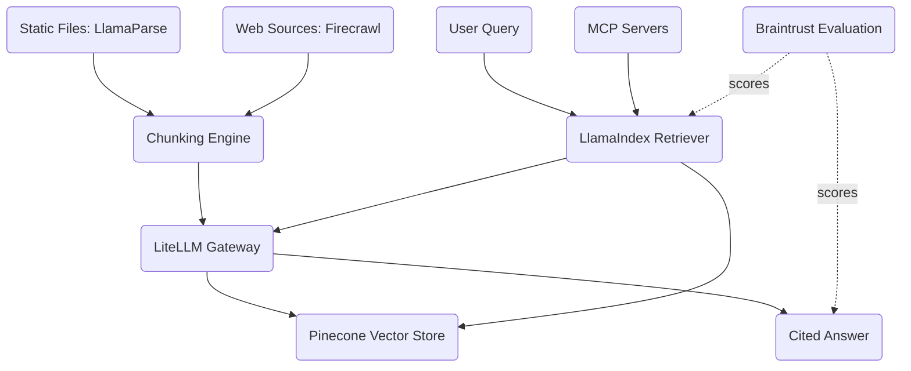

# RAG-First Knowledge System

<!-- SUMMARY: A complete configuration walkthrough assembling LlamaIndex, MCP servers, LiteLLM, Pinecone, LlamaParse, Firecrawl, and Braintrust into a retrieval-augmented generation system optimized for answer quality over a large, continuously evolving document corpus. The architecture prioritizes ingestion pipeline design, chunking strategy selection, and retrieval evaluation rather than model serving infrastructure, reflecting the principle that retrieval quality dominates answer quality in knowledge-heavy applications. -->

Retrieved context fidelity governs generated answer accuracy far more than frontier model selection does when an organization answers natural-language questions from a large, heterogeneous knowledge base. A flagship reasoning model fed irrelevant or badly fragmented text produces fluent, well-structured hallucinations, whereas a mid-tier model fed complete, accurately retrieved passages produces grounded, verifiable answers. This configuration from the [Guides collection](index.html#tab-guides) applies the ecosystem map from the [AI Tooling series](series-ai-tooling.html) to optimize every stage of the retrieval pipeline before inference begins.

## The Problem

An organization maintains an internal knowledge corpus spanning tens of thousands of documents across incompatible formats: engineering PDFs with multi-column tables and schematic captions, internal wikis with dense cross-links, live documentation portals that update daily, and regulatory reports with deep section hierarchies. Engineers, analysts, and support specialists need to ask natural-language questions and receive accurate answers with verifiable source citations.

### Dual Acquisition Patterns

Ingesting that heterogeneous corpus requires handling two structurally distinct document acquisition patterns:

- **Static batch documents**: Engineering specifications, archived PDFs, Word manuals, and slide decks arrive in periodic batches and require layout-aware vision parsing that reconstructs multi-column reading order, nested tables, and figure captions rather than flattening pages into raw character streams.
- **Dynamic web properties**: Product documentation portals, internal knowledge bases, and changelog sites mutate continuously behind client-side JavaScript rendering, requiring a headless browser crawler that traverses navigation links, respects rate limits, and converts rendered DOM trees into clean Markdown.

No single parser handles both regimes well. Optical layout reconstruction and headless JavaScript crawling solve different upstream problems, yet both must emit a normalized Markdown representation so downstream chunking and embedding stages operate uniformly.

### Pre-Inference Quality Ceiling

Retrieval accuracy is bounded by three upstream data-engineering stages that execute before the language model ever sees a prompt:

- **Structure-preserving parsing**: Extracting text from source files without destroying table row-column relationships, code blocks, or section header hierarchies that carry semantic meaning.
- **Granularity-balanced chunking**: Splitting parsed Markdown into retrieval units that balance specificity against surrounding context; overly narrow chunks sever claims from their qualifying conditions, whereas overly broad chunks dilute vector similarity scores with unrelated paragraphs.
- **High-discrimination embedding**: Encoding each chunk into a dense vector space where closely related engineering concepts, version numbers, and failure modes remain separable under cosine similarity search.

The language model acts as the final reader of a pipeline whose quality ceiling is fixed during ingestion and indexing. Investing engineering effort in upstream layout extraction, boundary-aware chunking, and quantitative retrieval scoring produces durable accuracy gains that persist across future language model upgrades.

## Architecture Overview

The architecture organizes seven components into an offline ingestion pipeline and an online query pipeline that share Pinecone as the central vector store and LiteLLM as the unified model gateway.

### Ingestion Versus Query Path

Data flows through two cooperating paths that converge at the managed vector index:

- **Ingestion path**: Static PDFs and DOCX files pass through LlamaParse's vision-language layout parser, while live documentation sites pass through Firecrawl's headless browser crawler. Both tools emit structured Markdown into a shared chunking engine, which splits documents along semantic boundaries, requests vector embeddings through the LiteLLM gateway, and upserts the resulting vectors with source and namespace metadata into Pinecone.
- **Query path**: Incoming user questions enter the LlamaIndex retriever, which embeds the query through the same LiteLLM embedding route, executes a metadata-filtered top-K similarity search against Pinecone, augments the context with live lookups from MCP servers when needed, and synthesizes a cited answer through the generation model routed by LiteLLM.

### Evaluation Feedback Loop

Braintrust connects across the query and synthesis stages as the quantitative optimization loop. Dotted edges in the diagram represent evaluation scoring rather than live user traffic. Braintrust executes versioned question-answer-citation benchmarks against the pipeline, scores retrieval precision and answer faithfulness, and guides iterative adjustments to chunk sizes, overlap windows, embedding encoders, and top-K cutoffs. Separating evaluation telemetry from interactive request routing keeps benchmark experiments reproducible while giving engineers a single score matrix to compare retrieval changes before promoting new parameters into production.

## Component Selection

### Framework Layer: LlamaIndex

Retrieval-pipeline construction uses LlamaIndex, profiled in [Agent Frameworks Compared](ai-tooling-chapter_02.html). Unlike the multi-agent enterprise and airgapped architectures, this system omits LangGraph and multi-agent choreography entirely. A focused knowledge system does not need autonomous peer agents negotiating state transitions; it needs a deterministic, high-precision pipeline that parses, chunks, indexes, retrieves, and cites source documents. Removing multi-agent handoffs eliminates intermediate summarization drift and ensures that the synthesis model always inspects the verbatim source chunks retrieved from the vector index.

Three core LlamaIndex abstractions run the entire online and offline workflow:

- **Node parsers and index structures**: `SentenceSplitter` and markdown-aware node parsers segment LlamaParse and Firecrawl outputs into `TextNode` objects with parent-child relationship links, while `VectorStoreIndex` binds those nodes directly to the backing vector database.
- **Composable query engines**: `QueryEngine` orchestrates query embedding generation, metadata filter construction, top-K similarity lookup, and optional post-retrieval node reranking in a single declarative interface.
- **Grounded response synthesizers**: `ResponseSynthesizer` with `tree_summarize` or `compact` synthesis modes combines retrieved document nodes with the prompt template and attaches source file paths and similarity scores to every generated answer.

Connecting LlamaIndex to Pinecone via `llama-index-vector-stores-pinecone` exposes Pinecone's namespace partitioning and metadata filter expressions directly inside the query engine call. That native binding avoids custom glue code between retrieval scoring and prompt synthesis while preserving document-level lineage metadata across every stage of the query pipeline.

### Connectivity Layer: MCP Servers

Supplementary live data access uses the Model Context Protocol, profiled in [Connectivity and Routing](ai-tooling-chapter_04.html). Where coding and enterprise stacks use MCP servers to execute side-effecting tool actions such as editing files or opening tickets, a RAG-first architecture uses MCP servers as read-only context augmenters alongside the pre-indexed vector store:

- **Relational database server**: Allows the retrieval layer to pair semantic vector search over unstructured documentation with live SQL lookups against product catalogs, pricing tables, or service health metrics.
- **Live web search server**: Provides a real-time fallback when a user asks about breaking external advisories or third-party release notes published between scheduled Firecrawl indexing runs.
- **Document repository server**: Fetches complete, unchunked source files from object storage or Git repositories when a retrieved chunk references a surrounding appendix or full configuration file.

Combining pre-indexed vector similarity with on-demand MCP lookups prevents the team from forcing rapidly changing operational counters or multi-megabyte configuration manifests into the vector index when a direct structured read is more accurate.

### Gateway Layer: LiteLLM

Model routing for both embedding generation and answer synthesis runs through LiteLLM, profiled in [Connectivity and Routing](ai-tooling-chapter_04.html). Routing every embedding and completion call through a local or containerized LiteLLM proxy provides three operational benefits for a retrieval-focused team:

- **Encoder benchmarking without code changes**: Switching the ingestion and query pipelines from OpenAI `text-embedding-3-small` to `text-embedding-3-large`, Cohere Embed v3, or Voyage AI encoders requires updating a single model alias in `litellm_config.yaml` before running a Braintrust comparison experiment.
- **Generation model agility**: The response synthesizer can test GPT-4o, Claude Sonnet, or Gemini models against the same retrieved context chunks by changing one model string, isolating whether an answer failure stems from weak retrieval or weak synthesis.
- **Embedding versus generation spend visibility**: Initial corpus ingestion and periodic full-site re-indexing consume millions of embedding tokens; LiteLLM's PostgreSQL spend tracking separates batch indexing costs from interactive query costs and enforces monthly budget ceilings.

Keeping both the ingestion scripts and the interactive query engine pointed at the same LiteLLM embedding alias also prevents vector space drift, guaranteeing that user questions and indexed document chunks are always encoded by identical model weights and dimensionality settings.

### Memory Layer: Pinecone

Managed vector storage uses Pinecone, profiled in [Data Infrastructure](ai-tooling-chapter_05.html). Previous guides selected embedded ChromaDB for single-workstation simplicity, self-hosted Weaviate for on-premises multi-tenancy, and single-binary Qdrant for airgapped accredibility. Organizations whose primary engineering bottleneck is retrieval accuracy rather than infrastructure sovereignty use Pinecone to remove database cluster maintenance from the team's workload:

- **Serverless elastic scaling**: Pinecone Serverless scales from thousands to hundreds of millions of vectors automatically without manual shard provisioning, HNSW memory tuning, or replica rebalancing, separating storage costs from compute query volume.
- **Single-stage metadata filtering**: Every vector upserted during ingestion carries structured metadata fields for source path, document type, chunk index, and category, allowing LlamaIndex queries to restrict similarity search to specific document classes or recency windows in a single index pass.
- **Namespace domain isolation**: Logical namespaces such as `product-docs` and `web-docs` partition distinct knowledge corpora inside a single Pinecone index so ingestion jobs can re-index crawled web pages independently of static PDF manuals without cross-domain pollution.

Offloading index durability, replica failover, and storage compaction to Pinecone allows a lean data-engineering team to focus on upstream document parsing, chunk boundary selection, and quantitative retrieval benchmarks rather than database administration.

### Knowledge Management Layer: LlamaParse and Firecrawl

Upstream document acquisition pairs LlamaParse and Firecrawl, both profiled in [Data Infrastructure](ai-tooling-chapter_05.html), so each source format is handled by a specialized extraction engine before entering the shared chunker:

- **LlamaParse for visually complex static files**: Standard PDF extractors scramble multi-column layouts and flatten specification tables into unsearchable strings, destroying the row-and-column structure needed to answer numeric or parameter queries. LlamaParse's agentic vision tier analyzes page geometry, reconstructs complex tables into valid Markdown grids, preserves heading hierarchies, and extracts figure context page by page.
- **Firecrawl for JavaScript-rendered web portals**: Modern documentation frameworks render navigation trees and API reference tables client-side in the browser, where raw HTTP scrapers see only empty shell tags. Firecrawl crawls a target domain in a headless browser, waits for client-side rendering, strips navigation chrome and footer boilerplate, and exports clean Markdown with preserved code blocks and source URLs.

Converging both extractors onto structured Markdown lets a single downstream chunking and embedding pipeline index PDFs, DOCX files, and live documentation sites uniformly. Preserving table borders and heading hierarchies in that intermediate Markdown representation directly improves retrieval recall on technical specification questions where cell alignment carries the answer.

### Observability Layer: Braintrust

Retrieval evaluation and experiment tracking run on Braintrust, profiled in [Runtime Infrastructure](ai-tooling-chapter_06.html). Langfuse and Arize Phoenix focus on live production trace warehousing and embedding cluster visualization, whereas Braintrust focuses on quantitative, regression-tested evaluation across pipeline experiments:

- **Versioned golden datasets**: Braintrust stores curated benchmark records such as `rag-eval-v1` that pair representative user questions with verified ground-truth answers and expected source document paths.
- **Programmatic retrieval and faithfulness scorers**: Custom and built-in scoring functions evaluate every experiment run across three independent axes: retrieval precision measuring whether the expected source document appears in the top-K retrieved nodes, answer faithfulness measuring whether every claim in the generated answer is supported by those nodes, and citation accuracy measuring whether cited file paths match the retrieved metadata.
- **Side-by-side experiment diffs**: Braintrust compares each new pipeline run against the prior baseline at the individual question level, highlighting which queries improved or regressed after a parameter change.

The team operates Braintrust as a four-step iterative engineering loop:

1. **Baseline benchmark curation**: Assemble a golden dataset in Braintrust covering factual lookups, multi-table comparisons, and edge-case questions with known source documents.
2. **Baseline evaluation execution**: Run `scripts/evaluate_rag.py` to execute the current LlamaIndex and Pinecone pipeline against every benchmark question and record baseline faithfulness and retrieval scores.
3. **Controlled parameter mutation**: Modify a single pipeline variable, such as reducing `SentenceSplitter` chunk size from 512 to 256 tokens, increasing `similarity_top_k` from 5 to 8, or switching embedding models in LiteLLM.
4. **Quantitative regression comparison**: Re-run the Braintrust evaluation suite, inspect the per-question score deltas in the experiment comparison view, and promote the configuration change only when aggregate retrieval and faithfulness scores improve without regressions.

Treating chunking parameters, embedding encoders, and synthesis prompts as testable hypotheses backed by deterministic benchmark scores prevents teams from tuning retrieval pipelines by intuition on a handful of ad-hoc sample queries.

## Integration Walkthrough

End-to-end indexing, querying, and evaluation follow four sequential integration paths across the stack:

1. **LlamaParse and Firecrawl into the LlamaIndex node splitter**: `scripts/ingest_documents.py` uploads static PDFs and DOCX files from `./knowledge_docs` to LlamaParse's agentic tier and wraps the returned Markdown pages into LlamaIndex `Document` objects. In parallel, `scripts/ingest_web_content.py` crawls target documentation domains via Firecrawl in Markdown mode and wraps each rendered page with its source URL. Both scripts pass their document lists into `SentenceSplitter` with a 512-token chunk size and 50-token overlap to produce chunked text nodes that preserve local paragraph continuity across adjacent segments.
2. **Node splitter through LiteLLM into Pinecone namespaces**: For every chunked node, the ingestion scripts call `OpenAIEmbedding` pointed at the local LiteLLM gateway at `http://localhost:4000/v1` using `text-embedding-3-small`. LiteLLM forwards the embedding request to the upstream provider, logs token spend, and returns the 1,536-dimensional vector. The scripts batch the vectors in groups of 100 and upsert them into Pinecone's `knowledge-base` index under the `product-docs` or `web-docs` namespace alongside content, source path, document type, and chunk index metadata.
3. **LlamaIndex query engine across Pinecone, MCP, and LiteLLM**: During interactive querying in `scripts/rag_query.py`, `PineconeVectorStore` binds to the target index and namespace while the embedding and language model settings both point at the LiteLLM gateway on port 4000. Submitting a question embeds the query string via `text-embedding-3-small`, retrieves the top five cosine-similarity nodes from Pinecone, augments context with read-only MCP lookups when configured, and passes those nodes to the synthesis model using `tree_summarize` response mode to produce a cited response with per-node similarity scores.
4. **Braintrust evaluation harness over the live query engine**: `scripts/evaluate_rag.py` wraps the query engine inside a task function that returns the synthesized answer, retrieved source file paths, and cosine similarity scores. Calling `braintrust.Eval` executes that task function across the benchmark dataset, scores each output with `faithfulness_scorer`, and uploads the experiment matrix to Braintrust for side-by-side comparison across pipeline revisions.

## Tradeoffs and Alternatives

This configuration maximizes retrieval precision and engineering velocity by delegating vector storage, vision document parsing, and headless web crawling to specialized managed services. That managed-first design introduces three primary operational tradeoffs:

- **Commercial vendor dependency and usage spend**: Pinecone, LlamaCloud, Firecrawl, Braintrust, and commercial LLM APIs each bill by usage volume across parsed pages, crawled URLs, stored vectors, and model tokens, introducing external availability dependencies outside the organization's infrastructure.
- **Fixed low-level indexing parameters**: Managed serverless vector indices and cloud vision parsers abstract away internal HNSW graph construction parameters, replica placement, and OCR model weights, preventing low-level systems tuning when niche edge cases arise.
- **External cloud data residency**: Uploading raw PDFs to LlamaParse and storing text payloads in Pinecone requires transmitting corpus documents across third-party cloud boundaries, which requires business-associate or data-processing agreements for regulated content.

**Alternative substitutions at each layer**:

- **Framework layer**: Replace LlamaIndex with LangChain when the knowledge system must expand beyond grounded question answering into multi-step transactional workflows that mutate external systems.
- **Memory layer**: Replace Pinecone with self-hosted Qdrant or Weaviate when data-residency rules or predictable fixed-hardware costs outweigh zero-maintenance serverless vector scaling.
- **Knowledge management layer**: Replace LlamaParse with local Docling or open-source Unstructured when proprietary PDFs cannot leave the corporate network, and replace Firecrawl with a self-hosted Playwright crawler when indexing internal intranet wikis behind private VPNs.
- **Observability layer**: Replace Braintrust with self-hosted Arize Phoenix when UMAP embedding drift visualization and local trace storage take priority over CI/CD experiment scoring, or with Langfuse when multi-team cost attribution is the primary goal.
- **Gateway layer**: Replace LiteLLM with Portkey when managed semantic caching at the gateway edge is preferred over operating a local proxy process.

This architecture demonstrates that systematic improvements in document parsing, boundary-aware chunking, and quantitative retrieval evaluation yield larger answer-quality gains than swapping frontier language models. Teams that later want to feed Braintrust evaluation failures into automated prompt refinement and LoRA model training can extend this stack directly into the [Evaluation-Driven Development Loop](evaluation-driven-development-loop-configuration.html). The companion [Setup Guide](rag-first-knowledge-system-guide.html) provides the complete installation commands, gateway configuration, ingestion scripts, and Braintrust evaluation harness.

## References

1. LlamaIndex Documentation, LlamaIndex Inc.
2. Model Context Protocol Specification, Anthropic and MCP Steering Group.
3. LiteLLM Proxy Documentation, BerriAI.
4. Pinecone Documentation, Pinecone Systems Inc.
5. LlamaParse Documentation, LlamaIndex Inc.
6. Firecrawl Documentation, Mendable Inc.
7. Braintrust Documentation, Braintrust Data Inc.
