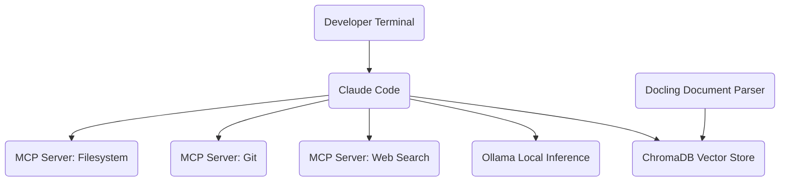

# Solo Developer Stack

<!-- SUMMARY: A complete configuration walkthrough assembling Claude Code, MCP servers, Ollama, ChromaDB, and Docling into a local-first AI development environment for a single developer. The architecture eliminates cloud infrastructure dependencies for supplementary tooling while providing agentic coding assistance, local model inference, and a lightweight retrieval-augmented generation pipeline. -->

The [AI Tooling series](series-ai-tooling.html) maps how each supporting ecosystem component connects to coding agents, frameworks, and orchestrators. That architectural map serves as a menu of options; the remaining engineering task is selecting and wiring specific components into a coherent, working system. This configuration assembles the first such selection: a local-first AI development stack for a single developer built from five components in the [Guides collection](index.html#tab-guides).

## The Problem

A developer working on a personal repository or a small-team codebase needs AI assistance across the daily engineering workflow without operating production cloud services. Designing that environment requires balancing three core functional capabilities against strict single-operator constraints.

### Functional Requirements

A complete solo development environment spans three distinct operational roles:

- **Repository-wide coding agency**: An interactive coding assistant that reads files, edits source code, executes shell commands, runs test suites, and reasons across an entire repository rather than completing isolated lines inside a single buffer.
- **Private local inference**: Direct access to open-weight language models on the workstation for high-volume, mechanical, or privacy-sensitive tasks where commercial API calls add unnecessary token spend or expose confidential data outside the machine.
- **Semantic document retrieval**: A local retrieval pipeline that indexes architecture specifications, API documentation, design notes, and reference manuals so the developer and the coding agent can search project knowledge by meaning rather than literal keyword match.

### Workstation Constraints and Scope Boundaries

Running those three capabilities as an individual operator imposes three strict operational limits:

- **Single-workstation execution**: Every supporting service must run on one development machine without cloud infrastructure management, container orchestration, or dedicated GPU cluster provisioning.
- **Predictable marginal cost**: Ongoing API expenditure beyond the primary coding agent subscription must remain zero or near zero during routine development and document indexing.
- **Zero DevOps maintenance**: One developer must be able to install, upgrade, and debug the entire stack in minutes using standard package managers without dedicated infrastructure engineering support.

Enterprise platform requirements remain outside this scope. Multi-tenant data isolation, compliance audit trails, distributed multi-agent choreography, and high-concurrency request serving solve organizational coordination problems rather than individual productivity bottlenecks. The objective here is maximum single-developer throughput with minimum operational overhead.

## Architecture Overview

The architecture connects five local components around the developer's terminal. Every file operation, Git inspection, document parse, vector lookup, and supplementary model request executes on the workstation, while only frontier reasoning turns and live web search queries cross the network boundary.

### Interactive and Retrieval Paths

Data and control flow divide into two cooperating paths that meet inside the coding agent session:

- **Interactive development path**: The developer works through Claude Code in the terminal, which connects to local Model Context Protocol servers for structured access to the filesystem, Git repository history, and live web content. Claude Code delegates mechanical or privacy-sensitive subtasks to an Ollama server on the same workstation through shell scripts or an MCP wrapper.
- **Knowledge retrieval path**: Docling parses raw PDFs, Word documents, and Markdown specifications into structured text, and an ingestion script writes the resulting vector embeddings into an embedded ChromaDB collection on disk. Claude Code and local utility scripts query ChromaDB during coding sessions to pull relevant design context into working memory.

### Deliberate Layer Omissions

Three ecosystem layers from the broader AI tooling taxonomy are omitted by design at solo scale:

- **No AI gateway**: A single developer interacting with one commercial model provider and one local inference server does not need multi-provider traffic routing, automated provider failover, or per-team cost attribution.
- **No agent orchestrator**: Claude Code manages task decomposition, tool selection, and iterative retry loops internally rather than coordinating a stateful graph of specialized peer agents.
- **No observability platform**: Direct inspection of terminal transcripts and local command output suffices for a single operator who does not need distributed trace aggregation or team-wide evaluation dashboards.

## Component Selection

### Interface Layer: Claude Code

Claude Code, profiled in [Coding Agents Compared](ai-tooling-chapter_01.html), operates as a terminal-native agentic coding assistant. The agent reads and writes files, executes shell commands, inspects test failures, and reasons across entire repositories without requiring a specific integrated development environment. That terminal-native design lets the developer keep an existing editor setup in Vim, Neovim, Emacs, VS Code, or JetBrains while delegating multi-file refactoring, debugging, test authoring, and commit preparation to the agent's built-in frontier model.

For a solo developer, an agentic coding tool replaces standalone application frameworks and multi-agent orchestrators entirely:

- **Framework consolidation**: Libraries profiled in [Agent Frameworks Compared](ai-tooling-chapter_02.html), such as LangChain and LlamaIndex, give application engineers programmatic primitives for prompt construction, tool binding, and retrieval chains. Claude Code supplies those primitives natively inside its interactive runtime loop.
- **Orchestrator consolidation**: Platforms profiled in [Agent Orchestrators Compared](ai-tooling-chapter_03.html), such as LangGraph and CrewAI, coordinate state transitions across multiple specialized agents. Claude Code decomposes multi-step engineering tasks internally, invokes external tools through MCP, manages its own context window, and dispatches isolated subagents when a search task would clutter the main conversation.

Building and maintaining a custom Python framework application to assist with personal repository tasks would duplicate runtime machinery that the terminal agent already provides out of the box.

### Connectivity Layer: MCP Servers

Standardized tool discovery and invocation across the stack rely on the Model Context Protocol, profiled in [Connectivity and Routing](ai-tooling-chapter_04.html). Rather than relying on ad-hoc shell scripts or brittle prompt pasting, MCP servers expose typed tool schemas, input validation, and structured outputs through a uniform client-server protocol.

Three MCP servers cover the core external capabilities needed during daily solo development:

- **Filesystem server**: Provides directory-scoped read, write, search, and metadata operations so the agent can navigate, create, and modify project files within explicit path boundaries declared in the configuration file.
- **Git server**: Exposes commit history, branch state, working-tree diffs, and file blame metadata as structured tool outputs, allowing the agent to trace how an interface evolved over time without the developer manually copying Git log output into the prompt.
- **Web search server**: Queries current vendor documentation, issue trackers, release notes, and API references on demand, closing knowledge gaps for libraries or protocol revisions published after the model's training cutoff.

All three servers run as local `stdio` child processes spawned by Claude Code at session startup and terminated when the session exits. No background daemon, container network, or OAuth token exchange is required, and no network traffic occurs beyond the web search server's outbound HTTPS queries. Extending the stack later with a PostgreSQL inspector, a SQLite reader, or an issue-tracker connector requires adding a single JSON block to `.mcp.json`.

### Intelligence Layer: Ollama

Single-binary local model inference on consumer hardware comes from Ollama, profiled in [Runtime Infrastructure](ai-tooling-chapter_06.html). A single `ollama pull` and `ollama run` workflow downloads quantized open-weight model weights from the registry and starts a local inference server with automatic hardware acceleration for Apple Silicon Metal, NVIDIA CUDA, and AMD ROCm processors.

Ollama plays a supplementary role alongside Claude Code's primary commercial model, splitting workloads along a clear capability, cost, and privacy boundary:

- **Commercial frontier model**: Handles tasks that demand deep multi-file reasoning, architectural refactoring, subtle concurrency debugging, and complex test synthesis across the repository.
- **Local open-weight model**: Handles high-volume, mechanical, or confidential tasks where external API calls waste commercial quota or expose sensitive data, including log summarization, boilerplate generation from templates, commit diff classification, and local scrubbing of credentials or personally identifiable information before logs are shared.

Ollama exposes an OpenAI-compatible HTTP endpoint on `http://localhost:11434/v1`, so any Python script, shell hook, or developer utility that speaks the standard chat completions protocol can target the local model without vendor-specific SDK code. Custom `Modelfiles` let the developer bake task-specific system prompts, context window sizes, and low-temperature sampling parameters into named local personas that launch with a single command.

### Memory Layer: ChromaDB

Embedded vector storage inside the Python runtime uses ChromaDB, profiled in [Data Infrastructure](ai-tooling-chapter_05.html). A persistent client call creates an on-disk SQLite metadata store and HNSW vector index inside a local project folder without requiring a separate database daemon, Docker container, or port binding.

In this configuration, ChromaDB stores vector embeddings of project documentation, architecture decision records, hardware or protocol specifications, and reference manuals. Calling the collection's query method with a natural-language question returns the top-ranked document chunks by cosine similarity, retrieving conceptually relevant sections even when the query uses different terminology than the source document. ChromaDB's built-in default embedding function runs a compact sentence-transformer model locally on the workstation during ingestion and querying, removing the need to configure an external embedding API or manage billing keys for vector generation.

The embedded deployment model matches the operational constraints of a single developer:

- **Zero background overhead**: The database consumes zero memory or CPU cycles when ingestion or retrieval scripts are not actively running, preserving workstation resources for compilation, testing, and local LLM inference.
- **Direct client-server migration path**: The Python client API for `PersistentClient` on local disk matches `HttpClient` for a standalone server, so the retrieval scripts require only a one-line client initialization change if the project later grows into a shared team service.
- **Right-sized indexing**: Dedicated server databases such as Qdrant and Weaviate deliver higher throughput across tens of millions of vectors and concurrent client connections, whereas ChromaDB's embedded HNSW index handles the thousands or tens of thousands of chunks typical of a single repository with sub-second latency and zero operational ceremony.

### Knowledge Management Layer: Docling

Document parsing and layout reconstruction run through Docling, an open-source library developed by IBM Research and profiled in [Data Infrastructure](ai-tooling-chapter_05.html). Rather than relying on brittle regular-expression text scrapers or external cloud APIs, Docling runs specialized compact vision models locally to analyze page layout and table geometry across PDFs, DOCX files, and Markdown documents.

Two structural capabilities make Docling the right parser for a local-first knowledge pipeline:

- **Layout and table preservation**: Standard PDF text extractors flatten multi-column pages and strip table borders, turning structured specification tables into unreadable word salads that poison downstream retrieval chunks. Docling's local layout detector and TableFormer model reconstruct reading order, heading hierarchies, and Markdown table grids before chunking begins.
- **Strict local data custody**: Cloud parsing services such as LlamaParse and Unstructured's hosted API produce strong extraction quality, yet they require uploading raw documents to third-party servers. Running Docling on the workstation keeps proprietary design documents, client specifications, and unpublished research entirely on local storage.

Docling exports each parsed document directly to structured Markdown. The ingestion script then splits that Markdown along paragraph and section boundaries so that tables, fenced code blocks, and heading hierarchies stay intact inside ChromaDB rather than fragmenting across arbitrary character offsets. Preserving those structural boundaries ensures that retrieved chunks carry complete parameter tables and section headers when injected into the coding agent's prompt context.

## Integration Walkthrough

An end-to-end engineering task traces how the five components cooperate across three sequential stages:

1. **MCP tool discovery and repository inspection**: Claude Code reads the project-level `.mcp.json` or user-level `~/.claude.json` file at session startup, spawns the `filesystem`, `git`, and `web-search` servers as local `stdio` subprocesses, and registers their tool schemas. The developer describes a feature or bug, and the agent inspects source files through the filesystem server, reviews recent commit history and diffs through the Git server, and queries external library documentation through the web search server without manual copy-pasting.
2. **Local inference delegation for mechanical and sensitive subtasks**: Ollama runs as a local service listening on `http://localhost:11434`. Whenever the workflow needs to condense a multi-megabyte test log, sanitize environment dumps containing secrets, or run batch classification across repository files, a shell command or utility script sends the payload to `http://localhost:11434/v1` or invokes a named `Modelfile` persona. Commercial API tokens stay reserved for multi-file code reasoning inside Claude Code.
3. **Document ingestion and semantic retrieval**: Adding new PDF specifications, Word documents, or design notes to the project's `docs/` folder triggers a run of `scripts/ingest_docs.py`. That script passes each file through Docling's local layout models to produce clean Markdown, splits the Markdown into paragraph-preserving chunks, and upserts the chunks with source file and chunk-index metadata into ChromaDB at `./chroma_data`. During coding sessions, Claude Code or the developer runs `scripts/query_docs.py` with a natural-language question to retrieve the highest-scoring specification chunks and their recorded source paths.

Declaring the retrieval and Ollama helper commands in the repository's root `CLAUDE.md` file closes the loop between the interactive path and the knowledge path, allowing Claude Code to query local documentation and local models autonomously through its shell tool.

## Tradeoffs and Alternatives

This configuration optimizes for operational simplicity, zero cloud infrastructure maintenance, and complete local custody over supplementary tooling and documentation. Running every supporting component on a single workstation introduces three structural tradeoffs:

- **Single-user concurrency ceiling**: ChromaDB's embedded SQLite-and-HNSW store and Ollama's local request queue are engineered for one operator at a time. A team of five engineers querying a shared knowledge base and local model server concurrently will hit lock contention and queuing delays, requiring a migration to client-server Qdrant or Weaviate and a continuous-batching inference engine such as vLLM.
- **Manual session observability**: Without a dedicated tracing and evaluation platform such as Langfuse, Arize Phoenix, or Braintrust, diagnosing a flawed multi-step agent run relies on reading Claude Code's local transcript logs and terminal output by hand. Manual log inspection suffices for one developer iterating on a personal repository, whereas team pipelines require centralized trace capture, latency histograms, and automated regression scoring.
- **Workstation memory and thermal contention**: Running 8B to 32B quantized language models in Ollama and vision layout models in Docling shares unified memory or VRAM with the developer's compiler, local containers, test runners, and browser. Workstations with 16 GB of RAM must stick to compact 7B or 8B parameter checkpoints and unload idle models between heavy build runs.

**Alternative substitutions at each layer**:

- **Interface layer**: Replace Claude Code with Cursor, Windsurf, or Cline when an IDE-embedded editor surface is preferred over a terminal-native workflow; the `.mcp.json` server definitions carry over with minimal changes because all three environments support Model Context Protocol clients.
- **Intelligence layer**: Replace Ollama with `llama.cpp` server binaries when fine-grained control over GGUF quantization formats, KV-cache quantization, flash-attention flags, and CPU/GPU layer splitting outweighs single-command model management.
- **Memory layer**: Replace ChromaDB with Qdrant in single-binary mode when the local corpus grows beyond hundreds of thousands of chunks or requires compound payload filtering alongside dense vector similarity.
- **Knowledge management layer**: Replace Docling with LlamaParse when documents contain dense, unconventional visual layouts or degraded scans that benefit from frontier cloud vision-language models, trading local data custody and zero marginal cost for higher extraction fidelity on difficult pages.

This configuration establishes the foundation: a single developer, one workstation, and a complete local-first AI development workflow. Developers who also want deterministic safety hooks, modular always-on rules, on-demand skills, isolated subagents, and file-based session state around Claude Code can layer the [Template for Coding Agent Best Practices](template-for-coding-agent-best-practices-configuration.html) directly onto this stack, mapping its local privacy vault role to the Ollama endpoint configured here. Growing team size, compliance mandates, or retrieval scale beyond a single workstation points toward the other four guides in the collection:

- **[Enterprise Agentic Pipeline](enterprise-agentic-pipeline-configuration.html)**: Replaces single-agent terminal operation with LangGraph multi-agent orchestration, LiteLLM cost governance, multi-tenant Weaviate storage, Langfuse audit trails, and vLLM cluster serving.
- **[Private and Airgapped Deployment](private-and-airgapped-deployment-configuration.html)**: Adapts the multi-agent stack for sealed network perimeters using offline artifact staging, Qdrant single-binary storage, SGLang structured decoding, and Unsloth local fine-tuning.
- **[RAG-First Knowledge System](rag-first-knowledge-system-configuration.html)**: Scales the document ingestion and retrieval path to continuously evolving heterogeneous corpora using LlamaParse, Firecrawl, Pinecone, and Braintrust retrieval scoring.
- **[Evaluation-Driven Development Loop](evaluation-driven-development-loop-configuration.html)**: Wraps production trace capture, dataset curation, Braintrust scoring, Unsloth LoRA training, and LiteLLM weighted A/B routing into a closed quality-improvement cycle.

The companion [Setup Guide](solo-developer-stack-guide.html) provides step-by-step installation commands, configuration files, wiring scripts, and verification checks for every component in this stack.

## References

1. Claude Code Documentation, Anthropic.
2. Model Context Protocol Specification, Anthropic and MCP Steering Group.
3. Ollama Documentation, Ollama Inc.
4. Chroma Documentation, Chroma Inc.
5. Docling Documentation, IBM Research and LF AI and Data Foundation.
6. MCP Filesystem Server, Model Context Protocol Reference Implementations.
7. MCP Git Server, Model Context Protocol Reference Implementations.
