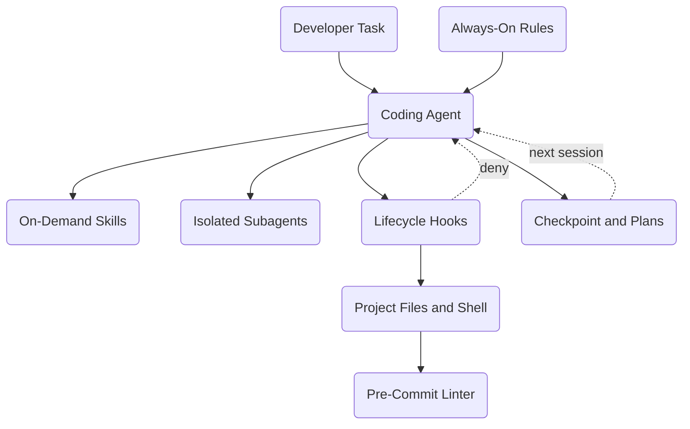

# Template for Coding Agent Best Practices

<!-- SUMMARY: An architecture walkthrough of the operating layer around a coding agent: always-on rules, on-demand skills, context-isolated subagents, deterministic hooks and linters, and file-based session state. The configuration enforces critical constraints in code rather than prompts, keeps context lean across long efforts, and lives in version control so any team can reproduce it. -->

The [AI Tooling series](series-ai-tooling.html) surveys the coding agents, protocols, and runtime services that make up an AI development environment, and the five configurations in the [Guides collection](index.html#tab-guides) wire those services into working stacks. Every one of those stacks places a coding agent at its interactive center, yet none of them configures the agent itself.

An agent installed with default settings forgets project rules under load, trusts prose to stop destructive commands, loses decisions as transcripts grow, and keeps its behavior in editor dialogs that never reach version control. This configuration adds the missing operating layer: five kinds of committed files that shape, constrain, and preserve the agent's work inside any of those stacks.

## The Problem

An agent left at its defaults degrades in four predictable ways during sustained engineering work. Fixing all four failures takes the same move: separate what the model should consider from what code must enforce, and keep both in the repository next to the source they govern. The template applies that split across seven targets: Claude Code, Cursor, Google Antigravity, Posit Assistant, Windsurf, Cline, and a vendor-neutral baseline built on plain instruction files and Git hooks.

### Instruction Dilution

Teams usually respond to agent mistakes by appending another paragraph to a single root instruction file, until coding conventions, debugging checklists, documentation templates, and safety prohibitions share one long prompt. The agent rereads that file on every turn. A long block of instructions raises the token cost of every tool call, competes with the task for attention, and buries rules in its middle, where the model is least likely to follow them.

### Silent Non-Compliance

A system prompt states every instruction as a request, and a language model honors requests statistically. Asking in prose for the agent to leave a released directory alone, avoid destructive shell commands, or keep credentials out of committed files works most of the time.

Under the reasoning load of a multi-file refactor, negative constraints are the first to slip. The agent overwrites a locked file or commits a local path and then reports success, so the failure surfaces only in review or after release.

### Context Degradation

Long sessions accumulate raw search output, abandoned debugging attempts, full file reads, and superseded plans. Recall degrades as that clutter grows, well before the advertised context limit. A decision settled two hours earlier fades from effective memory, and the agent reintroduces a fixed bug or reverses an agreed design choice. Switching models mid-task compounds the loss, because the only record of the work lives in a chat transcript that the next model never sees.

### Non-Reproducible Configuration

Settings toggled in an editor preferences pane and prompts typed ad hoc exist on one workstation only. Without committed files and tests, a teammate cannot clone the setup, a reviewer cannot diff it across branches, and continuous integration cannot verify it.

## Architecture Overview

A task enters at the top of the diagram. The coding agent reads the always-on rules, loads a skill or dispatches a subagent when the work calls for one, and sends every shell command and file edit through the lifecycle hooks. Permitted actions reach the project files and shell, while a denied action returns to the agent along the dashed deny edge. Committed work passes the pre-commit linter, and the session closes by writing the checkpoint and plan files that the next session reads first.

### Guidance Versus Enforcement

The first boundary runs through every turn and separates probabilistic guidance from deterministic enforcement:

- **Guidance side**: Always-on rules enter every prompt and stay short. Skills load only when a task calls for them. Subagents run in their own context windows and return compact summaries, so heavy reading never reaches the main conversation.
- **Enforcement side**: Hooks and linters inspect every proposed command or file edit as structured data and block violations before they take effect. A hook denial returns to the agent as an error it must work around, and the pre-commit linter repeats the checks when work reaches Git.

### Working Memory Versus Durable State

The second boundary separates one session from the next. Context windows are working memory, not storage, so the state layer moves durable facts onto disk. A short checkpoint file records scope, decisions, verified results, and next tasks, while plans live as dated files and a handoff prompt tells the next session which files to read first.

The next session starts with a clean context window and the same project knowledge, regardless of which model or tool runs it. The dashed edge from the checkpoint and plans back to the agent is the only path between sessions, and it runs through files that a reviewer can open and read.

## Component Selection

### Rules

Always-on rules state the passive boundaries that apply to every turn: how much initiative the agent takes, what counts as evidence, when it must stop and plan, how it writes, and which paths it must never touch. The template splits these concerns into five short files, which replace the monolithic root prompt, keep the per-turn cost low, and let a team edit one concern without rereading the rest:

- **Agency**: Tells the agent to act on unambiguous tasks, exhaust local search before asking where something lives, skip unsolicited recaps, and fix root causes instead of masking symptoms.
- **Ground truth**: Requires the agent to read a file in the current session before describing it, and asks for every claim to carry an evidence tier: executed locally, stated in vendor documentation, or unconfirmed.
- **Planning mode**: Requires clarifying questions and an approved plan before any change that touches three or more files, a shared interface, a build pipeline, or a new dependency.
- **Writing style**: Ships as a placeholder with four neutral examples, because every team has its own conventions.
- **Freeze paths**: Marks released directories as read-only and asks for a restore-point commit hash before shared build files change.

Scoping matters as much as size. Most of the supported tools can attach a rule to file patterns, so the writing rule loads only when the agent edits documentation, and code turns skip it. The vendor-neutral tree, built for tools that read only `AGENTS.md`, places all five rules in that single file. Rules remain requests, however. Anything destructive or mechanically testable also needs a hook, and the rule exists to tell the agent about the constraint before the hook has to enforce it.

### Skills

Skills hold repeatable multi-step procedures that would bloat every prompt if written as rules. Each skill is a folder containing a `SKILL.md` file, following the Agent Skills open format that every tool in the template reads natively. The file opens with a name and a one-sentence description, and the body holds the procedure.

At startup the agent indexes only the descriptions. The body loads when a task matches the description or when the developer invokes the skill by name, and supporting reference files load only when a step reads them. In the template, the six descriptions together amount to less than a tenth of the full skill text, so the procedures cost almost nothing until a task needs them.

The six skills fall into two groups, with two continuity skills that close a session and four reasoning skills that shape the work in between:

- **`checkpoint`**: Writes the rolling state file and a detailed session log.
- **`handoff`**: Prints the bootstrap prompt for the next session.
- **`tree-of-thought`**: Requires at least three candidate approaches, each scored on strength, failure mode, and verification cost, before one is chosen.
- **`adversarial-self-audit`**: Attacks a finished plan, change, or draft for unsupported claims, edge-case failures, drift between documentation and implementation, leaked data, and style violations.
- **`deep-research`**: Gathers primary documentation with evidence tags.
- **`autonomous-debugger`**: Isolates failures through hypothesis-driven reproduction.

Skills replace two weaker patterns. Pasting a procedure into chat works once and disappears with the transcript. Folding it into an always-on rule makes every turn pay for a procedure used once a week. A skill file is versioned like code, shared through the repository, and copied unchanged into every tool tree, where a sync test confirms that no copy has drifted.

### Subagents

Subagents solve two problems that rules and skills cannot: context pollution and self-confirmation. A task such as tracing a symbol across a large repository reads dozens of files, and every line of raw output that lands in the main conversation competes with the task for attention. A subagent runs that work in a separate context window without the parent's history and returns a compact, cited report, so the main agent keeps the conclusions and never sees the noise. A reviewing subagent that did not write a draft and cannot see the reasoning behind it also has no stake in defending the work, making it a sharper critic than an authoring agent reviewing its own output.

The template defines three roles:

- **Codebase explorer**: Runs read-only searches and returns a file map with line-range citations.
- **Web researcher**: Pulls primary vendor documentation and tags each claim as documented or unconfirmed.
- **Style auditor**: Reviews drafts against the writing rule and the restricted-term lists on a strong reasoning model, where lighter models miss violations.

Each role is scoped by tool restrictions in its definition file, so the explorer and the auditor cannot write files even when a prompt tells them to. Several of the supported tools read subagent files natively. Tools without them receive the same roles as handoff prompts that run in a fresh session, which preserves the isolation at the cost of one manual step.

### Hooks and Linters

Rules, skills, and subagents all influence a probabilistic model. Hooks and linters enforce. A lifecycle hook is a short script that the agent runtime calls before a tool runs. The runtime passes the proposed command or file edit as a JSON payload, and the script uses `jq` or Python to read only the relevant fields, such as the target path or command, so mentioning a protected path in prose never triggers a false block. The script then allows the action or blocks it with the tool's documented signal, usually a nonzero exit code or a JSON deny decision. The check consumes no model tokens and does not depend on whether the agent remembered a rule.

The template ships five guards:

- **Freeze guard**: Keeps released directories intact.
- **Destructive-command guard**: Refuses recursive force deletes, hard resets, forced pushes, and dropped tables.
- **Network guard**: Blocks remote scripts piped into a shell and uploads of local credential files.
- **Secrets guard**: Blocks file edits and commands that contain common API key prefixes or private key headers.
- **Style hook**: Checks written prose against local home paths, restricted terms, and banned phrases.

A companion test harness runs 96 checks across the guards and the commit linter using sample payloads for each supported tool, verifying that safe actions pass and forbidden actions fail before the configuration is deployed.

Agent hooks can be switched off in settings, and some runtimes let an action proceed when a hook crashes or times out. A Git pre-commit hook closes that gap. Activated once with `git config core.hooksPath .githooks`, it reruns the freeze and secrets checks against the staged diff, passes staged Markdown through `scripts/lint_prose.py`, and aborts the commit on any failure, whichever agent or person produced the change. Operating system sandboxing, where a tool offers it, adds a third line of defense that limits file and network access regardless of what any script decides.

### State Artifacts

State artifacts replace transcript memory with Markdown or plain-text files in Git, so any model and any tool can read them, and none of it depends on a vendor's memory feature:

- **`session_checkpoint.md`**: A rolling summary capped at 150 lines and read first at the start of every session. The file holds four sections covering project scope, constraints and decisions, verified results, and next tasks. Each closeout rewrites the summary in full, carries scope and decisions forward, and writes a detailed log into `checkpoints/` so verbose command output stays off the active path.
- **Dated plan files**: Markdown plans created in the tool's plans folder by `scripts/plan.sh`, which also lists active plans and archives finished ones. An approved plan on disk outlives the session that wrote it, and a reviewer can read it in a pull request.
- **Policy lists**: Three plain-text files at the project root that configure the mechanical checks. `.freeze-paths.txt` lists protected directories for the commit hook, and `.style-denylist.txt` and `.style-phrases.txt` list restricted terms and banned prose phrases for the style hook and the linter.

### Model Routing

No single model suits every step of a session. Routing planning and auditing to an economy model invites the model to lose track of hard constraints, and routing mechanical edits to a slow frontier model wastes time and budget. The template assigns work to four roles by capability rather than by product name, so the mapping survives model releases:

- **Strategy and constraints**: A frontier reasoning model for planning, tree-of-thought comparisons, constraint-heavy drafting, and adversarial audits.
- **Daily driver**: A fast model that handles tool calls reliably, used for implementation, debugging loops, research, and codebase exploration.
- **Long-context archivist**: A model with an extended context window for whole-repository audits and checkpoint condensation.
- **Local privacy vault**: An open-weight model on the workstation for scrubbing credentials or personal data from logs and for offline utility tasks.

Several tools let a session pin one model for planning and another for execution, subagent definitions pin a model per role, and each tool tree maps the roles to its own model names. The state files make switching roles cheap, because a handoff carries the work to whichever model takes the next step.

## Integration Walkthrough

A single task shows how the layers cooperate in sequence. The example task is a request to add a configuration option that touches a parser, its tests, and the user documentation:

1. **Plan gate**: The always-on rules are already in context. The planning mode rule recognizes a change across three or more files, so the agent asks clarifying questions and then writes a plan with `bash scripts/plan.sh new <slug>`, listing the objective, affected files, verification commands, and rollback steps. No application code changes until the developer approves. Most tools pair the rule with a native plan mode that keeps the agent read-only until approval.
2. **Skill**: A design question remains: where the new option should be validated. The agent invokes `tree-of-thought` and records the scored branches in the plan. The procedure enters context only at that moment, and the scored table lands in the plan file, where later sessions can read it.
3. **Subagent**: The agent dispatches the codebase explorer to find every caller of the parser, and the returned map of call sites becomes the file list in the plan.
4. **Hook and linter**: During implementation, every command and edit passes through the guards. The destructive-command guard denies a cleanup step that reaches for a recursive force delete, and the agent receives the reason and proposes a narrower command for approval. At commit time, the pre-commit hook reruns the secrets, freeze, and prose checks and aborts the commit with a file and line number when the documentation contains a pasted local home path.
5. **Audit**: Before requesting review, the agent runs `adversarial-self-audit` on the diff and hands the documentation to the style auditor, whose line-cited fixes go in before the commit.
6. **Checkpoint and handoff**: The session ends with `checkpoint`, which records the working tree state, writes the detailed log, and rewrites the rolling checkpoint within its line cap. `handoff` then prints a self-contained prompt naming the next objective, the files to read first, and the frozen paths. The next session, possibly on a different model or tool, starts from that prompt and a clean context window, reads the checkpoint and the active plan, and continues without inheriting the noise of the previous transcript.

Scoping each session to one deliverable keeps the loop tight: one plan, one set of changes, one checkpoint. Long efforts become a sequence of short, verifiable sessions joined by files rather than one sprawling conversation that slowly forgets its own decisions.

## Tradeoffs and Alternatives

This configuration optimizes for constraint compliance, session longevity, and reproducibility. Every behavior that matters lives in a committed file, and every rule that can be tested in code is enforced in code. Carrying that discipline introduces three operational costs:

- **Vendor churn**: Each tool names its folders, definition keys, and hook contracts differently, and those details change between releases. A team on one tool maintains one tree, while a multi-tool team maintains several. The template contains that cost by keeping one shared source for skills, scripts, and rule bodies and running a sync test that flags any copy that has drifted.
- **Planning ceremony**: A gate that demands questions, a written plan, and approval slows down medium-sized changes, and teams that make many of them may raise the threshold.
- **Mechanical check limits**: Regex linters and shell guards catch leaked paths, credentials, and forbidden commands, yet they cannot judge whether an architecture is sound or a claim is true. Those questions still depend on tests, the auditor subagent, and human review, and the guards set a floor rather than a ceiling.

**Alternative approaches**:

- **Minimal baseline**: A short-lived prototype can adopt only the vendor-neutral tree, a root `AGENTS.md` plus the Git pre-commit hook, and run the same linter in continuous integration, trading per-turn feedback for a simpler setup.
- **Single-model operation**: An environment with one approved model endpoint can let every subagent inherit the session model, trading higher exploration cost for simpler provider configuration.
- **Shared rules only**: A team that wants guidance without enforcement can adopt the rules and skills alone, accepting that every constraint returns to being a request the model may drop under load.

The template drops into each of the five stacks without changing them:

- **[Solo Developer Stack](solo-developer-stack-configuration.html)**: Maps the local privacy role to the Ollama endpoint already on the workstation.
- **[Enterprise Agentic Pipeline](enterprise-agentic-pipeline-configuration.html)**: Gains uniform secret detection before code reaches CI.
- **[Private and Airgapped Deployment](private-and-airgapped-deployment-configuration.html)**: Carries the dependency-light scripts across the air gap in Git.
- **[RAG-First Knowledge System](rag-first-knowledge-system-configuration.html)**: Uses the subagents to keep raw corpus text out of the main conversation context.
- **[Evaluation-Driven Development Loop](evaluation-driven-development-loop-configuration.html)**: Uses the prose linter and hook test harness as deterministic local scorers alongside the evaluation suite.

The companion [Setup Guide](template-for-coding-agent-best-practices-guide.html) installs each layer step by step, and the [template repository](https://github.com/Lyd1aCla1r3/coding-agent-best-practices) holds the complete, tested files for all seven targets.

## References

1. Agent Skills Specification, Agent Skills Open Standard.
2. AGENTS.md Open Format for Coding Agents, AGENTS.md Community Specification.
3. Model Context Protocol Specification, Anthropic and MCP Steering Group.
4. Claude Code Documentation, Anthropic.
5. Cursor Documentation, Anysphere Inc.
6. Google Antigravity Documentation, Google DeepMind.
7. Posit Assistant Documentation, Posit Software, PBC.
8. Devin Desktop and Windsurf Documentation, Cognition AI.
9. Cline Documentation, Cline Bot Inc.
10. Git Documentation: githooks and core.hooksPath, Software Freedom Conservancy.
