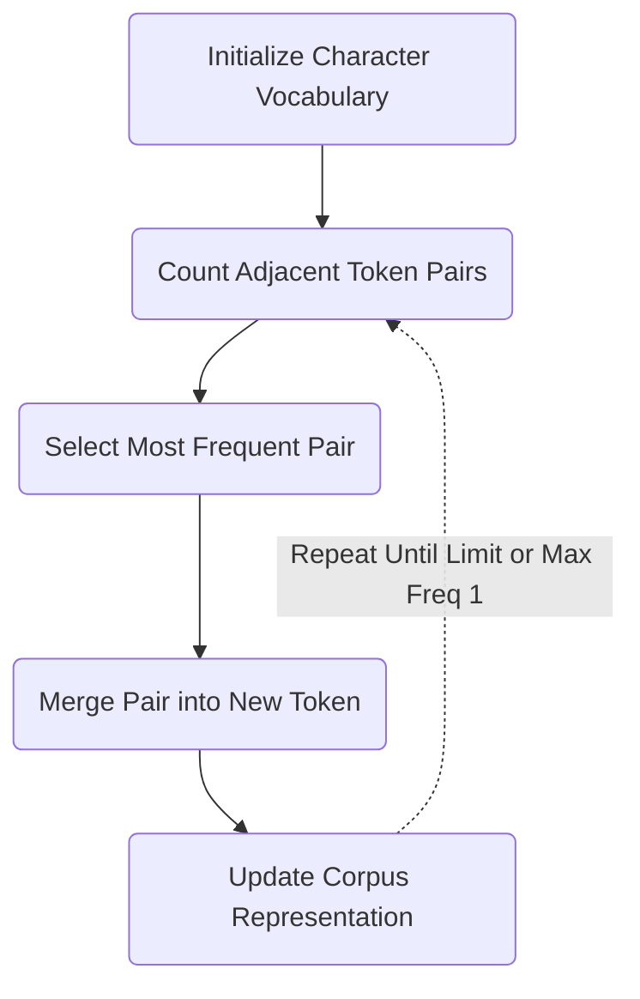

# Part 2: The BPE Training Algorithm

<!-- SUMMARY: Constructing an optimized subword vocabulary requires a deterministic compression algorithm rather than manual linguistic rules. Byte Pair Encoding resolves this by initializing a base character vocabulary and executing a greedy, iterative merge operation that systematically fuses the most frequent adjacent tokens into unified semantic structures. -->

<em>Prefer to read this offline? <a href="../assets/docs/tokenization-ebook-v1.0.pdf" target="_blank" rel="noopener">Download the complete, formatting-optimized Tokenization Ebook here.</a></em>

The previous section established that subword tokenization provides the necessary mathematical compromise between the dimensionality explosion of word-level tokenization and the semantic destruction of character-level boundaries. Constructing this precise subword vocabulary requires a data-driven mechanism. Byte Pair Encoding accomplishes this structural transformation through a deterministic, iterative pipeline that binds distinct characters into logical stems and suffixes.

## Initialization and Boundary Preservation

The training algorithm begins by isolating the fundamental building blocks of the language. The entire training corpus is first separated into discrete words, typically delineated by whitespace. Every word is then strictly decomposed into a sequence of individual character tokens.

This isolation requires a dedicated mechanism to preserve original word boundaries. Processing the corpus as an unsegmented stream of characters risks merging characters across adjacent words and creating spurious cross-word tokens. Appending a dedicated end-of-word marker, denoted as `</w>`, to the terminal character of every word sequence prevents cross-boundary bleeding.

The toy corpus from the preceding chapter provides a concrete initialization state. The corpus consists of nine distinct inflected word forms, each occurring once. Decomposing these nine words produces a compact initial vocabulary of thirteen character-level tokens:

<code>a</code> <code>d</code> <code>e</code> <code>g</code> <code>i</code> <code>k</code> <code>l</code> <code>n</code> <code>o</code> <code>r</code> <code>t</code> <code>w</code> <code>&lt;/w&gt;</code>

Each word transforms into a sequence constructed exclusively from this initial character inventory. The string `walking` maps to a sequence of eight discrete elements: `w`, `a`, `l`, `k`, `i`, `n`, `g`, `</w>`. The tokenizer converts the entire corpus into this fully atomized state before any compression occurs.

## Pair Frequency Evaluation

The core intelligence of the algorithm relies on discovering structural redundancies within these atomized sequences. The system executes a comprehensive scan over the entire corpus, evaluating every instance where two distinct tokens appear adjacent to one another.

This frequency counting operation tallies the occurrences of every adjacent pair across all words. The goal is to identify the single pair of tokens that co-occur most frequently. In the initialized state of the toy corpus, several character pairings appear repeatedly due to the morphological similarities of the chosen verb families. A tally of the most common adjacent pairs immediately highlights structural patterns:

<table style="width: 100%; border: none; margin-bottom: 2rem; border-collapse: collapse;">
  <tbody>
    <tr>
      <td style="border: none; padding: 0.25rem 0; text-align: left;"><code>a</code> + <code>l</code> &rarr;</td>
      <td style="border: none; padding: 0.25rem 0; text-align: right;">6 occurrences</td>
    </tr>
    <tr>
      <td style="border: none; padding: 0.25rem 0; text-align: left;"><code>k</code> + <code>e</code> &rarr;</td>
      <td style="border: none; padding: 0.25rem 0; text-align: right;">6 occurrences</td>
    </tr>
    <tr>
      <td style="border: none; padding: 0.25rem 0; text-align: left;"><code>l</code> + <code>k</code> &rarr;</td>
      <td style="border: none; padding: 0.25rem 0; text-align: right;">6 occurrences</td>
    </tr>
    <tr>
      <td style="border: none; padding: 0.25rem 0; text-align: left;"><code>w</code> + <code>a</code> &rarr;</td>
      <td style="border: none; padding: 0.25rem 0; text-align: right;">4 occurrences</td>
    </tr>
  </tbody>
</table>

The algorithm identifies the pairs `a` + `l`, `k` + `e`, and `l` + `k` as tied for the highest frequency at six occurrences each. A deterministic tie-breaking protocol resolves this collision by selecting the tied pair that sorts first lexicographically. Comparing the three tied pairs, the character `a` precedes `k` and `l` in alphabetical order, dictating the selection of `a` + `l` for the inaugural merge operation.

## The Greedy Merge Rule

The identification of the highest-frequency pair triggers the central update mechanism. The algorithm formally registers a new token representing the concatenation of the selected pair. This new element is appended to the recognized vocabulary, increasing the total size of the vocabulary space by one.

<code>a</code> <code>d</code> <code>e</code> <code>g</code> <code>i</code> <code>k</code> <code>l</code> <code>n</code> <code>o</code> <code>r</code> <code>t</code> <code>w</code> <code>&lt;/w&gt;</code> <b><code>al</code></b>

Simultaneously, the algorithm sweeps through the entire corpus and replaces every adjacent occurrence of the individual tokens with the new fused token. This structural update reduces the overall sequence length of the corpus by compressing two discrete tokens into a single unit at every matching location. The sequence representation of the string `walking` compresses from eight elements to seven: `w`, `al`, `k`, `i`, `n`, `g`, `</w>`.

This localized compression logic forms an iterative loop.

### Termination Conditions and the Vocabulary-Sequence Tradeoff

The training loop scans the updated corpus, recomputes adjacent pair frequencies, selects the highest-frequency pair, and executes another merge. This cycle repeats until it satisfies one of two termination conditions: reaching a target merge count $M$, or reaching a state where no adjacent token pair occurs more than once. Every merge operation mints one new token, locking the final vocabulary size $V$ to the initial base vocabulary count $|V_0|$ plus the number of executed merges $M$ ($V = |V_0| + M$). Production language models typically execute between $32,000$ and $128,000$ merge iterations to construct their final vocabulary.

Selecting the target merge budget $M$ balances two competing computational scaling laws:

- **Linear Embedding Parameter Cost ($\mathcal{O}(V \cdot d_{\text{model}})$):** Every merged token adds one row of width $d_{\text{model}}$ to the embedding matrix $W_E$, increasing static parameter memory linearly with vocabulary size $V$.
- **Quadratic Self-Attention Compute Cost ($\mathcal{O}(L^2 \cdot d_{\text{model}})$):** Every merge shortens the encoded sequence length $L$ across the corpus, quadratically reducing the pairwise token comparisons required inside self-attention layers.

Greedily merging the most frequent adjacent pairs first maximizes sequence compression per added vocabulary row. The algorithm systematically binds individual characters into morphological suffixes, root stems, and whole words.

The next chapter executes this training procedure by hand across all fourteen merge steps on the nine-word toy corpus. Tracing the pair frequency counts and corpus updates at each iteration demonstrates how statistical compression isolates stems such as `alk` and `woke` alongside suffixes such as `ing</w>` without explicit linguistic rules.

<em>Prefer to read this offline? <a href="../assets/docs/tokenization-ebook-v1.0.pdf" target="_blank" rel="noopener">Download the complete, formatting-optimized Tokenization Ebook here.</a></em>

