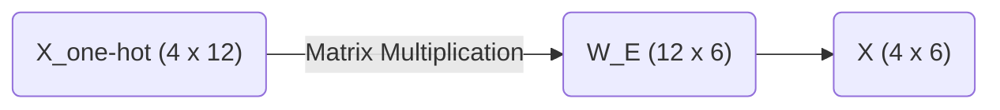

# Part 1: Tokens, One-Hot Encodings, and the Embedding Matrix

<!-- SUMMARY: Translating raw text into a rigorous geometric representation requires mapping discrete tokens into orthogonal one-hot vectors. This process mathematically motivates the necessity of the embedding matrix to compress these isolated dimensions into a dense semantic space, enabling the natural inference of conceptual relationships. -->

<em>Prefer to read this offline? <a href="../assets/docs/transformers-ebook-v1.0.pdf" target="_blank" rel="noopener">Download the complete, formatting-optimized Transformer Ebook here.</a></em>

The Preface established that every operation in the Transformer reads from and writes to a central $4 \times 6$ matrix. Bridging the gap between raw text and that geometric representation is the next requirement. Text is inherently abstract. Computers cannot multiply words. Computers multiply numbers. A rigorous mechanical process is needed to translate human language into a mathematical format that a neural network can manipulate.

This translation executes in three sequential stages:

1. **Tokenization:** Segment the input string into discrete vocabulary symbols and map each symbol to its integer index.
2. **One-Hot Encoding:** Convert each integer index into an orthogonal unit vector in $\mathbb{R}^V$ to remove arbitrary index magnitude.
3. **Embedding Projection:** Multiply the one-hot matrix by a learned embedding matrix $W_E$ to project the isolated basis vectors into a continuous semantic subspace $\mathbb{R}^{d_{\text{model}}}$.

## The Vocabulary Space and Tokenization

The objective is to process the sequence `<BOS>` `i` `woke` `up`.

Before processing this sequence, the model requires a predefined universe of discrete symbols known as the vocabulary. In this configuration, the vocabulary consists of twelve tokens indexed from `0` to `11`:

<b><code>&lt;BOS&gt;</code></b> <b><code>&lt;EOS&gt;</code></b> <b><code>&lt;PAD&gt;</code></b> <b><code>i</code></b> <b><code>we</code></b> <b><code>woke</code></b> <b><code>stayed</code></b> <b><code>up</code></b> <b><code>late</code></b> <b><code>early</code></b> <b><code>today</code></b> <b><code>yesterday</code></b>

Tokenization maps each raw token in the prompt to its integer index in the vocabulary table:

- **`<BOS>`:** Maps to vocabulary index `0`.
- **`i`:** Maps to vocabulary index `3`.
- **`woke`:** Maps to vocabulary index `5`.
- **`up`:** Maps to vocabulary index `7`.

Collecting these four lookups in sequence order produces the integer index array:

$$ \text{Sequence Indices} = [0, 3, 5, 7] $$

## The Geometry of One-Hot Encodings

Feeding raw integer indices directly into a neural network introduces an artificial numerical hierarchy. Assigning the integer `5` to `woke` and the integer `10` to `today` causes linear layers to treat `today` as twice the scalar magnitude of `woke`. That numerical ratio is an arbitrary artifact of vocabulary ordering rather than a linguistic property.

Translating the integer indices into one-hot encoded vectors eliminates this false scalar ordering.

A one-hot vector isolates a concept geometrically. For a vocabulary of size 12, each word becomes a 12-dimensional vector filled with zeros, with a single `1.0` placed at the vocabulary index.

Converting the four tokens into one-hot vectors creates a $4 \times 12$ matrix:

$$
X_{\text{one-hot}} = \begin{bmatrix}
1.0 & 0.0 & 0.0 & 0.0 & 0.0 & 0.0 & 0.0 & 0.0 & 0.0 & 0.0 & \dots & 0.0 \\
0.0 & 0.0 & 0.0 & 1.0 & 0.0 & 0.0 & 0.0 & 0.0 & 0.0 & 0.0 & \dots & 0.0 \\
0.0 & 0.0 & 0.0 & 0.0 & 0.0 & 1.0 & 0.0 & 0.0 & 0.0 & 0.0 & \dots & 0.0 \\
0.0 & 0.0 & 0.0 & 0.0 & 0.0 & 0.0 & 0.0 & 1.0 & 0.0 & 0.0 & \dots & 0.0
\end{bmatrix}
$$

Treating each vocabulary entry as an independent coordinate axis in $\mathbb{R}^{12}$ places every distinct token pair at an identical Euclidean distance of $\sqrt{2}$. The resulting vectors are mutually orthogonal. The token `i` shares zero inner-product similarity with the token `woke`, replacing arbitrary index magnitude with geometric neutrality.

## The Problem with Neutrality

Complete orthogonality introduces a severe representational bottleneck. The pronoun `i` shares grammatical structure with `we`, and the temporal modifier `late` shares semantic structure with `early`. Orthogonal one-hot vectors erase all pairwise similarity, forcing the network to learn syntactic rules independently for every vocabulary item.

One-hot representations also scale poorly with vocabulary size. Production language models routinely operate over vocabularies exceeding 100,000 subword tokens, making a matrix of that width computationally intractable across deep layers.

The isolated 12-dimensional vectors must be projected into a denser, lower-dimensional subspace where tokens with related meanings occupy neighboring coordinates. This dense subspace corresponds to the model dimension $d_{\text{model}} = 6$.

## The Embedding Matrix

This compression is achieved using the Embedding Matrix, denoted as $W_E$. This matrix serves as a learnable lookup table that maps every 12-dimensional one-hot vector to a 6-dimensional coordinate vector, giving $W_E$ a shape of $12 \times 6$.

Network initialization populates $W_E$ with small random values. Over thousands of training iterations, backpropagation updates these coordinates and pulls semantically related tokens into neighboring regions of the vector space to minimize prediction error.

To demonstrate these calculations manually, the training phase is bypassed and a $12 \times 6$ embedding matrix is explicitly designed to show these semantic clusters:

$$
W_E = \begin{bmatrix}
 0.1 &  0.0 &  0.0 &  0.0 &  0.0 &  0.0 \\
 0.1 &  0.0 &  0.0 &  0.0 &  0.0 &  0.1 \\
 0.1 &  0.0 &  0.0 &  0.0 &  0.0 & -0.1 \\
 0.0 &  0.8 & -0.1 &  0.2 &  0.0 &  0.5 \\
 0.0 &  0.9 & -0.1 &  0.2 &  0.0 &  0.8 \\
 0.0 & -0.2 &  0.9 &  0.1 & -0.4 &  0.1 \\
 0.0 & -0.2 &  0.8 &  0.0 &  0.5 & -0.1 \\
 0.0 & -0.1 &  0.4 &  0.9 & -0.2 &  0.0 \\
 0.0 &  0.0 & -0.3 & -0.1 &  0.9 & -0.8 \\
 0.0 &  0.0 & -0.3 & -0.1 &  0.9 &  0.8 \\
 0.0 &  0.0 & -0.2 &  0.0 &  0.8 &  0.1 \\
 0.0 &  0.0 & -0.2 & -0.2 &  0.7 & -0.4
\end{bmatrix}
$$

The pronoun rows at indices 3 and 4 (`i` and `we`) share large positive values in the second column. The temporal modifier rows at indices 8, 9, 10, and 11 (`late`, `early`, `today`, and `yesterday`) share large positive values in the fifth column.

The Embedding Matrix functions as a continuous coordinate map of meaning. Positioning related concepts in neighboring regions of the subspace allows downstream linear layers to generalize across clusters. A grammatical transformation learned for the coordinate region containing `i` transfers directly to `we` because both vectors occupy adjacent coordinates.

## Generating the Central Tensor

To transform the neutral one-hot vectors into this rich geometric space, a standard matrix multiplication is performed. The $4 \times 12$ input matrix is multiplied by the $12 \times 6$ embedding matrix:

$$ X = X_{\text{one-hot}} \times W_E $$

Multiplying a one-hot row vector by $W_E$ selects the single row of the embedding matrix corresponding to the active token index.

The resulting $4 \times 6$ embedding matrix $X$ takes the following form:

$$
X = \begin{bmatrix}
 0.1 &  0.0 &  0.0 &  0.0 &  0.0 &  0.0 \\
 0.0 &  0.8 & -0.1 &  0.2 &  0.0 &  0.5 \\
 0.0 & -0.2 &  0.9 &  0.1 & -0.4 &  0.1 \\
 0.0 & -0.1 &  0.4 &  0.9 & -0.2 &  0.0
\end{bmatrix}
$$

- **Row 1 (`[0.1, 0.0, 0.0, 0.0, 0.0, 0.0]`):** Coordinate vector for `<BOS>` (vocabulary index `0`).
- **Row 2 (`[0.0, 0.8, -0.1, 0.2, 0.0, 0.5]`):** Coordinate vector for `i` (vocabulary index `3`).
- **Row 3 (`[0.0, -0.2, 0.9, 0.1, -0.4, 0.1]`):** Coordinate vector for `woke` (vocabulary index `5`).
- **Row 4 (`[0.0, -0.1, 0.4, 0.9, -0.2, 0.0]`):** Coordinate vector for `up` (vocabulary index `7`).

The text is now translated into the central $4 \times 6$ tensor that moves along the residual stream. The subsequent section examines a structural limitation in this representation and demonstrates why Transformers require positional encoding to represent sequential order.

<em>Prefer to read this offline? <a href="../assets/docs/transformers-ebook-v1.0.pdf" target="_blank" rel="noopener">Download the complete, formatting-optimized Transformer Ebook here.</a></em>

