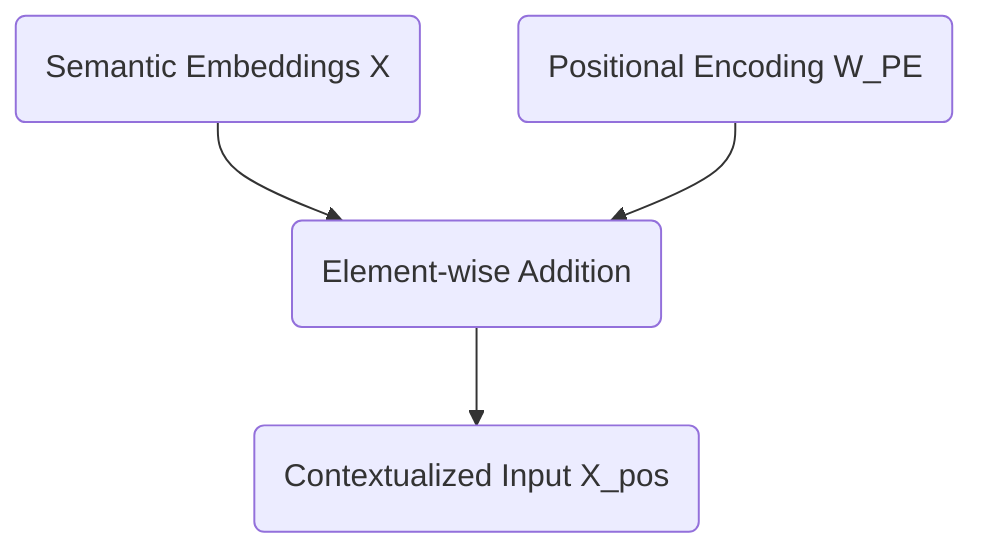

# Part 2: The Permutation Invariance Problem & Positional Encoding

<!-- SUMMARY: Matrix operations are inherently permutation invariant, creating a structural flaw that leaves the architecture entirely blind to sequence order. This limitation is resolved by explicitly injecting temporal context through the element-wise addition of mathematically deterministic absolute positional encodings. -->

<em>Prefer to read this offline? <a href="../assets/docs/transformers-ebook-v1.0.pdf" target="_blank" rel="noopener">Download the complete, formatting-optimized Transformer Ebook here.</a></em>

The input sequence `<BOS>` `i` `woke` `up` is now transformed into a dense, continuous semantic space. Sparse 12-dimensional one-hot vectors are mathematically compressed into a 6-dimensional embedding matrix.

The current tensor representation $X$ for the sequence takes the following form:

$$
X = \begin{bmatrix}
 0.1 &  0.0 &  0.0 &  0.0 &  0.0 &  0.0 \\
 0.0 &  0.8 & -0.1 &  0.2 &  0.0 &  0.5 \\
 0.0 & -0.2 &  0.9 &  0.1 & -0.4 &  0.1 \\
 0.0 & -0.1 &  0.4 &  0.9 & -0.2 &  0.0
\end{bmatrix}
$$

This matrix captures the semantic meaning of the words. A structural limitation remains regarding sequential context.

## The Permutation Invariance Problem

To understand the nature of this flaw, the processing method of the Attention mechanism must be anticipated. During the computation of self-attention, dot products are calculated between these row vectors to measure similarities.

Set operations and row-wise matrix multiplications exhibit permutation invariance. Shuffling the rows of $X$ to represent the reordered sequence `woke` `i` `up` `<BOS>` produces identical pairwise dot products inside self-attention. The network treats `i` `woke` `up` and `woke` `i` `up` as interchangeable multisets of vectors. Natural language depends on sequential order to establish syntax and causality; `"The dog bit the man"` and `"The man bit the dog"` contain identical tokens while describing opposite events.

Without an explicit mechanism to encode sequence order, the Transformer collapses into a permutation-invariant bag-of-words model.

## Injecting Time: Positional Encoding

Positional information must be explicitly injected into the vectors before they enter the attention layers. This injection is achieved by creating a secondary matrix of identical dimensions to the input tensor and adding the two matrices element by element.

Two primary design paradigms encode sequence order in Transformer architectures:

- **Relative Positional Encoding:** The attention computation encodes pairwise token distances rather than fixed sequence indices. Instead of assigning `woke` a static index of `2`, the mechanism records that `woke` sits one step after `i`, using pairwise distance biases or rotary coordinate transformations.
- **Absolute Positional Encoding:** Every sequence index receives a unique, deterministic vector signature added directly to the token embedding. Position `0` applies one fixed geometric translation in $\mathbb{R}^{d_{\text{model}}}$, position `1` applies a second translation, and each subsequent index shifts its token vector along a distinct trajectory.

This walkthrough uses a deterministic absolute positional encoding with entries bounded in $[-1, 1]$ so the variance of the token embeddings remains controlled.

Sinusoidal positional encoding pairs sine and cosine functions of geometrically increasing wavelengths across the $d_{\text{model}} = 6$ dimensions. Using a compact base wavelength of $10$ suited to a 6-dimensional toy space, each coordinate pair $(2i, 2i+1)$ for $i \in \{0, 1, 2\}$ at sequence index $pos \in \{0, 1, 2, 3\}$ follows $\text{PE}_{(pos, 2i)} = \sin(pos / 10^{2i/6})$ and $\text{PE}_{(pos, 2i+1)} = \cos(pos / 10^{2i/6})$. Rounding this wave grid to one decimal place for manual arithmetic yields the $4 \times 6$ Positional Encoding matrix $W_{PE}$:

$$
W_{PE} = \begin{bmatrix}
 0.0 &  1.0 &  0.0 &  1.0 &  0.0 &  1.0 \\
 0.8 &  0.5 &  0.4 &  0.9 &  0.2 &  1.0 \\
 0.9 & -0.4 &  0.8 &  0.6 &  0.4 &  0.9 \\
 0.1 & -1.0 &  1.0 &  0.2 &  0.6 &  0.8
\end{bmatrix}
$$

This matrix exhibits geometric regularity. The values fluctuate smoothly between `-1.0` and `1.0`. Position `0` produces an alternating `[0.0, 1.0, 0.0, 1.0, 0.0, 1.0]` pattern, while subsequent positions introduce distinct phase shifts across the three frequency pairs. No two rows are identical.

## The Final Matrix Addition

An element-wise matrix addition merges the semantic embeddings $X$ and the positional signatures $W_{PE}$:

Adding the embedding matrix $X$ and the positional matrix $W_{PE}$ element by element produces the positionally encoded input tensor:

$$
X_{pos} = \begin{bmatrix}
 0.1 &  0.0 &  0.0 &  0.0 &  0.0 &  0.0 \\
 0.0 &  0.8 & -0.1 &  0.2 &  0.0 &  0.5 \\
 0.0 & -0.2 &  0.9 &  0.1 & -0.4 &  0.1 \\
 0.0 & -0.1 &  0.4 &  0.9 & -0.2 &  0.0
\end{bmatrix} + \begin{bmatrix}
 0.0 &  1.0 &  0.0 &  1.0 &  0.0 &  1.0 \\
 0.8 &  0.5 &  0.4 &  0.9 &  0.2 &  1.0 \\
 0.9 & -0.4 &  0.8 &  0.6 &  0.4 &  0.9 \\
 0.1 & -1.0 &  1.0 &  0.2 &  0.6 &  0.8
\end{bmatrix}
$$

This operation yields the final, positionally aware tensor $X_{pos}$:

$$
X_{pos} = \begin{bmatrix}
 0.1 &  1.0 &  0.0 &  1.0 &  0.0 &  1.0 \\
 0.8 &  1.3 &  0.3 &  1.1 &  0.2 &  1.5 \\
 0.9 & -0.6 &  1.7 &  0.7 &  0.0 &  1.0 \\
 0.1 & -1.1 &  1.4 &  1.1 &  0.4 &  0.8
\end{bmatrix}
$$

The third row vector no longer represents the isolated lexical concept `woke` in a vacuum; its coordinates now encode `woke` anchored at sequence index `2`.

The initial input preparations are complete. A sequence of discrete tokens has been mapped into a continuous $4 \times 6$ tensor that encodes both lexical identity and sequential position, ready to enter Layer 1 Self-Attention.

<em>Prefer to read this offline? <a href="../assets/docs/transformers-ebook-v1.0.pdf" target="_blank" rel="noopener">Download the complete, formatting-optimized Transformer Ebook here.</a></em>

