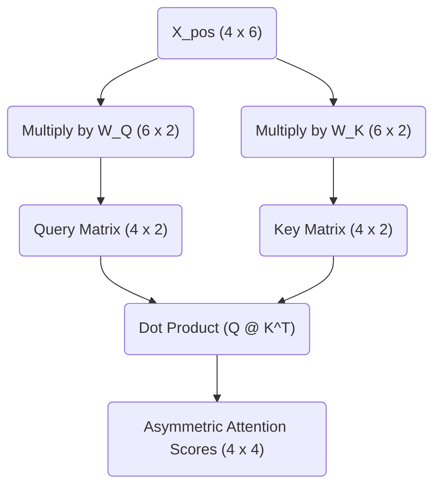

# Part 3: The Motivation for Q, K, and V (Asymmetric Similarity)

<!-- SUMMARY: Symmetric similarity is structurally inadequate for capturing grammatically asymmetric linguistic relationships. Projecting context-aware embeddings into distinct query and key subspaces implements a bilinear form that enables tokens to independently query their surroundings and present complementary information. -->

<em>Prefer to read this offline? <a href="../assets/docs/transformers-ebook-v1.0.pdf" target="_blank" rel="noopener">Download the complete, formatting-optimized Transformer Ebook here.</a></em>

The permutation invariance problem is solved by adding absolute positional encodings to the token embeddings. The sequence `<BOS>` `i` `woke` `up` is now represented by the $4 \times 6$ matrix $X_{pos}$, which contains both semantic meaning and positional context. 

The next step in the Transformer architecture is self-attention. The core mechanism of attention involves discovering which tokens in the sequence are relevant to each other. The simplest way to measure mathematical relevance between two vectors is to calculate their dot product. A naive assumption suggests computing the dot product of every token vector with every other token vector directly.

This approach is known as computing symmetric similarity. The process involves multiplying $X_{pos}$ by its own transpose $X_{pos}^T$:

$$ \text{Symmetric Similarity} = X_{pos} \times X_{pos}^T $$

Evaluating that product produces the $4 \times 4$ symmetric similarity matrix:

$$
\text{Symmetric Similarity} = \begin{bmatrix}
3.01 & 3.98 & 1.19 & 0.81 \\
3.98 & 5.92 & 2.72 & 1.56 \\
1.19 & 2.72 & 5.55 & 4.70 \\
0.81 & 1.56 & 4.70 & 5.19
\end{bmatrix}
$$

The dot product measures directional alignment between vectors. Multiplying any real matrix by its own transpose concentrates the largest magnitudes along the main diagonal. The token `woke` aligns most strongly with itself at a score of $5.55$, and the token `up` aligns most strongly with itself at $5.19$.

This diagonal dominance exposes a structural limitation of raw inner products. Linguistic relationships are inherently asymmetric: verbs govern subjects, and particles modify verbs. Interpreting the sequence requires the particle `up` to attend backward to `woke` to resolve the phrasal verb `woke up`. Symmetric similarity forces every token vector to match most strongly with its own coordinate direction, preventing tokens from selectively targeting complementary parts of speech that occupy different regions of the embedding space.

A mechanism is required to allow a token to issue a targeted query while permitting other tokens to advertise complementary keys. Asymmetric similarity fulfills this requirement.

## The Bilinear Form

To achieve asymmetric similarity, the Transformer projects the input tensor $X_{pos}$ into three distinct subspaces using three learned weight matrices: Queries, Keys, and Values. The immediate focus remains on the Queries and Keys.

Instead of measuring the direct inner product between vector $A$ and vector $B$, vector $A$ is projected into a Query subspace and vector $B$ is projected into a Key subspace. Alignment is then measured between the Query projection of $A$ and the Key projection of $B$.

Mathematically, this operation defines a bilinear form. Given the input $X_{pos}$ and two weight matrices $W_Q$ and $W_K$, the attention scores are calculated as follows:

$$
\text{Attention Scores} = (X_{pos} W_Q)(X_{pos} W_K)^T
$$

The learned projection matrices $W_Q$ and $W_K$ act as asymmetric linear lenses. During training, backpropagation adjusts these matrices to project grammatically complementary tokens into aligned regions of a shared lower-dimensional subspace. The Query projection of a particle such as `up` and the Key projection of a verb such as `woke` can map to nearly collinear coordinates in $\mathbb{R}^{d_k}$, producing a large positive dot product that routes attention across the pair.

## Calculating Queries and Keys

The Transformer uses $3$ attention heads across a model dimension of $d_{model} = 6$. Dividing the model dimension by the number of heads sets the Query and Key subspace dimension to $d_k = 2$.

Each attention head maintains independent $W_Q$ and $W_K$ projection matrices of shape $6 \times 2$. Dedicating separate subspace projections to each head enables the network to track multiple linguistic relationships in parallel: Head 1 can align subject-verb pairs while Head 2 tracks temporal modifiers.

A concrete $W_Q$ and $W_K$ for the first attention head can be instantiated as follows:

$$
W_Q = \begin{bmatrix}
 0.1 &  0.2 \\
-0.1 &  0.5 \\
 0.8 & -0.2 \\
 0.3 &  0.4 \\
-0.2 &  0.1 \\
 0.1 & -0.3
\end{bmatrix}
$$

$$
W_K = \begin{bmatrix}
-0.2 &  0.4 \\
 0.5 & -0.1 \\
 0.6 &  0.2 \\
 0.1 &  0.7 \\
 0.2 & -0.2 \\
-0.4 &  0.3
\end{bmatrix}
$$

To calculate the Queries $Q$, the positionally encoded sequence $X_{pos}$ is multiplied by $W_Q$:

$$ Q = X_{pos} \times W_Q $$

The resulting Query matrix $Q$ has dimensions $4 \times 2$, compressing each token from a 6-dimensional representation into a 2-dimensional Query vector:

$$
Q = \begin{bmatrix}
 0.31 &  0.62 \\
 0.63 &  0.76 \\
 1.82 & -0.48 \\
 1.57 & -0.57
\end{bmatrix}
$$

Multiplying $X_{pos}$ by the Key projection matrix $W_K$ projects the sequence into the Key subspace:

$$ K = X_{pos} \times W_K $$

The multiplication produces the $4 \times 2$ Key matrix $K$, assigning each token a 2-dimensional Key vector:

$$
K = \begin{bmatrix}
 0.18 &  0.94 \\
 0.22 &  1.43 \\
 0.21 &  1.55 \\
 0.14 &  1.36
\end{bmatrix}
$$

Separating the input into independent Query and Key projections breaks the symmetry of raw inner products. The token `woke` no longer defaults to attending primarily to itself; it projects a targeted search vector into the Query subspace and a distinct descriptor vector into the Key subspace. Subsequent operations multiply these projected matrices to compute the pairwise attention scores and scale the resulting variance to prevent gradient saturation.

<em>Prefer to read this offline? <a href="../assets/docs/transformers-ebook-v1.0.pdf" target="_blank" rel="noopener">Download the complete, formatting-optimized Transformer Ebook here.</a></em>

