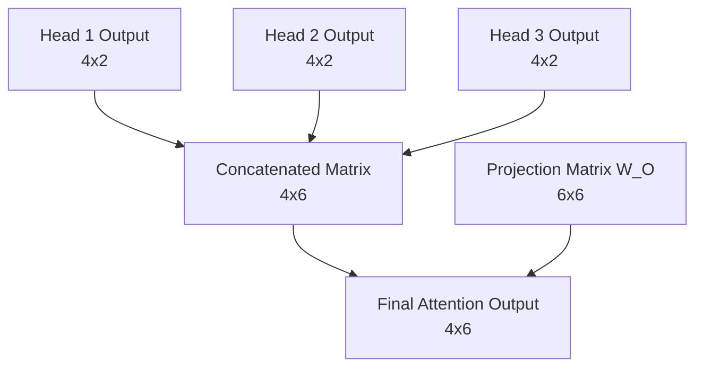

# Part 7: The Projection Matrix and The Cross-Head Mixer

<!-- SUMMARY: The isolated outputs of multiple attention heads are concatenated into a unified matrix to preserve structural integrity without destructive interference. These discrete features are synthesized into higher-order contextual representations by projecting them through a learned cross-head mixing matrix, preparing the vectors to rejoin the residual stream. -->

<em>Prefer to read this offline? <a href="../assets/docs/transformers-ebook-v1.0.pdf" target="_blank" rel="noopener">Download the complete, formatting-optimized Transformer Ebook here.</a></em>

The computations detailed in Parts 5 and 6 resolve the core attention mechanism, yielding isolated outputs from the parallel attention heads of the network. These discrete features must now combine into a unified structure before projecting the contextual representations forward.

## The Concatenation Step

The previous phase completed the journey of a single attention head. The mechanism calculated its masked attention scores, converted those scores into strict probability distributions via the Softmax function, and finally computed a weighted sum over the Value matrix $V$.

That process yields a contextually enriched vector for each token in the sequence. These vectors only possess a dimension of $d_v = 2$, whereas the overall model dimension is $d_{model} = 6$. The architecture deliberately splits into three parallel attention heads so the network can simultaneously look for different types of semantic relationships. Head 1 might attend to subject-verb pairings, while Head 2 looks for temporal markers, and Head 3 focuses on pronoun antecedents.

The system now faces a structural challenge. Three isolated sets of findings exist. The model must unify these independent representations back into a single cohesive vector for each token that matches the overarching $d_{model} = 6$ dimension.

The most direct way to combine the outputs of the three heads might appear to be element-wise addition. Summing the three $4 \times 2$ matrices destroys the distinct subspace features extracted by each head. A strong positive activation in Head 1 paired with a strong negative activation in Head 2 cancels out under addition, erasing the directional evidence gathered by both heads.

Instead of summing, the architecture concatenates the outputs along the feature dimension. Placing the three $4 \times 2$ matrices side by side preserves every subspace coordinate. The resulting matrix has a sequence length of 4 and a combined feature dimension of $3 \times 2 = 6$.

The numerical outputs of the three heads illustrate this concatenation step. The Head 1 matrix calculated in Part 6 sits alongside the corresponding outputs from Head 2 and Head 3:

$$
\text{Head 1} = \begin{bmatrix}
 0.83 &  0.69 \\
 1.03 &  0.70 \\
 0.70 &  0.42 \\
 0.46 &  0.32
\end{bmatrix}
$$

$$
\text{Head 2} = \begin{bmatrix}
-0.50 &  0.10 \\
-0.40 &  0.30 \\
-0.20 &  0.25 \\
 0.10 & -0.15
\end{bmatrix}
$$

$$
\text{Head 3} = \begin{bmatrix}
 0.20 & -0.30 \\
 0.15 & -0.20 \\
 0.40 &  0.05 \\
 0.25 &  0.10
\end{bmatrix}
$$

Concatenating these three matrices horizontally achieves the target width of 6:

$$
\text{Concatenated} = \begin{bmatrix}
 0.83 &  0.69 & -0.50 &  0.10 &  0.20 & -0.30 \\
 1.03 &  0.70 & -0.40 &  0.30 &  0.15 & -0.20 \\
 0.70 &  0.42 & -0.20 &  0.25 &  0.40 &  0.05 \\
 0.46 &  0.32 &  0.10 & -0.15 &  0.25 &  0.10
\end{bmatrix}
$$

## The Projection Matrix

Concatenation restores the required $4 \times 6$ matrix dimensions, yet a geometric isolation problem remains. The features stay partitioned by head: columns 1 and 2 belong exclusively to Head 1, columns 3 and 4 to Head 2, and columns 5 and 6 to Head 3. The extracted features occupy the same matrix without interacting.

Synthesizing discrete subspace features into higher-order concepts requires cross-head interaction. The architecture achieves this synthesis through the final learned parameter of the attention block: the output projection matrix $W_O$.

| Tensor | Symbol | Shape | Architectural Role |
| :--- | :--- | :--- | :--- |
| **Head 1 Output** | `Head 1` | `4 x 2` | Captures subspace 1 contextual payload (`Columns 1-2`) |
| **Head 2 Output** | `Head 2` | `4 x 2` | Captures subspace 2 contextual payload (`Columns 3-4`) |
| **Head 3 Output** | `Head 3` | `4 x 2` | Captures subspace 3 contextual payload (`Columns 5-6`) |
| **Concatenated Heads** | `Concatenated` | `4 x 6` | Aligns all three `4 x 2` head outputs side by side |
| **Output Projection** | `W_O` | `6 x 6` | Mixes features across all heads via learned linear weights |
| **Attention Block Output** | `Output` | `4 x 6` | Produces unified contextual update for the residual stream |

The matrix $W_O$ has dimensions of $d_{model} \times d_{model}$, which in this configuration is $6 \times 6$. It acts as a cross-head mixer. Multiplying the concatenated matrix by $W_O$ produces a resulting matrix that is a linear combination of all features across all heads. The network can learn that a high value in column 1 from Head 1 combined with a low value in column 5 from Head 3 encodes a composite syntactic signal that should pass forward to the rest of the architecture.

The initialized projection matrix $W_O$ for the toy model takes the following form:

$$
W_O = \begin{bmatrix}
 0.10 &  0.20 & -0.10 &  0.30 &  0.00 & -0.20 \\
-0.20 &  0.10 &  0.40 &  0.10 &  0.20 &  0.00 \\
 0.30 & -0.10 &  0.10 & -0.20 &  0.50 &  0.10 \\
-0.10 &  0.40 & -0.30 &  0.10 & -0.10 &  0.30 \\
 0.20 &  0.00 &  0.20 & -0.10 &  0.30 & -0.10 \\
-0.30 &  0.10 & -0.10 &  0.20 & -0.20 &  0.40
\end{bmatrix}
$$

Multiplying the concatenated outputs by $W_O$ applies the cross-head linear transformation:

$$
\text{Output} = \text{Concatenated} \cdot W_O
$$

$$
\text{Output} = \begin{bmatrix}
-0.08 &  0.29 &  0.18 &  0.35 &  0.00 & -0.33 \\
-0.10 &  0.42 &  0.10 &  0.43 & -0.01 & -0.25 \\
-0.03 &  0.31 &  0.08 &  0.29 &  0.07 & -0.10 \\
 0.05 &  0.06 &  0.18 &  0.13 &  0.18 & -0.11
\end{bmatrix}
$$

## Rejoining the Stream

This calculation completes the Multi-Head Self-Attention block. The process began with token embeddings representing the sequence `<BOS>` `i` `woke` `up`. The architecture projected those representations into three subspaces, gathered causal context across the sequence, and fused the resulting head outputs into a unified $4 \times 6$ matrix.

Every row vector in this output matrix now encodes contextualized information drawn from its preceding tokens. These updates are ready to merge back into the main residual stream of the Transformer.

<em>Prefer to read this offline? <a href="../assets/docs/transformers-ebook-v1.0.pdf" target="_blank" rel="noopener">Download the complete, formatting-optimized Transformer Ebook here.</a></em>

