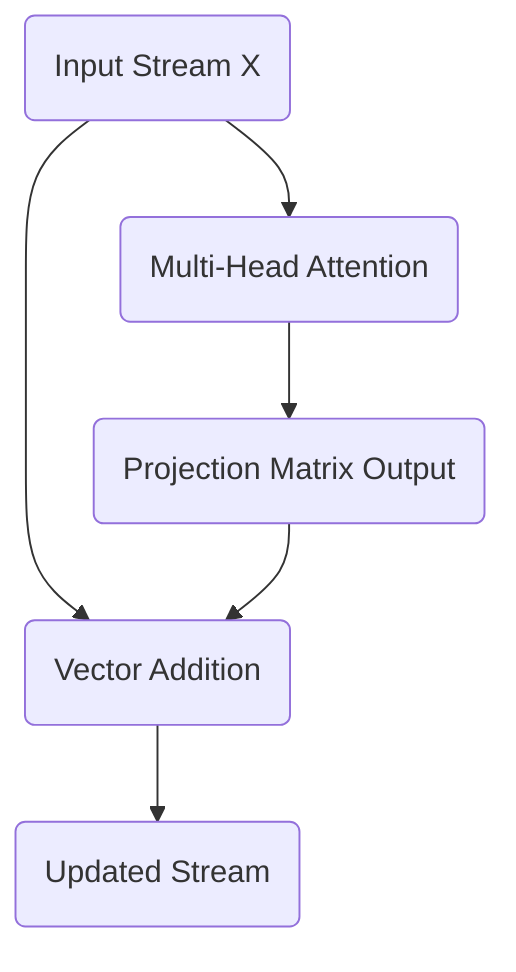

# Part 8: The Residual Stream and the Central Memory Bus

<!-- SUMMARY: The central memory bus of the architecture processes contextual updates from the attention blocks via element-wise addition to the residual stream. Geometrically, this operation acts as a vector translation in high-dimensional space, shifting token representations to incorporate context while preserving their foundational identities. -->

<em>Prefer to read this offline? <a href="../assets/docs/transformers-ebook-v1.0.pdf" target="_blank" rel="noopener">Download the complete, formatting-optimized Transformer Ebook here.</a></em>

The multi-head attention output has been calculated. Treating this output as the sole input to the next layer is a common instinct in traditional feed-forward networks. The Transformer architecture abandons this sequential pipeline. It instead relies on a central shared memory backbone known as the residual stream.

## Reframing the Architecture: The Information Highway

In a traditional sequential neural network, each layer overwrites the representation completely because the input to layer two is exclusively the output of layer one. This sequential overwrite creates an information bottleneck: any feature destroyed during an intermediate transformation is lost permanently. Backpropagation through a strictly sequential chain also forces gradients to multiply through the weight matrix of every layer. Small singular values across those weight matrices cause the backpropagated gradients to vanish exponentially, halting weight updates in early layers.

The Transformer solves both problems by treating the network as a continuous highway of information rather than a sequence of overwrites. The positionally encoded input embeddings travel straight through the entire network, from the first block to the final output. The attention mechanisms and feed-forward networks sit alongside this highway. They read from the stream, perform their specialized computations, and write their results back into the stream via addition.

The token vectors do not lose their original identity. The attention block acts as an additive update, mixing contextual information into the base meaning of the token.

## The Mathematics of the Residual Connection

This additive update is formalized with a direct equation:

$$
X_{\text{out}} = X_{\text{in}} + \text{Attention}(X_{\text{in}})
$$

Here, $X_{\text{in}}$ is the state of the residual stream entering the attention block, and $\text{Attention}(X_{\text{in}})$ is the $4 \times 6$ output calculated in Part 7 using the output projection matrix $W_O$.

To match the two-decimal precision of $\text{Attention}(X_{\text{in}})$, the residual stream matrix $X_{\text{in}}$ retains the two-decimal sinusoidal evaluation of $X + W_{PE}$ from Part 2:

$$
X_{\text{in}} = \begin{bmatrix}
 0.10 &  1.00 &  0.00 &  1.00 &  0.00 &  1.00 \\
 0.84 &  1.34 &  0.35 &  1.09 &  0.21 &  1.48 \\
 0.91 & -0.62 &  1.70 &  0.70 &  0.02 &  1.01 \\
 0.14 & -1.09 &  1.38 &  1.08 &  0.40 &  0.80
\end{bmatrix}
$$

The output from the multi-head attention block $\text{Attention}(X_{\text{in}})$ is:

$$
\text{Attention}(X_{\text{in}}) = \begin{bmatrix}
-0.08 &  0.29 &  0.18 &  0.35 &  0.00 & -0.33 \\
-0.10 &  0.42 &  0.10 &  0.43 & -0.01 & -0.25 \\
-0.03 &  0.31 &  0.08 &  0.29 &  0.07 & -0.10 \\
 0.05 &  0.06 &  0.18 &  0.13 &  0.18 & -0.11
\end{bmatrix}
$$

These two matrices are added together element by element, writing the newly discovered contextual relationships directly into the original vector representations:

$$
X_{\text{out}} = \begin{bmatrix}
 0.02 &  1.29 &  0.18 &  1.35 &  0.00 &  0.67 \\
 0.74 &  1.76 &  0.45 &  1.52 &  0.20 &  1.23 \\
 0.88 & -0.31 &  1.78 &  0.99 &  0.09 &  0.91 \\
 0.19 & -1.03 &  1.56 &  1.21 &  0.58 &  0.69
\end{bmatrix}
$$

## The Geometric Implications of Addition

Adding the attention output to the original embedding performs vector translation. The attention block calculates a directional shift based on the surrounding context. Adding this shift vector to the original token vector moves the token to a new location in the $d_{model}$-dimensional space.

The vector for the token `woke` originally represented the static embedding of waking at position `2`. Adding the attention output translates that vector along a direction that incorporates its syntactic relationship with `i` and `up`. The foundational token identity remains intact, and the shifted coordinate reflects its contextual role in the sequence.

## Gradient Flow and the Residual Highway

Deep neural networks learn by calculating the gradient of the loss function and propagating that error signal backward through the layers. In a strictly sequential architecture, the gradient multiplies by the derivative of each layer. A sub-layer operation frequently yields a derivative matrix containing small values. An idealized sub-layer Jacobian matrix containing diagonal values of `0.10` illustrates this decay:

$$
\text{Jacobian} = \begin{bmatrix}
 0.10 &  0.00 &  0.00 &  0.00 &  0.00 &  0.00 \\
 0.00 &  0.10 &  0.00 &  0.00 &  0.00 &  0.00 \\
 0.00 &  0.00 &  0.10 &  0.00 &  0.00 &  0.00 \\
 0.00 &  0.00 &  0.00 &  0.10 &  0.00 &  0.00 \\
 0.00 &  0.00 &  0.00 &  0.00 &  0.10 &  0.00 \\
 0.00 &  0.00 &  0.00 &  0.00 &  0.00 &  0.10
\end{bmatrix}
$$

Backpropagating an error signal through four consecutive layers of this type requires multiplying the Jacobian matrix by itself four times ($0.10^4 = 0.0001 \approx 0.00$). This exponentiation causes the gradient to decay exponentially. The resulting matrix demonstrates signal loss at two-decimal precision, leaving the earliest layers unable to update their parameters:

$$
\text{Sequential Gradient Multiplier} = \begin{bmatrix}
 0.00 &  0.00 &  0.00 &  0.00 &  0.00 &  0.00 \\
 0.00 &  0.00 &  0.00 &  0.00 &  0.00 &  0.00 \\
 0.00 &  0.00 &  0.00 &  0.00 &  0.00 &  0.00 \\
 0.00 &  0.00 &  0.00 &  0.00 &  0.00 &  0.00 \\
 0.00 &  0.00 &  0.00 &  0.00 &  0.00 &  0.00 \\
 0.00 &  0.00 &  0.00 &  0.00 &  0.00 &  0.00
\end{bmatrix}
$$

The residual addition neutralizes this vanishing gradient problem. Differentiating an addition operation distributes the upstream gradient equally to both branches. Differentiating the residual equation $X_{\text{out}} = X_{\text{in}} + \text{Attention}(X_{\text{in}})$ with respect to $X_{\text{in}}$ assigns an identity derivative $I$ to the skip path. This additive identity term shifts the single-layer gradient multiplier from the sub-layer Jacobian alone to the sum of the identity matrix and the Jacobian:

$$
\text{Residual Multiplier} = I + \text{Jacobian}
$$

Backpropagating through four layers utilizing residual connections multiplies this updated term by itself four times ($1.10^4 = 1.4641 \approx 1.46$). The addition of the Identity matrix ensures the gradient survives the backward pass:

$$
\text{Residual Gradient Multiplier} = \begin{bmatrix}
 1.46 &  0.00 &  0.00 &  0.00 &  0.00 &  0.00 \\
 0.00 &  1.46 &  0.00 &  0.00 &  0.00 &  0.00 \\
 0.00 &  0.00 &  1.46 &  0.00 &  0.00 &  0.00 \\
 0.00 &  0.00 &  0.00 &  1.46 &  0.00 &  0.00 \\
 0.00 &  0.00 &  0.00 &  0.00 &  1.46 &  0.00 \\
 0.00 &  0.00 &  0.00 &  0.00 &  0.00 &  1.46
\end{bmatrix}
$$

The error signal reaches the initial embedding matrices intact. The residual stream functions as an unimpeded gradient highway: contextual information accumulates forward across layers, and loss gradients propagate backward to update early parameters.

This central memory bus ensures that every subsequent layer has direct access to both the initial embeddings and the accumulated contextual updates from all previous layers. Stabilizing these shifted vectors requires layer normalization, which is examined next.

<em>Prefer to read this offline? <a href="../assets/docs/transformers-ebook-v1.0.pdf" target="_blank" rel="noopener">Download the complete, formatting-optimized Transformer Ebook here.</a></em>

