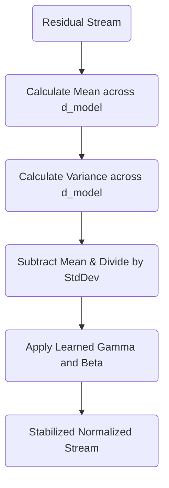

# Part 9: Taming the Stream: The Geometry of Layer Normalization

<!-- SUMMARY: Geometric drift and magnitude expansion caused by continuous additive updates are counteracted through layer normalization. Centering and scaling each token vector independently across its embedding dimension stabilizes the residual stream while preserving directional context. -->

<em>Prefer to read this offline? <a href="../assets/docs/transformers-ebook-v1.0.pdf" target="_blank" rel="noopener">Download the complete, formatting-optimized Transformer Ebook here.</a></em>

The previous section detailed the Residual Stream. The Attention block operates as an independent module that reads from the central memory bus, calculates contextual updates, and adds those updates directly back into the original embeddings. This additive process ensures that the network never loses the raw initial information about the token and its position. 

Continuous vector addition introduces a geometric side effect. Repeated updates from attention and feed-forward blocks cause token vector magnitudes to grow across layers, shifting component distributions away from zero. Unbounded or skewed activations saturate downstream linear projections and nonlinearities, triggering numerical instability and exploding or vanishing gradients during backpropagation.

Layer Normalization counteracts this activation drift by standardizing each token vector before the next sub-layer transformation.

## The Geometry of Normalization

The token embeddings function as points in a six-dimensional space, where $d_{model} = 6$. Before the addition of the Attention output, these points were bounded by the properties of the initial embedding and positional encoding. Adding the attention output shifts these points away from their initial centered distribution.

The current state of the Residual Stream for the sequence `<BOS>` `i` `woke` `up` is:

$$
\text{Residual Stream} = \begin{bmatrix}
 0.02 &  1.29 &  0.18 &  1.35 &  0.00 &  0.67 \\
 0.74 &  1.76 &  0.45 &  1.52 &  0.20 &  1.23 \\
 0.88 & -0.31 &  1.78 &  0.99 &  0.09 &  0.91 \\
 0.19 & -1.03 &  1.56 &  1.21 &  0.58 &  0.69
\end{bmatrix}
$$

Layer Normalization stabilizes these representations by executing two operations independently on each token vector: subtracting the row mean to center the distribution at zero, and dividing by the row standard deviation to normalize the spread to unit variance.

Layer Normalization operates across the embedding dimension $d_{model}$ for each individual token rather than across the sequence length. Normalizing the vector for `i` is statistically independent of normalizing the vector for `woke`. Per-token normalization preserves strict causal independence across sequence positions between attention layers.

| Position | Token | Row Sum | Mean (`μ`) | Variance (`σ²`) | Std Dev (`σ`) |
| :--- | :--- | :--- | :--- | :--- | :--- |
| **Row 1** | `<BOS>` | `3.51` | `0.58` (`0.585`) | `0.32` | `0.57` |
| **Row 2** | `i` | `5.90` | `0.98` | `0.32` | `0.56` |
| **Row 3** | `woke` | `4.34` | `0.72` | `0.45` | `0.67` |
| **Row 4** | `up` | `3.20` | `0.53` | `0.68` | `0.83` |

### Step 1: Centering the Vector

For a token vector $x \in \mathbb{R}^{d_{\text{model}}}$, the mean $\mu$ is the arithmetic average across its $d_{\text{model}} = 6$ components.

The mean for each of the four tokens is:

$$
\text{Means} = \begin{bmatrix}
 0.58 \\
 0.98 \\
 0.72 \\
 0.53
\end{bmatrix}
$$

Subtracting this mean from every element in the corresponding token vector shifts the vector through six-dimensional space so that its components are centered around zero. The relative spacing between the components of the vector remains intact while anchoring the vector to the origin of the coordinate system.

### Step 2: Scaling the Vector

Centering resolves the mean drift, yet the dispersion of the vector components may still be too wide or too narrow. Standardizing the scale requires computing the population variance $\sigma^2$ of each vector across its $d_{model}$ components.

The variances for the tokens are as follows:

$$
\text{Variances} = \begin{bmatrix}
 0.32 \\
 0.32 \\
 0.45 \\
 0.68
\end{bmatrix}
$$

The vector is scaled by dividing each centered component by the standard deviation $\sqrt{\sigma^2 + \epsilon}$, where a small constant $\epsilon$ prevents division by zero:

$$
\hat{x} = \frac{x - \mu}{\sqrt{\sigma^2 + \epsilon}}
$$

Evaluating this formula at full precision for each row of the Residual Stream and rounding to two decimal places yields the standardized matrix:

$$
\text{Normalized Stream} = \begin{bmatrix}
-1.00 &  1.25 & -0.72 &  1.35 & -1.04 &  0.15 \\
-0.43 &  1.38 & -0.95 &  0.95 & -1.39 &  0.44 \\
 0.23 & -1.54 &  1.57 &  0.40 & -0.94 &  0.28 \\
-0.42 & -1.89 &  1.24 &  0.82 &  0.06 &  0.19
\end{bmatrix}
$$

Every token row in this standardized matrix now has a mean of $0$ and a variance of $1$.

### Step 3: Learned Scale and Bias

Standardizing the vectors to zero mean and unit variance guarantees numerical stability. Restricting every token vector to unit variance can discard useful representation capacity that the network encodes in the scale or offset of specific features.

Layer Normalization restores this expressive capacity by introducing two learnable parameter vectors of length $d_{\text{model}}$: a scale parameter $\gamma$ and a bias parameter $\beta$:

$$
\text{Output} = \gamma \odot \hat{x} + \beta
$$

Backpropagation updates $\gamma$ and $\beta$ during training so the network can amplify or shift individual feature dimensions whenever strict standardization is suboptimal.

In this toy walkthrough, $\gamma$ is initialized to a vector of ones ($\mathbf{1}$) and $\beta$ to a vector of zeros ($\mathbf{0}$). This identity initialization leaves the `Normalized Stream` matrix unchanged as the direct input $X_{\text{norm}}$ to the Multi-Layer Perceptron.

## The Stabilized Backbone

With Layer Normalization complete, the token representations are numerically bounded and ready to enter the next component of the Transformer architecture.

The vectors have been stabilized while retaining the contextual updates harvested by the Attention mechanism. These standardized vectors next enter the Feed-Forward Network, which functions as a conceptual Key-Value memory bank for each individual token.

<em>Prefer to read this offline? <a href="../assets/docs/transformers-ebook-v1.0.pdf" target="_blank" rel="noopener">Download the complete, formatting-optimized Transformer Ebook here.</a></em>

