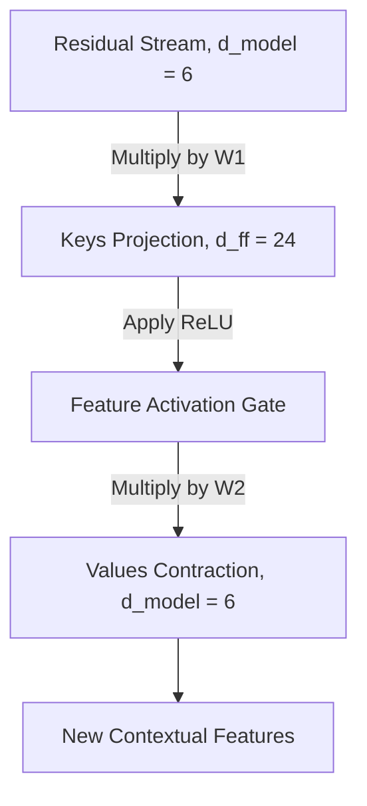

# Part 11: Layer Normalization and The Multi-Layer Perceptron

<!-- SUMMARY: The multi-layer perceptron executes non-linear gating and geometric contraction phases. The ReLU activation function sparsifies the high-dimensional space by isolating positive pattern matches, which are subsequently contracted through a value matrix to synthesize a refined vector of contextual updates. -->

<em>Prefer to read this offline? <a href="../assets/docs/transformers-ebook-v1.0.pdf" target="_blank" rel="noopener">Download the complete, formatting-optimized Transformer Ebook here.</a></em>

The calculations established in Parts 9 and 10 center and scale the residual stream while mapping the token representations into a 24-dimensional key space. This geometric expansion isolates conceptual patterns, preparing the network to filter and extract the matched semantic features.

## The Multi-Layer Perceptron: Activation and Contraction

Part 10 framed the first half of the Multi-Layer Perceptron as a Key-Value memory bank. Projecting the $d_{model} = 6$ residual stream into the $d_{ff} = 24$ intermediate space using $W_1$ and $b_1$ evaluated each token against 24 learned Key vectors.

At this stage, token vectors reside in the expanded 24-dimensional space. Two operations complete the MLP block:

1. **Non-Linear Gating:** Apply an element-wise activation threshold to retain positive Key matches and zero out negative non-matches.
2. **Value Contraction:** Multiply the sparse 24-dimensional activations by the Value matrix $W_2$ ($24 \times 6$) and add bias $b_2$ to return a 6-dimensional update vector for the residual stream.

### The Non-Linear Gate: ReLU

Linear transformations alone cannot implement selective memory retrieval. Chaining the $W_1$ projection directly into a second matrix $W_2$ without an intermediate non-linearity collapses the two matrices into a single linear transformation $W_{\text{eff}} = W_1 W_2$ of rank at most $6$, negating the 24-dimensional expansion. Selective feature activation requires a non-linear gate.

The toy model uses the Rectified Linear Unit (ReLU):

$$
\text{ReLU}(x) = \max(0, x)
$$

The ReLU function operates as a piecewise-linear gate: negative pre-activation scores indicate absent Key patterns and are clamped to $0$, whereas positive scores pass through unchanged with unit slope.

The biased pre-activation tensor $X_{\text{proj\_biased}}$ from Part 10 holds the raw Key alignment scores for `<BOS>`, `i`, `woke`, and `up` across all 24 dimensions:

$$
X_{\text{proj\_biased}} = \begin{bmatrix}
 0.58 & -0.26 & -1.09 & -0.90 &  0.56 & -1.16 &  1.03 &  0.71 & -2.25 & \dots & -0.04 \\
 1.01 & -1.28 & -0.81 & -1.00 &  1.50 & -2.11 &  2.30 & -0.21 & -2.75 & \dots &  1.88 \\
-2.27 & -0.07 & -2.28 &  0.29 & -2.16 &  2.81 & -0.78 &  1.72 &  3.20 & \dots &  1.24 \\
-0.69 & -0.71 & -0.74 & -0.60 &  0.03 &  2.34 & -0.56 &  0.74 &  2.29 & \dots &  1.68
\end{bmatrix}
$$

Applying the ReLU function element-wise across the tensor yields the sparse activated state $X_{act}$:

$$
X_{act} = \max(0, X_{\text{proj\_biased}}) = \begin{bmatrix}
 0.58 & 0.00 & 0.00 & 0.00 & 0.56 & 0.00 & 1.03 & 0.71 & 0.00 & \dots & 0.00 \\
 1.01 & 0.00 & 0.00 & 0.00 & 1.50 & 0.00 & 2.30 & 0.00 & 0.00 & \dots & 1.88 \\
 0.00 & 0.00 & 0.00 & 0.29 & 0.00 & 2.81 & 0.00 & 1.72 & 3.20 & \dots & 1.24 \\
 0.00 & 0.00 & 0.00 & 0.00 & 0.03 & 2.34 & 0.00 & 0.74 & 2.29 & \dots & 1.68
\end{bmatrix}
$$

This operation sparsifies the representation. All negative scores are zeroed out, silencing memory slots that did not match. The remaining positive entries represent specific contextual features recognized by the $W_1$ Keys.

### The Value Matrix: Contracting Back to the Stream

Translating these sparse activations back into the $d_{model} = 6$ residual stream requires the second linear projection matrix $W_2$ and its bias vector $b_2$.

Within the Key-Value memory framework, the columns of $W_1$ act as the Keys and the rows of $W_2$ act as the corresponding Values.

The matrix $W_2$ has dimensions $d_{ff} \times d_{model} = 24 \times 6$, forming a table of 24 six-dimensional Value vectors. Each positive activation scalar in $X_{act}$ scales its corresponding row in $W_2$, and summing those weighted rows produces a 6-dimensional update vector for each token.

The following tensors show the first three rows and final row of the $24 \times 6$ matrix $W_2$ alongside the bias vector $b_2$ (the complete 24-row $W_2$ matrix is printed in Part 13):

$$
W_2 = \begin{bmatrix}
 0.75 &  0.19 &  0.34 &  0.44 & -0.42 & -0.78 \\
-0.56 &  0.17 &  0.53 &  0.06 & -0.68 &  0.70 \\
-0.80 & -0.24 & -0.28 &  0.13 &  0.55 & -0.75 \\
\vdots & \vdots & \vdots & \vdots & \vdots & \vdots \\
-0.02 &  0.27 & -0.68 & -0.35 &  0.05 &  0.14
\end{bmatrix}
$$

$$
b_2 = \begin{bmatrix}
 -0.06 &  0.12 & -0.15 & -0.08 &  0.04 &  0.09
\end{bmatrix}
$$

Multiplying the activated memory state $X_{act}$ by the Value matrix $W_2$ and adding the bias $b_2$ contracts the representations back down to the $d_{model} = 6$ dimension:

$$
X_{contracted} = X_{act} W_2 + b_2
$$

Evaluating the full 24-dimensional matrix multiplication yields the Multi-Layer Perceptron output tensor:

$$
X_{contracted} = \begin{bmatrix}
-4.07 &  0.04 & -0.06 & -1.74 & -1.17 & -0.77 \\
-6.51 &  0.18 & -0.33 & -3.85 & -0.84 & -1.43 \\
 0.82 & -3.22 &  0.39 & -2.11 &  3.22 &  6.02 \\
 1.18 & -2.83 & -0.72 & -1.89 &  1.58 &  4.39
\end{bmatrix}
$$

This $4 \times 6$ matrix holds the contracted feature updates for all four sequence positions. Row 3, corresponding to the token `woke`, now stores the weighted combination of Value vectors triggered by its active Key matches.

### The Big Picture of the Multi-Layer Perceptron

The complete Key-Value workflow operates as a three-stage expansion, gating, and contraction pipeline:

The Multi-Layer Perceptron reads from the normalized residual stream, expands the representation to probe 24 high-dimensional Keys, filters those matches through a non-linear gate, and contracts the surviving Values back into a 6-dimensional update vector.

The next step writes this update matrix back into the central residual highway and normalizes the result, completing Layer 1.

<em>Prefer to read this offline? <a href="../assets/docs/transformers-ebook-v1.0.pdf" target="_blank" rel="noopener">Download the complete, formatting-optimized Transformer Ebook here.</a></em>

