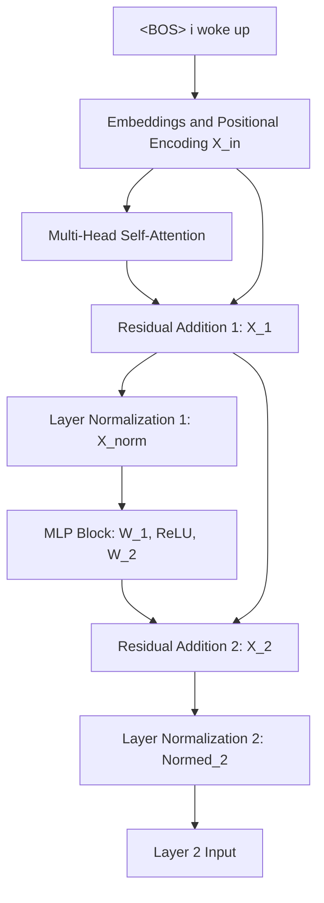

# Part 12: The MLP as a Key-Value Memory and Layer 1 Completion

<!-- SUMMARY: The feed-forward network acts as a conceptual memory bank for the Transformer. Projecting the residual stream into a higher-dimensional space allows the first linear layer to function as a set of pattern-matching keys that probe each token vector for contextual features learned during training. Layer 1 then concludes by adding the synthesized MLP updates back into the residual stream and applying layer normalization to stabilize the vectors for Layer 2. -->

<em>Prefer to read this offline? <a href="../assets/docs/transformers-ebook-v1.0.pdf" target="_blank" rel="noopener">Download the complete, formatting-optimized Transformer Ebook here.</a></em>

## Complete Key-Value Memory Synthesis

Self-attention enables tokens to gather context across the sequence and shift their geometric positions based on surrounding words. Layer Normalization then standardizes those context-enriched vectors before they enter the Multi-Layer Perceptron (MLP). Viewed through mechanistic interpretability, the two linear layers of the MLP form a complete Key-Value memory bank: the expansion matrix $W_1$ ($6 \times 24$) stores 24 six-dimensional Key columns, the ReLU gate filters out negative alignments, and the contraction matrix $W_2$ ($24 \times 6$) writes the matched Value rows back into the $d_{model} = 6$ subspace.

Inspecting the 10-column view of the calibrated $W_1$ matrix alongside the resulting pre-activation state $X_{\text{proj\_biased}}$ consolidates the forward trace of the memory lookup stage before the output merges back into the residual stream:

$$
W_1 = \begin{bmatrix}
 0.33 & -0.71 &  0.20 &  0.15 &  0.71 & -0.90 &  0.55 & -0.72 & -0.44 & \dots &  1.34 \\
-0.51 &  1.01 & -0.44 &  0.44 & -1.17 &  0.04 & -0.53 &  0.52 & -0.34 & \dots & -1.68 \\
-1.89 &  1.56 & -1.29 &  0.83 & -2.77 &  2.09 & -1.75 &  1.56 &  1.94 & \dots & -2.10 \\
 0.67 & -0.70 & -0.02 & -0.55 &  1.07 & -0.56 &  0.27 & -0.11 & -0.79 & \dots &  0.85 \\
 0.86 & -0.17 &  1.20 & -0.25 &  1.14 & -0.19 & -0.09 & -0.87 & -0.43 & \dots &  0.06 \\
 1.55 & -2.53 &  1.14 & -1.22 &  3.02 & -0.86 &  2.47 & -1.93 & -0.83 & \dots &  4.32
\end{bmatrix}
$$

Multiplying the normalized sequence representation $X_{norm}$ for `<BOS>`, `i`, `woke`, and `up` by $W_1$ and adding the bias vector $b_1$ produces the 24 pre-activation potentials in $X_{\text{proj\_biased}}$:

$$
\text{Projected State } (X_{\text{proj\_biased}}) = \begin{bmatrix}
 0.58 & -0.26 & -1.09 & -0.90 &  0.56 & -1.16 &  1.03 &  0.71 & -2.25 & \dots & -0.04 \\
 1.01 & -1.28 & -0.81 & -1.00 &  1.50 & -2.11 &  2.30 & -0.21 & -2.75 & \dots &  1.88 \\
-2.27 & -0.07 & -2.28 &  0.29 & -2.16 &  2.81 & -0.78 &  1.72 &  3.20 & \dots &  1.24 \\
-0.69 & -0.71 & -0.74 & -0.60 &  0.03 &  2.34 & -0.56 &  0.74 &  2.29 & \dots &  1.68
\end{bmatrix}
$$

Positive entries in this matrix mark strong directional matches between a token and the corresponding Key column, whereas negative entries mark absent features that the ReLU activation clamps to zero. Projecting the surviving positive activations through the Value matrix $W_2$ and adding $b_2$ (as computed in Part 11) yields the $4 \times 6$ update matrix $MLP_{output}$.

## The Information Accumulator

The Transformer does not pass data sequentially through destructive filters that overwrite prior representations. It maintains a persistent residual vector for each token, and each sub-layer reads from this vector and adds its computed update back into the stream.

The output of the MLP is an additive update rather than a replacement for the representation of the token. The architecture adds the MLP output matrix directly to the Residual Stream state $X_1$ that exited the first attention residual connection in Part 8.

The residual stream entering this addition is $X_1$, which holds the positionally encoded embeddings enriched with the Layer 1 self-attention updates:

$$
X_1 = \begin{bmatrix}
 0.02 &  1.29 &  0.18 &  1.35 &  0.00 &  0.67 \\
 0.74 &  1.76 &  0.45 &  1.52 &  0.20 &  1.23 \\
 0.88 & -0.31 &  1.78 &  0.99 &  0.09 &  0.91 \\
 0.19 & -1.03 &  1.56 &  1.21 &  0.58 &  0.69
\end{bmatrix}
$$

The MLP contracted output matrix from Part 11 provides the feature updates discovered within the local context of each token:

$$
MLP_{output} = \begin{bmatrix}
-4.07 &  0.04 & -0.06 & -1.74 & -1.17 & -0.77 \\
-6.51 &  0.18 & -0.33 & -3.85 & -0.84 & -1.43 \\
 0.82 & -3.22 &  0.39 & -2.11 &  3.22 &  6.02 \\
 1.18 & -2.83 & -0.72 & -1.89 &  1.58 &  4.39
\end{bmatrix}
$$

Adding $X_1$ and $MLP_{output}$ element by element produces the updated Residual Stream $X_2$:

$$
X_2 = X_1 + MLP_{output} = \begin{bmatrix}
-4.05 &  1.33 &  0.12 & -0.39 & -1.17 & -0.10 \\
-5.77 &  1.94 &  0.12 & -2.33 & -0.64 & -0.20 \\
 1.70 & -3.53 &  2.17 & -1.12 &  3.31 &  6.93 \\
 1.37 & -3.86 &  0.84 & -0.68 &  2.16 &  5.08
\end{bmatrix}
$$

The magnitudes in the bottom two rows, representing the tokens `woke` and `up`, have grown substantially. The MLP has injected a strong semantic update into these token representations based on their local context.

## Preparing for Layer 2 Normalization

Accumulating updates through vector addition increases activation magnitudes across sub-layers. Passing unnormalized vectors with variances as large as $10.89$ directly into Layer 2 would inflate the Query-Key dot products in the next attention block, triggering the Softmax saturation problem analyzed in Part 4.

Applying a second Layer Normalization operation before Layer 2 restores zero mean and unit variance across the $d_{model} = 6$ dimension for each token independently:

$$
\text{Means} = \begin{bmatrix} -0.71 \\ -1.15 \\  1.57 \\  0.82 \end{bmatrix} \quad \text{Variances} = \begin{bmatrix} 2.78 \\  5.85 \\ 10.89 \\  7.40 \end{bmatrix}
$$

Subtracting the row mean and dividing by the row standard deviation recenters each token vector at zero and scales its spread to unit variance:

$$
Normed_2 = \begin{bmatrix}
-2.00 &  1.22 &  0.50 &  0.19 & -0.28 &  0.37 \\
-1.91 &  1.28 &  0.52 & -0.49 &  0.21 &  0.39 \\
 0.04 & -1.55 &  0.18 & -0.82 &  0.52 &  1.62 \\
 0.20 & -1.72 &  0.01 & -0.55 &  0.49 &  1.57
\end{bmatrix}
$$

The directional relationships encoded across the six coordinates are preserved, while the overall vector magnitudes return to a well-conditioned numerical range.

## Visualizing the Complete Layer 1 Architecture

The sequence of operations in the first layer of the Transformer is now complete. The full Layer 1 computation graph traces how tensors flow from the initial prompt to the normalized input of Layer 2:

The vectors exiting Layer 1 are no longer static dictionary lookups; they are contextualized geometric representations. The vector for the token `woke` now encodes relational features from the preceding pronoun `i` alongside local conceptual updates from the MLP. Passing this normalized $4 \times 6$ matrix into Layer 2 allows the next self-attention block to compute higher-order associations across multi-token phrases.

<em>Prefer to read this offline? <a href="../assets/docs/transformers-ebook-v1.0.pdf" target="_blank" rel="noopener">Download the complete, formatting-optimized Transformer Ebook here.</a></em>

