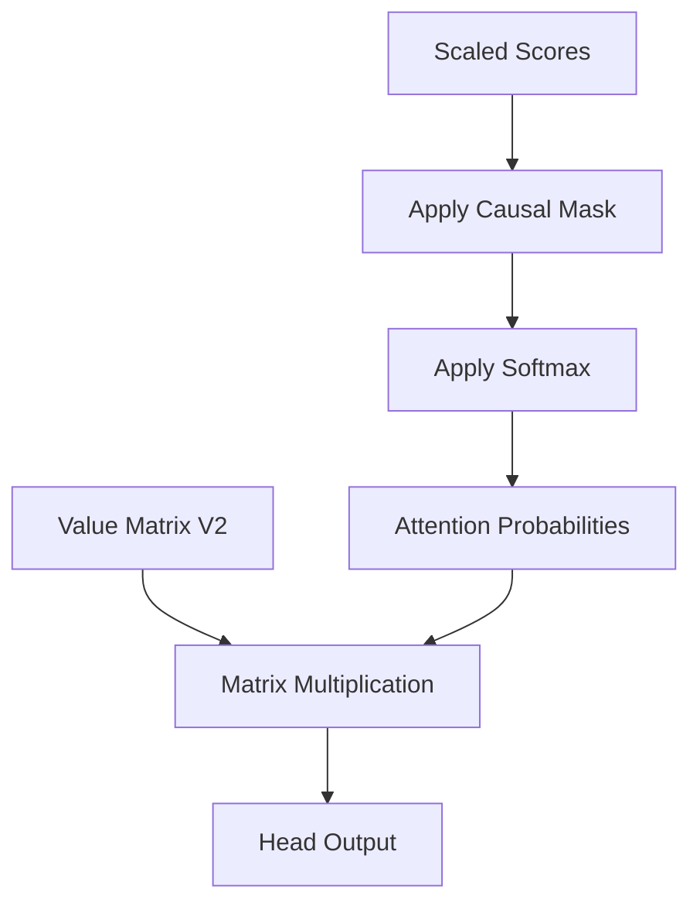

# Part 15: Layer 2 Self-Attention

<!-- SUMMARY: The progression into the second layer marks a shift as the self-attention mechanism now operates on contextualized representations rather than static embeddings. By projecting these enriched vectors into new query, key, and value spaces, the mechanism computes relationships between complex semantic clusters. Causality is enforced through lower-triangular masking and the scores are normalized into a strict probability distribution via the softmax function, with the resulting attention probabilities blended against the value matrix to extract refined contextual features. -->

<em>Prefer to read this offline? <a href="../assets/docs/transformers-ebook-v1.0.pdf" target="_blank" rel="noopener">Download the complete, formatting-optimized Transformer Ebook here.</a></em>

Advancing into the second layer of the Transformer architecture shifts how the network routes sequence information. Layer 1 operated on static token embeddings combined with sinusoidal positional encodings. The vectors entering Layer 2 are contextualized amalgamations of lexical identity, local syntax, and conceptual features extracted by the Layer 1 Multi-Layer Perceptron.

This evolution of the input representations supports hierarchical abstraction. Layer 1 self-attention resolved immediate lexical pairings across the prompt, whereas Layer 2 self-attention computes similarities between composite phrase structures. Rather than testing how an isolated verb relates to a pronoun, Layer 2 evaluates how a contextualized action cluster aligns with the sequence anchors.

## Subspace Tensors Entering the Masking Stage

To keep the complete Layer 2 Head 1 forward trace self-contained for causal masking and Value extraction, this section consolidates the normalized Layer 2 input $X_2$ and the three subspace projections ($Q_2, K_2, V_2$) derived in Part 13.

The normalized output from Layer 1 serves as the $4 \times 6$ input matrix for Layer 2:

$$
\text{Layer 2 Input } (X_2) = \begin{bmatrix}
-2.00 &  1.22 &  0.50 &  0.19 & -0.28 &  0.37 \\
-1.91 &  1.28 &  0.52 & -0.49 &  0.21 &  0.39 \\
 0.04 & -1.55 &  0.18 & -0.82 &  0.52 &  1.62 \\
 0.20 & -1.72 &  0.01 & -0.55 &  0.49 &  1.57
\end{bmatrix}
$$

The self-attention mechanics match Layer 1: three head-specific weight matrices project $X_2$ into 2-dimensional Query, Key, and Value subspaces.

The Query weight matrix $W_Q^{(2)}$ maps the enriched token vectors into a target-seeking subspace:

$$
\text{Layer 2 Head 1 Query Weights } (W_Q^{(2)}) = \begin{bmatrix}
 0.10 & -0.20 \\
-0.30 &  0.40 \\
 0.50 & -0.10 \\
-0.20 &  0.30 \\
 0.40 &  0.20 \\
-0.10 & -0.50
\end{bmatrix}
$$

Multiplying $X_2$ by $W_Q^{(2)}$ produces the $4 \times 2$ Query vectors for Head 1:

$$
\text{Query Vectors } (Q_2) = \begin{bmatrix}
-0.50 &  0.66 \\
-0.17 &  0.54 \\
 0.77 & -1.60 \\
 0.69 & -1.58
\end{bmatrix}
$$

The Key weight matrix $W_K^{(2)}$ projects $X_2$ into a complementary indexing subspace where each token broadcasts its composite syntactic role:

$$
\text{Layer 2 Head 1 Key Weights } (W_K^{(2)}) = \begin{bmatrix}
-0.20 &  0.30 \\
 0.40 & -0.10 \\
-0.30 &  0.50 \\
 0.10 & -0.40 \\
 0.20 &  0.20 \\
-0.50 &  0.10
\end{bmatrix}
$$

The resulting $4 \times 2$ Key vectors establish the indexing targets matched against $Q_2$ in Part 14:

$$
\text{Key Vectors } (K_2) = \begin{bmatrix}
 0.52 & -0.57 \\
 0.53 & -0.16 \\
-1.47 &  0.85 \\
-1.47 &  0.71
\end{bmatrix}
$$

The Value weight matrix $W_V^{(2)}$ isolates the contextual payload that will be blended once the attention probabilities are finalized:

$$
\text{Layer 2 Head 1 Value Weights } (W_V^{(2)}) = \begin{bmatrix}
 0.30 & -0.10 \\
-0.20 &  0.40 \\
 0.10 & -0.30 \\
-0.40 &  0.20 \\
 0.50 & -0.20 \\
-0.10 &  0.50
\end{bmatrix}
$$

Multiplying $X_2$ by $W_V^{(2)}$ generates the $4 \times 2$ Value vectors for Head 1:

$$
\text{Value Vectors } (V_2) = \begin{bmatrix}
-1.05 &  0.82 \\
-0.51 &  0.60 \\
 0.77 & -0.13 \\
 0.71 & -0.13
\end{bmatrix}
$$

In Part 14, taking the inner product $Q_2 K_2^T$ and dividing by $\sqrt{d_k} = \sqrt{2}$ produced the $4 \times 4$ scaled attention score matrix. The model now completes Layer 2 Head 1 attention by applying the causal mask, normalizing each row via Softmax, and multiplying by $V_2$.

## The Causal Mask

Autoregressive training predicts the next token at all sequence positions in parallel, requiring the attention graph to respect the arrow of time. Allowing a token position to attend to future tokens leaks target information backward and invalidates autoregressive training.

Applying a lower-triangular causal mask to the scaled attention scores prevents this look-ahead leakage by setting all entries above the main diagonal to negative infinity ($-\infty$). Exponentiating $-\infty$ during the subsequent Softmax step drives every masked future weight to zero ($e^{-\infty} = 0$).

The scaled attention scores computed in Part 14 are:

$$
\text{Scores} = \begin{bmatrix}
-0.45 & -0.27 & 0.92 & 0.86 \\
-0.28 & -0.13 & 0.50 & 0.45 \\
0.93 & 0.47 & -1.76 & -1.60 \\
0.89 & 0.44 & -1.66 & -1.51
\end{bmatrix}
$$

Applying the lower-triangular causal mask yields the causally constrained score matrix:

$$
\text{Masked} = \begin{bmatrix}
-0.45 & -\infty & -\infty & -\infty \\
-0.28 & -0.13 & -\infty & -\infty \\
0.93 & 0.47 & -1.76 & -\infty \\
0.89 & 0.44 & -1.66 & -1.51
\end{bmatrix}
$$

## Normalizing with Softmax

The unmasked entries in each row remain unbounded real numbers. Converting these unbounded real numbers into normalized attention weights requires mapping each row to a probability distribution that sums to $1.0$. The Softmax function exponentiates each score in a row and divides by the row sum of exponentiated scores.

This non-linear normalization amplifies higher alignment scores while suppressing negative scores. Applying Softmax row by row to the masked matrix produces the Layer 2 Head 1 Attention Probabilities:

$$
\text{Attention Probabilities} = \begin{bmatrix}
1.00 & 0.00 & 0.00 & 0.00 \\
0.46 & 0.54 & 0.00 & 0.00 \\
0.59 & 0.37 & 0.04 & 0.00 \\
0.55 & 0.35 & 0.04 & 0.05
\end{bmatrix}
$$

Inspecting these probability rows highlights two structural patterns (note that Row 4 sums to $0.99$ at two-decimal display precision, corresponding to $0.5536 + 0.3530 + 0.0432 + 0.0502 = 1.0000$ at four decimal places). In Row 1, the causal mask restricts `<BOS>` to attend $100\%$ to itself. In Row 4, the final token `up` concentrates its attention near the start of the sequence, allocating $55\%$ of its weight to `<BOS>` and $35\%$ to `i`. Deeper Transformer layers frequently route attention back toward initial boundary and subject tokens to anchor phrase-level representations.

## Extracting the Value

The attention probability matrix specifies how much weight each token assigns to preceding positions, and the Value matrix $V_2$ defines the feature vectors retrieved from those positions.

Multiplying the $4 \times 4$ Attention Probabilities matrix by the $4 \times 2$ Value matrix $V_2$ computes a convex combination of Value rows for each sequence position:

$$
\text{Head Output} = \begin{bmatrix}
1.00 & 0.00 & 0.00 & 0.00 \\
0.46 & 0.54 & 0.00 & 0.00 \\
0.59 & 0.37 & 0.04 & 0.00 \\
0.55 & 0.35 & 0.04 & 0.05
\end{bmatrix}
\begin{bmatrix}
-1.05 & 0.82 \\
-0.51 & 0.60 \\
0.77 & -0.13 \\
0.71 & -0.13
\end{bmatrix}
= \begin{bmatrix}
-1.05 & 0.82 \\
-0.76 & 0.70 \\
-0.78 & 0.70 \\
-0.69 & 0.65
\end{bmatrix}
$$

This dataflow executes as a four-stage sequence of matrix operations:

This $4 \times 2$ output matrix encodes a multi-token feature mixture for Head 1. Row 4, corresponding to `up`, combines the contextual Value representations of `<BOS>`, `i`, `woke`, and `up` after two rounds of self-attention and the Layer 1 Multi-Layer Perceptron.

In Part 16, the projected Layer 2 attention updates merge into the residual stream and pass through the Layer 2 Multi-Layer Perceptron to complete the deep processing stack.

<em>Prefer to read this offline? <a href="../assets/docs/transformers-ebook-v1.0.pdf" target="_blank" rel="noopener">Download the complete, formatting-optimized Transformer Ebook here.</a></em>

