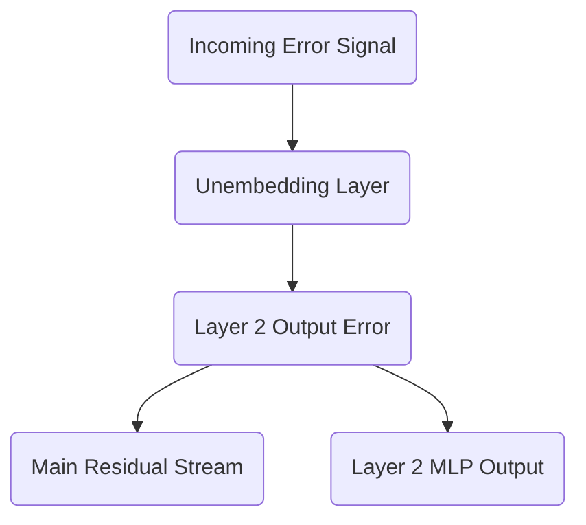

# Part 21: Backpropagating Through the Unembedding and Residual Stream

<!-- SUMMARY: The backward pass initiates by routing the error signal from the vocabulary logits through the unembedding matrix and into the final residual stream. Applying the chain rule demonstrates how the gradient branches undisturbed across residual additions and projects through the multi-layer perceptron to update intermediate weights. -->

<em>Prefer to read this offline? <a href="../assets/docs/transformers-ebook-v1.0.pdf" target="_blank" rel="noopener">Download the complete, formatting-optimized Transformer Ebook here.</a></em>

Part 20 derived the cross-entropy loss gradient with respect to the pre-Softmax logits, reducing the output error signal to the $4 \times 12$ matrix $P - Y$. That matrix quantifies the directional error across all four sequence positions and twelve vocabulary candidates. Backpropagation now routes this gradient backward through the unembedding projection $W_U$, down the central residual stream, and into the Layer 2 Multi-Layer Perceptron (MLP).

| Backward Stage | Weight Gradient | Weight Shape | Input Gradient | Input Shape |
| :--- | :--- | :--- | :--- | :--- |
| **Unembedding (`W_U`)** | `X_L2^T * dZ` | `6 x 12` | `dZ * W_U^T` | `4 x 6` |
| **Residual Add** | `None` | `N/A` | `dX_L2` (both branches) | `4 x 6` |
| **MLP Output (`W_2`)** | `H^T * dX_L2` | `24 x 6` | `dX_L2 * W_2^T` | `4 x 24` |

## The Chain Rule at the Unembedding Layer

The unembedding layer is the final linear projection in the Transformer. During the forward pass (Part 17), this layer multiplied the Layer 2 output matrix $\text{Output}_{\text{Layer2}}$ ($4 \times 6$) by the unembedding weight matrix $W_U$ ($6 \times 12$) to produce the vocabulary logits:

$$
\text{Logits} = \text{Output}_{\text{Layer2}} \times W_U
$$

Given the incoming logit gradient $\frac{\partial L}{\partial \text{Logits}}$ of shape $4 \times 12$, backpropagation through a linear multiplication $Z = A B$ computes two distinct derivatives:

1. **Weight Gradient ($\frac{\partial L}{\partial W_U}$):** Measures how each parameter in $W_U$ contributed to the logit error so the optimizer can update the unembedding weights.
2. **Input Activation Gradient ($\frac{\partial L}{\partial \text{Output}_{\text{Layer2}}}$):** Projects the error signal back into the $d_{\text{model}} = 6$ subspace so preceding layers can be updated.

### Updating the Unembedding Weights

Computing the gradient of the loss with respect to the unembedding weights multiplies the transposed layer input by the incoming logit gradient:

$$
\frac{\partial L}{\partial W_U} = \text{Output}_{\text{Layer2}}^T \times \frac{\partial L}{\partial \text{Logits}}
$$

Tracking the matrix dimensions confirms the geometric alignment. Transposing the $4 \times 6$ input matrix $\text{Output}_{\text{Layer2}}$ produces a $6 \times 4$ matrix. Multiplying that $6 \times 4$ transpose by the $4 \times 12$ logit gradient contracts across the sequence dimension ($S = 4$) and yields a $6 \times 12$ gradient matrix matching the shape of $W_U$. Each entry accumulates the error contribution of a specific model-dimension feature to a specific vocabulary token across all four sequence positions.

### Passing the Error Backward

Propagating the error signal to the preceding layer requires differentiating the loss with respect to $\text{Output}_{\text{Layer2}}$. That derivative multiplies the incoming logit gradient by the transpose of the unembedding weight matrix:

$$
\frac{\partial L}{\partial \text{Output}_{\text{Layer2}}} = \frac{\partial L}{\partial \text{Logits}} \times W_U^T
$$

Multiplying the $4 \times 12$ logit gradient by the $12 \times 6$ transposed matrix $W_U^T$ contracts across the vocabulary dimension ($V = 12$) and produces a $4 \times 6$ matrix. This operation projects the vocabulary-space error back into the $d_{\text{model}} = 6$ coordinate space of the residual stream.

## Splitting the Signal: The Residual Connection

The $4 \times 6$ gradient $\frac{\partial L}{\partial \text{Output}_{\text{Layer2}}}$ now arrives at the output boundary of Layer 2. During the forward pass (Part 16), this state was formed by adding the Layer 2 MLP output to the intermediate residual stream:

$$
\text{Output}_{\text{Layer2}} = \text{Residual}_{\text{Pre-MLP}} + \text{MLP}_{\text{Output}}
$$

In multivariable calculus, the derivative of a sum equals the sum of the derivatives, so each additive term has a local partial derivative equal to the identity matrix $I$. Backpropagating through an element-wise addition distributes the upstream gradient equally and without modification to both incoming branches:

The $4 \times 6$ gradient matrix bifurcates into two identical copies. One copy continues directly down the main residual highway toward the attention sub-layer and Layer 1, while the second copy enters the output of the Layer 2 MLP.

## Entering the Multi-Layer Perceptron

Inside the Layer 2 MLP, the final forward-pass operation contracted the 24-dimensional hidden activations back to the 6-dimensional model space via the second weight matrix $W_2$ ($24 \times 6$):

$$
\text{MLP}_{\text{Output}} = \text{Activations} \times W_2
$$

The residual connection delivers $\frac{\partial L}{\partial \text{Output}_{\text{Layer2}}}$ directly to $\text{MLP}_{\text{Output}}$, so the same matrix-calculus transpose rules govern the backward pass through $W_2$.

Computing the weight gradient for $W_2$ multiplies the transposed hidden activations by the incoming $4 \times 6$ error signal:

$$
\frac{\partial L}{\partial W_2} = \text{Activations}^T \times \frac{\partial L}{\partial \text{Output}_{\text{Layer2}}}
$$

Transposing the $4 \times 24$ activation matrix yields a $24 \times 4$ matrix. Multiplying by the $4 \times 6$ residual gradient produces a $24 \times 6$ weight gradient matching the dimensions of $W_2$. (When a bias vector $b_2$ is included, its $1 \times 6$ gradient is the column-wise sum of $\frac{\partial L}{\partial \text{Output}_{\text{Layer2}}}$ across the four sequence rows.)

Propagating the error signal backward toward the ReLU gate and the first MLP projection $W_1$ multiplies the $4 \times 6$ residual gradient by the transposed weight matrix $W_2^T$ ($6 \times 24$):

$$
\frac{\partial L}{\partial \text{Activations}} = \frac{\partial L}{\partial \text{Output}_{\text{Layer2}}} \times W_2^T
$$

This multiplication expands the $4 \times 6$ error signal into a $4 \times 24$ gradient tensor aligned with the hidden neurons of the feed-forward layer. Passing through the ReLU derivative masks out coordinates whose forward pre-activations were negative, and multiplying by $W_1^T$ returns the MLP branch gradient to the residual stream. The next installment traces how the combined residual gradient navigates the Softmax Jacobian and causal mask of the self-attention mechanism.

<em>Prefer to read this offline? <a href="../assets/docs/transformers-ebook-v1.0.pdf" target="_blank" rel="noopener">Download the complete, formatting-optimized Transformer Ebook here.</a></em>

