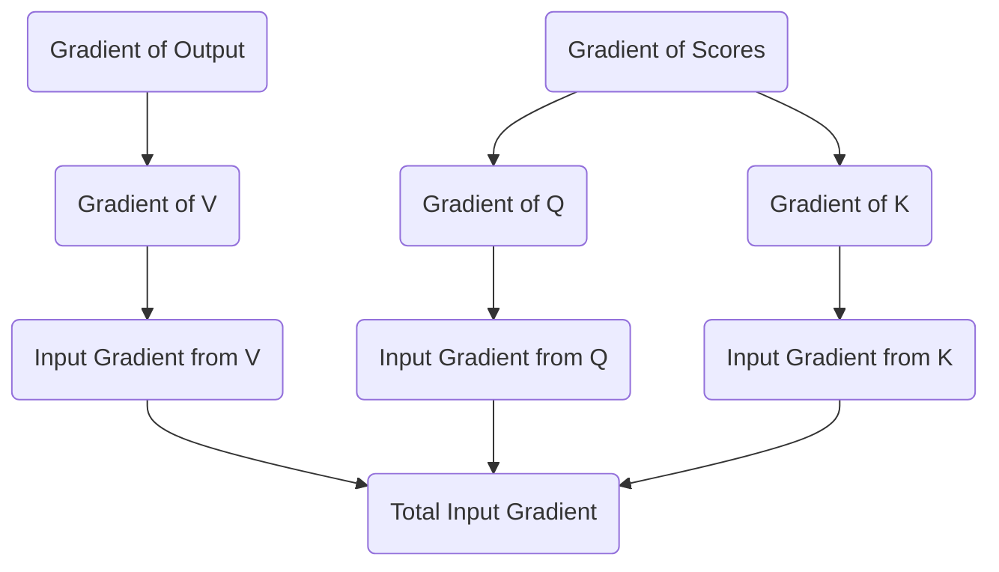

# Part 23: Backpropagation - Attention (Part 2: Q, K, V)

<!-- SUMMARY: Following the calculation of the attention score gradients, the error signal is distributed backward into the query, key, and value matrices. Reversing the weighted sums geometrically mirrors the forward pass, translating the output error into parameter updates for the self-attention weight matrices. -->

<em>Prefer to read this offline? <a href="../assets/docs/transformers-ebook-v1.0.pdf" target="_blank" rel="noopener">Download the complete, formatting-optimized Transformer Ebook here.</a></em>

Part 22 navigated the Softmax Jacobian and the causal mask to obtain the gradient of the loss with respect to the unmasked attention scores. Completing the backward pass through self-attention requires distributing these score gradients, alongside the attention output gradient $d\_Z$, into the Query ($Q$), Key ($K$), and Value ($V$) projections. From those three subspace gradients, the chain rule computes the weight updates for $W_Q$, $W_K$, and $W_V$ and merges the three input branches back into the $4 \times 6$ residual stream.

| Target Tensor | Backward Equation | Input Shapes | Output Shape | Geometric Role |
| :--- | :--- | :--- | :--- | :--- |
| **Value Gradient (`d_V`)** | `P^T * d_Z` | `(4 x 4)^T * (4 x 2)` | `4 x 2` | Attributes output error across Value rows |
| **Value Weights (`d_W_V`)** | `X^T * d_V` | `(4 x 6)^T * (4 x 2)` | `6 x 2` | Accumulates Value projection updates |
| **Query Gradient (`d_Q`)** | `(d_S * K) / sqrt(d_k)` | `(4 x 4) * (4 x 2)` | `4 x 2` | Projects score adjustments onto Keys |
| **Key Gradient (`d_K`)** | `(d_S^T * Q) / sqrt(d_k)` | `(4 x 4)^T * (4 x 2)` | `4 x 2` | Projects transposed score adjustments onto Queries |
| **Query Weights (`d_W_Q`)** | `X^T * d_Q` | `(4 x 6)^T * (4 x 2)` | `6 x 2` | Accumulates Query projection updates |
| **Key Weights (`d_W_K`)** | `X^T * d_K` | `(4 x 6)^T * (4 x 2)` | `6 x 2` | Accumulates Key projection updates |
| **Input Gradient (`d_X`)** | `d_V W_V^T + d_Q W_Q^T + d_K W_K^T` | `3 * [(4 x 2) * (2 x 6)]` | `4 x 6` | Sums gradients from all three subspace branches |

To illustrate non-zero gradient entries across all four rows at four-decimal precision, the numerical matrices below evaluate a standardized single-head benchmark state (`np.random.seed(42)` draws for $X \in \mathbb{R}^{4 \times 6}$, $W_Q, W_K, W_V \in \mathbb{R}^{6 \times 2}$, $Q = X W_Q$, $K = X W_K$, causal probabilities $P$, upstream output gradient $d\_Z$, and a general lower-triangular score perturbation $d\_S$ with $d\_S_{0,0} = -0.0404$).

## The Value Matrix Gradient

During the forward pass, the attention head produced its output $Z$ by multiplying the $4 \times 4$ probability matrix $P$ by the $4 \times 2$ Value matrix $V$. Differentiating $Z = P V$ with respect to $V$ multiplies the transposed probability matrix $P^T$ by the upstream output gradient $d\_Z$:

$$
d\_V = P^T d\_Z
$$

Transposing $P$ reverses the forward routing geometry. In the forward pass, row $i$ of $P$ specified how strongly output token $i$ blended each Value row. In the backward pass, column $i$ of $P$ (which becomes row $i$ of $P^T$) gathers the output errors from every token that attended to Value vector $i$, producing the $4 \times 2$ Value gradient matrix $d\_V$:

$$
d\_V = \begin{bmatrix}
0.0634 & -0.1513 \\
0.0274 & -0.0883 \\
0.0244 & 0.0048 \\
0.0285 & -0.0100
\end{bmatrix}
$$

With $d\_V$ established, backpropagating through the linear projection $V = X W_V$ multiplies the transposed layer input $X^T$ ($6 \times 4$) by the Value gradient $d\_V$ ($4 \times 2$):

$$
d\_W_V = X^T d\_V
$$

Contracting across the four sequence positions yields the $6 \times 2$ gradient matrix for the Value projection weights:

$$
d\_W_V = \begin{bmatrix}
0.0547 & -0.2043 \\
-0.0747 & -0.0419 \\
0.0279 & -0.0796 \\
0.0913 & -0.2788 \\
-0.0503 & 0.0708 \\
-0.0606 & 0.0923
\end{bmatrix}
$$

## Routing Gradients to Queries and Keys

The Query and Key matrices generated the scaled dot-product attention scores during the forward pass via $S = \frac{Q K^T}{\sqrt{d_k}}$.

The $4 \times 4$ score gradient $d\_S$ specifies how the pairwise alignment between every query and key must shift. Differentiating the bilinear product $\frac{Q K^T}{\sqrt{d_k}}$ distributes $d\_S$ across both factors while retaining the $\frac{1}{\sqrt{d_k}}$ scaling factor ($d_k = 2$).

Multiplying the $4 \times 4$ score gradient $d\_S$ by the $4 \times 2$ Key matrix $K$ and dividing by $\sqrt{d_k}$ yields the $4 \times 2$ Query gradient $d\_Q$:

$$
d\_Q = \frac{d\_S K}{\sqrt{d_k}}
$$

Evaluating this scaled product on the general lower-triangular perturbation state produces the $4 \times 2$ error signal for the Query representations (whereas substituting the zero-sum Softmax score gradient $d\_S$ from Part 22, where Row 1 is $[0, 0, 0, 0]$, sets Row 1 of $d\_Q$ identically to $[0.0000, 0.0000]$ and rows 2 through 4 to $[-0.0292, -0.0451]$, $[0.0352, 0.0549]$, and $[-0.0019, -0.0088]$):

$$
d\_Q = \begin{bmatrix}
-0.0298 & 0.0408 \\
-0.0232 & -0.0340 \\
-0.0615 & 0.0730 \\
-0.0182 & -0.0480
\end{bmatrix}
$$

The transpose $K^T$ appears in the forward equation $S = \frac{Q K^T}{\sqrt{d_k}}$, so differentiating with respect to $K$ multiplies the transposed score gradient $d\_S^T$ ($4 \times 4$) by the $4 \times 2$ Query matrix $Q$:

$$
d\_K = \frac{d\_S^T Q}{\sqrt{d_k}}
$$

Evaluating this product yields the $4 \times 2$ error signal for the Key representations:

$$
d\_K = \begin{bmatrix}
-0.0037 & -0.1250 \\
-0.0805 & 0.0564 \\
-0.0515 & 0.0076 \\
-0.0017 & -0.0016
\end{bmatrix}
$$

These two equations exhibit dual geometric symmetry. Adjusting query vector $i$ requires projecting row $i$ of the score gradient $d\_S$ onto the Key vectors $K$ it scored against. Adjusting key vector $j$ requires projecting column $j$ of $d\_S$ (row $j$ of $d\_S^T$) onto the Query vectors $Q$ that attended to it.

Multiplying the transposed input matrix $X^T$ ($6 \times 4$) by $d\_Q$ and $d\_K$ produces the $6 \times 2$ parameter gradients for the Query and Key weight matrices:

$$
d\_W_Q = X^T d\_Q
$$

$$
d\_W_K = X^T d\_K
$$

Evaluating both matrix products completes the parameter gradients for $W_Q$ and $W_K$:

$$
d\_W_Q = \begin{bmatrix}
-0.0497 & 0.0279 \\
0.1298 & -0.1036 \\
0.0710 & -0.1539 \\
-0.0193 & 0.0135 \\
0.0788 & -0.0710 \\
0.0244 & 0.0976
\end{bmatrix}
$$

$$
d\_W_K = \begin{bmatrix}
-0.1398 & 0.0302 \\
0.0397 & 0.0483 \\
0.1217 & -0.1228 \\
-0.0199 & -0.1637 \\
0.0902 & -0.0046 \\
0.0246 & 0.0076
\end{bmatrix}
$$

## The Confluence at the Input

The concluding step inside the attention head routes the subspace gradients back to the $4 \times 6$ input matrix $X$. During the forward pass, $X$ branched into three parallel linear projections ($Q = X W_Q$, $K = X W_K$, and $V = X W_V$).

By the multivariable chain rule, gradients flowing backward through a fan-out branch sum together at the shared origin. Multiplying each $4 \times 2$ subspace gradient by the transpose of its $6 \times 2$ projection matrix maps the three error signals back into $\mathbb{R}^{4 \times 6}$:

$$
d\_X_V = d\_V W_V^T
$$

$$
d\_X_Q = d\_Q W_Q^T
$$

$$
d\_X_K = d\_K W_K^T
$$

Summing the three $4 \times 6$ branch contributions produces the total attention input gradient:

$$
d\_X_{\text{Total}} = d\_X_V + d\_X_Q + d\_X_K
$$

Evaluating the sum across all three branches yields the $4 \times 6$ input gradient matrix $d\_X$:

$$
d\_X = \begin{bmatrix}
0.5536 & 0.1088 & -0.1536 & 0.0560 & 0.0463 & -0.3314 \\
0.0465 & 0.1747 & -0.0985 & -0.1107 & 0.1189 & 0.0421 \\
0.0159 & 0.1742 & -0.0346 & 0.2056 & -0.0277 & -0.0953 \\
0.0348 & 0.0179 & -0.0020 & -0.0572 & 0.0338 & 0.0424
\end{bmatrix}
$$

The backward traversal through self-attention is now complete. The mechanism has translated the upstream output and score gradients into explicit weight updates for $W_Q$, $W_K$, and $W_V$ while assembling the unified $4 \times 6$ gradient $d\_X$ to continue down the residual stream. Part 24 traces this accumulated signal back to the initial token embedding lookup table to complete the training step.

<em>Prefer to read this offline? <a href="../assets/docs/transformers-ebook-v1.0.pdf" target="_blank" rel="noopener">Download the complete, formatting-optimized Transformer Ebook here.</a></em>

