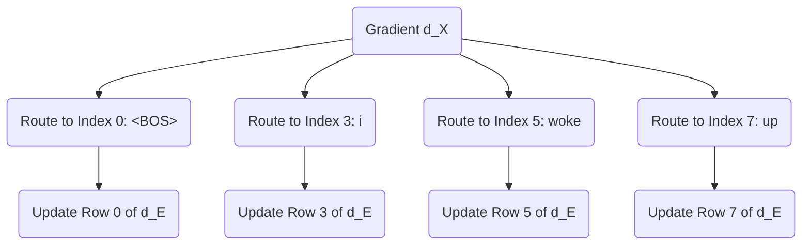

# Part 24: Updating the Embeddings and Conclusion

<!-- SUMMARY: The accumulated gradient reaches the initial embedding matrix via the residual stream, encapsulating how token representations must shift to minimize prediction error. Completing the backward pass finalizes the mathematical traversal of the Transformer architecture. -->

<em>Prefer to read this offline? <a href="../assets/docs/transformers-ebook-v1.0.pdf" target="_blank" rel="noopener">Download the complete, formatting-optimized Transformer Ebook here.</a></em>

The backward pass now reaches the input boundary of the architecture. The error signal originated at the cross-entropy loss, traversed the unembedding projection $W_U$, branched across the Layer 2 MLP and attention blocks, and propagated through Layer 1. That accumulated gradient now arrives at the foundational token representation table: the embedding matrix $W_E$ (denoted here as $E$).

## The Residual Highway

During the forward pass, the residual stream operated as a shared memory bus. Initial token embeddings entered this highway, and each attention and MLP sub-layer added contextual updates back into the stream.

In the backward pass, the residual stream functions as a direct gradient highway. Differentiating each element-wise residual addition routes the upstream gradient equally to both the skip path and the sub-layer branch. The gradient arriving at the base of the residual stream therefore equals the sum of the direct skip-connection gradient and the gradients emerging from every attention and MLP block across both layers. This $4 \times 6$ matrix $d\_X$ encapsulates how each of the four input token vectors (`<BOS>`, `i`, `woke`, and `up`) must shift in $\mathbb{R}^{d_{\text{model}}}$ to reduce the sequence prediction loss:

$$
d\_X = \begin{bmatrix}
-0.0036 & 0.1565 & -0.2620 & 0.0822 & 0.0087 & -0.0299 \\
0.0092 & -0.1988 & -0.0220 & 0.0357 & 0.1478 & -0.0518 \\
-0.0808 & -0.0502 & 0.0915 & 0.0329 & -0.0530 & 0.0513 \\
0.0097 & 0.0969 & -0.0702 & -0.0328 & -0.0392 & -0.1464
\end{bmatrix}
$$

## Routing Gradients to the Vocabulary Space

During the forward pass (Part 1), the $4 \times 6$ input matrix $X$ was constructed by multiplying the $4 \times 12$ one-hot token matrix $X_{\text{one-hot}}$ by the $12 \times 6$ embedding matrix $E$:

$$
X = X_{\text{one-hot}} E
$$

Differentiating this lookup with respect to $E$ multiplies the transposed one-hot matrix $X_{\text{one-hot}}^T$ ($12 \times 4$) by the $4 \times 6$ gradient matrix $d\_X$:

$$
d\_E = X_{\text{one-hot}}^T d\_X
$$

Multiplying by $X_{\text{one-hot}}^T$ scatters each row of $d\_X$ back into the vocabulary row index that was selected during the forward pass. Mapping the prompt `<BOS>` `i` `woke` `up` to vocabulary indices `[0, 3, 5, 7]` causes the $12 \times 6$ embedding gradient matrix $d\_E$ to accumulate rows `0, 1, 2, 3` of $d\_X$ into vocabulary rows `0, 3, 5, 7`, while the eight unused vocabulary rows receive a gradient of zero:

## The Optimizer Update

With $d\_E$ assembled alongside the weight gradients for every attention and MLP projection matrix across the network, the optimizer executes the parameter update step.

Production training pipelines typically apply adaptive optimizers such as AdamW, which normalize parameter updates using running estimates of first and second gradient moments alongside decoupled weight decay. Stochastic Gradient Descent (SGD) illustrates the core geometric update rule using a scalar learning rate $\alpha$:

$$
E_{\text{new}} = E_{\text{old}} - \alpha \cdot d\_E
$$

Applying a learning rate of $\alpha = 0.01$ to Row 0 (`<BOS>`, where $d\_E[0] = d\_X[0]$ equals `[-0.0036, 0.1565, -0.2620, 0.0822, 0.0087, -0.0299]`) subtracts $0.01 \cdot d\_X[0]$ from the initial embedding coordinates. Starting from a four-decimal Gaussian initialization $E_{\text{old}}[0]$ (or equivalently from Part 1's hand-crafted row $W_E[0]$ of `[0.1000, 0.0000, 0.0000, 0.0000, 0.0000, 0.0000]`, which updates to `[0.1000, -0.0016, 0.0026, -0.0008, -0.0001, 0.0003]`), the update shifts the six coordinates in the direction that lowers cross-entropy loss:

$$
E_{\text{old}}[0] = \begin{bmatrix}
0.4967 & -0.1383 & 0.6477 & 1.5230 & -0.2342 & -0.2341
\end{bmatrix}
$$

$$
E_{\text{new}}[0] = \begin{bmatrix}
0.4967 & -0.1399 & 0.6503 & 1.5222 & -0.2343 & -0.2338
\end{bmatrix}
$$

*(Evaluating the subtraction on unrounded floating-point draws before four-decimal rounding yields `-0.1398` in column 2 and `-0.2342` in column 5.)*

Subtracting $\alpha \cdot d\_E$ translates the active token vectors (`<BOS>`, `i`, `woke`, and `up`) within the $d_{\text{model}} = 6$ embedding space. On the next forward pass, the updated coordinates for `woke` and `up` enter the residual stream pre-aligned with the attention and MLP subspaces that increase the output probability of the target token `late`.

## Conclusion

This parameter update completes a full forward and backward training cycle of the Decoder-only Transformer. The forward pass mapped discrete vocabulary indices into continuous vectors in $\mathbb{R}^{d_{\text{model}}}$, injected sinusoidal positional signatures, routed asymmetric context across three parallel attention heads per layer, stabilized activations via Layer Normalization, and extracted higher-order features through two Key-Value MLP blocks before projecting back to vocabulary logits.

The backward pass reversed every stage of that computational graph via the chain rule. Starting from the linear cancellation $P - Y$ at the cross-entropy output boundary, gradients flowed backward through the unembedding matrix, split across residual additions, traversed the MLP projections and ReLU gates, navigated the coupled Softmax Jacobian and causal mask, and updated every projection weight down to the initial embedding lookup table.

Viewed through explicit matrix arithmetic, the Transformer is not an opaque black box. Every forward prediction and backward weight update reduces to deterministic linear projections, dot-product alignments, and coordinate translations in vector space.

<em>Prefer to read this offline? <a href="../assets/docs/transformers-ebook-v1.0.pdf" target="_blank" rel="noopener">Download the complete, formatting-optimized Transformer Ebook here.</a></em>

