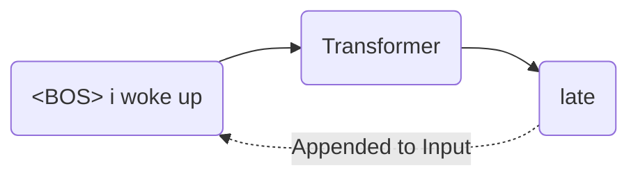
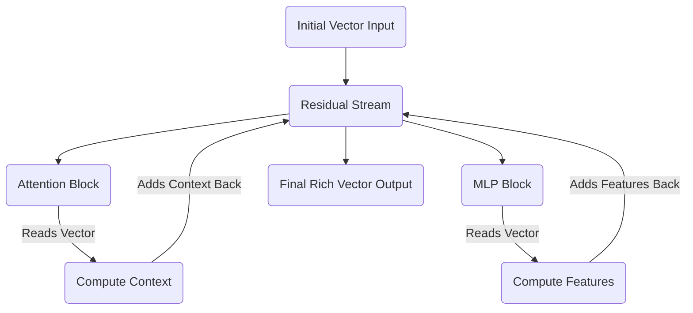

# Preface: The Big Picture & Tensor Notation

<!-- SUMMARY: This foundational overview introduces an autoregressive Decoder-only Transformer built from scratch using rigorous tensor notation and geometric principles. The text defines the vocabulary space, architectural dimensions, and the central residual stream required to calculate the forward pass. -->

<em>Prefer to read this offline? <a href="../assets/docs/transformers-ebook-v1.0.pdf" target="_blank" rel="noopener">Download the complete, formatting-optimized Transformer Ebook here.</a></em>

## The Problem with Tutorials

The typical approach to understanding the Transformer architecture presents a frustrating hurdle. Existing literature relies heavily on abstract analogies. Texts often describe the Query matrix as asking a question and the Key matrix as holding the answer. These metaphors might give a fleeting sense of intuition. They collapse the moment a practitioner attempts to write code, debug a model, or understand the fundamental geometry of deep learning.

This text takes a different approach. A complete Transformer is built from scratch by calculating every single number by hand. The goal is to translate these complex, abstract operations into meaningful, structural realities. The result is a clear, intuitive grasp of how multi-dimensional tensors flow through linear projections, removing any sense of hidden mechanics.

To accomplish this, a problem is selected that is small enough to compute on a whiteboard, yet complex enough to demonstrate the true power of the architecture.

## The Toy Example

The objective is to train a Transformer to predict the next word in a specific sequence. 

**Input:** `<BOS>` `i` `woke` `up`  
**Target:** `late`

The token `<BOS>` stands for Beginning of Sequence and serves as a standard boundary marker indicating the start of a sequence.

This four-token prompt requires the attention mechanism to perform observable contextual work. Predicting the target token `late` requires more than inspecting the final token `up` in isolation; the network must combine `woke` and `up` into a unified phrasal concept.

### The Vocabulary Space

To keep every matrix operation tractable by hand, the model operates on a fixed vocabulary of twelve tokens. The variable $V$ denotes the total vocabulary size, setting $V = 12$ for this configuration.

<b><code>&lt;BOS&gt;</code></b> <b><code>&lt;EOS&gt;</code></b> <b><code>&lt;PAD&gt;</code></b> <b><code>i</code></b> <b><code>we</code></b> <b><code>woke</code></b> <b><code>stayed</code></b> <b><code>up</code></b> <b><code>late</code></b> <b><code>early</code></b> <b><code>today</code></b> <b><code>yesterday</code></b>

This compact vocabulary contains distinct semantic clusters. The pronouns `i` and `we` form one grammatical group, while the temporal modifiers `late`, `early`, `today`, and `yesterday` form another. These groupings allow the matrix operations to cluster related concepts geometrically in vector space during training.

## The Architecture

Before specifying the tensor dimensions, the network topology must be established. The model uses an autoregressive, Decoder-only Transformer architecture, which forms the standard structural foundation for causal language modeling.

Two architectural properties define this topology:

- **Autoregressive Generation:** The network predicts the next token from its own preceding outputs. Completing a token prediction appends that newly generated token to the input sequence, and the forward pass repeats in a continuous feedback loop to generate subsequent text.
- **Decoder-Only Topology:** Early sequence-to-sequence Transformers paired a bidirectional Encoder for processing a source sequence with a causal Decoder for generating a target sequence. Next-token prediction operates on a single continuous sequence rather than translating between two distinct sequences, eliminating the Encoder and retaining only the causal Decoder stack.

### The Residual Stream

Inside this Decoder exists a central memory bus known as the residual stream, which forms the primary structural backbone of the architecture.

The residual stream acts as a continuous data highway running from the initial embedding layer to the final output projection. Entering tokens are placed onto this highway as dense vectors. Rather than overwriting those vectors in place, the Attention and Multi-Layer Perceptron (MLP) sub-layers read from the stream, compute contextual updates, and add those updates back into the original vectors.

This additive update rule preserves the initial representation without compressing it through a destructive bottleneck. Each token vector accumulates semantic and syntactic context as the forward pass progresses across layers.

## The Dimensions

Six hyperparameters govern the shape of every tensor and weight matrix in the toy architecture:

| Hyperparameter | Symbol | Toy Value | Architectural Role |
| :--- | :--- | :--- | :--- |
| **Sequence Length** | `S` | `4` | Number of tokens processed simultaneously in one forward pass |
| **Model Dimensionality** | `d_model` | `6` | Width of each token vector traveling along the residual stream |
| **Batch Size** | `B` | `1` | Number of independent token sequences processed in parallel |
| **Attention Heads** | `H` | `3` | Number of parallel subspaces used to route token-to-token context |
| **Head Dimensionality** | `d_k`, `d_v` | `2` | Subspace width per attention head (`d_model / H = 6 / 3`) |
| **Feed-Forward Dimension** | `d_ff` | `24` | Expanded hidden width of the MLP block (`4 * d_model = 24`) |

Three structural tradeoffs motivate these specific hyperparameter choices:

- **Single-Sequence Batching (`B = 1`):** Parallel hardware accelerators stack multiple independent sequences into a batch to execute matrix multiplications concurrently across inputs. Setting the batch size to `1` isolates the geometry of a single four-token prompt without altering the underlying linear algebra.
- **Multi-Head Subspace Splitting (`H = 3`, `d_k = 2`):** Dividing the 6-dimensional residual stream across 3 parallel heads assigns each head a $6 \times 2$ projection matrix. Independent heads can specialize in distinct linguistic relationships simultaneously, such as pairing subjects with verbs in one subspace while tracking temporal modifiers in another.
- **Feed-Forward Expansion (`d_ff = 24`):** A 6-dimensional residual stream suffices to transport token representations between layers, whereas non-linear feature extraction requires a wider workspace. The MLP projects each 6-dimensional vector into a 24-dimensional intermediate space (following the standard $4 \times d_{\text{model}}$ expansion ratio) so entangled concepts can be linearly separated before projecting back into the residual stream.

## The Central Tensor

Before text enters the Transformer, the characters must be converted into numbers. The process begins by assigning a unique integer index to every word in the vocabulary.

That integer is then mapped to a one-hot encoded vector. A one-hot vector is an array of zeros with a single `1` placed at the index corresponding to that word. For a twelve-word vocabulary, the one-hot vector for the fourth word is a 12-dimensional array consisting of eleven zeros and one `1` in the fourth position.

Projecting each one-hot vector into a continuous vector space produces the foundational tensor that travels through the network. The full three-dimensional tensor has shape $\text{Batch} \times \text{Sequence Length} \times \text{Model Dimension}$.

Under the toy hyperparameters, this tensor has shape $1 \times 4 \times 6$. Dropping the unit batch dimension ($B = 1$) leaves a $4 \times 6$ matrix $X$ traveling along the residual stream:

$$
X = \begin{bmatrix} 
\text{-- } \langle \text{BOS} \rangle \text{ vector --} \\
\text{-- "i" vector --} \\
\text{-- "woke" vector --} \\
\text{-- "up" vector --} 
\end{bmatrix}_{4 \times 6}
$$

Every single mathematical operation in the forward pass reads from and writes to this $4 \times 6$ matrix.

The raw text is then mapped to the vocabulary indices, preparing for the first genuine calculation. The one-hot encoded vectors are transformed into this $4 \times 6$ geometric representation.

<em>Prefer to read this offline? <a href="../assets/docs/transformers-ebook-v1.0.pdf" target="_blank" rel="noopener">Download the complete, formatting-optimized Transformer Ebook here.</a></em>

